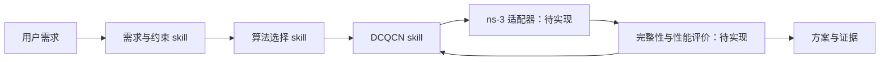

# 智能网络专家 Agent：v0.1

这是一版项目内的 skill 和接口约定，服务于“用户需求 → 约束 → 算法选择 → DCQCN 参数方案 → ns-3 验证”流程。
当前已实现的执行入口是仓库的原生构建、固定流量 smoke 脚本和 C++ 仿真程序；通用调参运行器、搜索器及报告生成器仍待实现。

## 目录与职责

```text
agent/
├── README.md
├── skills/
│   ├── top-level/
│   │   ├── analyze-network-requirements/SKILL.md
│   │   └── select-network-algorithm/SKILL.md
│   └── bottom-level/
│       └── tune-dcqcn/SKILL.md
├── interfaces/
│   ├── contracts.md
│   └── ns3-interface.md
└── examples/
    └── dcqcn-incast-task.json
```

| 层次 | 入口 | 产物 |
| --- | --- | --- |
| 顶层 | [分析用户需求](skills/top-level/analyze-network-requirements/SKILL.md) | `TaskSpec`：目标、约束、可调范围、假设 |
| 顶层 | [选择网络算法](skills/top-level/select-network-algorithm/SKILL.md) | `AlgorithmDecision`：机制组合、理由、能力证据 |
| 底层 | [DCQCN 调参](skills/bottom-level/tune-dcqcn/SKILL.md) | `ParameterPlan`：基线、搜索范围、固定参数、复验要求 |
| 平台 | [ns-3 接口说明](interfaces/ns3-interface.md) | 真实命令和拟实现的 `TrialResult` 契约 |

共用字段见 [数据契约](interfaces/contracts.md)，规划输入示例见 [DCQCN incast 任务](examples/dcqcn-incast-task.json)。
该示例尚未生成流量或执行实验，不是性能结果。

## 如何使用

让执行任务的 Agent 按路径读取所需 `SKILL.md`。这是项目内约定；运行 ns-3 本身不会自动加载这些文件。
例如：

> 读取 agent/skills/top-level/analyze-network-requirements/SKILL.md，
> 将“在现有 Leaf-Spine 上降低 incast 完成时间，只调 DCQCN 参数”整理成 TaskSpec；
> 再按算法选择 skill 和 DCQCN skill 输出机制选择与参数计划。

常规链路为：



v0.1 优先支持 DCQCN＋ECMP、PFC 开启、IRN 关闭的离线参数调优。用户指定其他机制时，
按实际能力检查并报告缺口；默认范围可以调整，但不能把未验证组合自动标为可用。
参数在每轮仿真开始前确定，LLM 在实验之间分析结果。

目前可直接运行的宿主机检查命令（在仓库根目录执行）：

```bash
python3 tools/native_build.py
python3 tools/native_smoke.py
```

smoke 使用固定的 16 条流，不读取示例 TaskSpec，也不执行参数搜索。它验证启动与流完成性；
下一步是按接口约定实现通用 runner、拥塞流量生成及评价器，再接入搜索。

后续实验建议在 `.native/agent-runs/<task_id>/<trial_id>/` 保存完整输入、参数、日志、版本和结果，
与 skill 源文件分开。每次交付报告给出适用场景、基线对照、独立复验和局限；未运行的方案标为规划。
