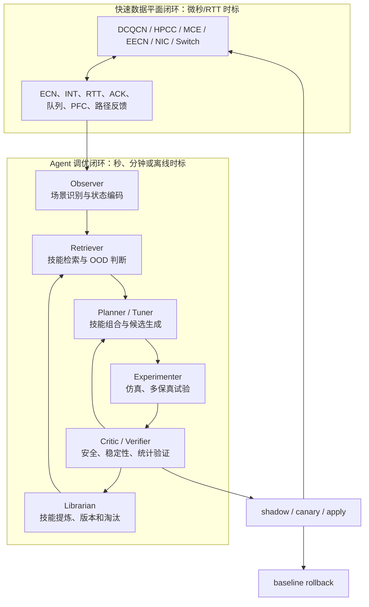

# Agent 驱动的数据中心网络 CC/LB 自主调优与 AI 技能复用可行性报告

> 调研截止日期：2026-10-14
>
> 调研所依据的源代码仓库：`ns3-eecn`；本文随智算专家项目资料包迁移，文中的 `simulation/` 等路径均指向该外部仓库根目录。
>
> 研究对象：使用 AI Agent 面向不同数据中心工作负载，自动选择和调节拥塞控制（CC）、多路径负载均衡（LB）、ECN/PFC 及路径调度参数，并将经过验证的调优经验沉淀为可复用技能。
>
> 证据口径：本文结合公开论文、会议官网和当前仓库源码进行可行性分析；没有把不同论文中的性能提升数字直接横向排名，也没有把尚未复现的设想写成已实现能力。

## 1. 结论与建议

这个方向具有较高的研究和原型实现可行性。最值得做的并不是让大模型进入每包或每 RTT 的控制环，而是构建一个位于网络协议之上的**慢时标自治调优 Agent**：它识别工作负载和网络状态，检索过去验证过的调优技能，生成受约束的候选配置，调用 ns-3 数字孪生或小规模试验，分析结果，选择下一次最有信息量的实验，并把成功与失败经验重新沉淀为技能。

补充调研后，创新边界需要进一步收窄。Remy、CCmatic、NECC、PolicySmith、NADA、LLM CC Optimizer 和 GenCC 已分别覆盖自动合成 CC、LLM 生成或修改可编译 CC 代码、以及用实验反馈迭代代码；SymbolicPCC 和 RL-CC NIC 实现已覆盖“先学习，再蒸馏为可部署规则”；NVIDIA 又在 2026 年公开了包含 DOCA PCC/RDMA 的 Agent Skills。因此，“Agent 会生成 PCC 代码”或“为 PCC 提供 AI 技能”都不能单独作为核心创新。本课题仍有价值的空间，是把**工作负载驱动的 CC/LB 优化经验**封装为带适用域、统计证据、反例、版本和回滚条件的性能技能，并验证它能否跨 RDMA 工作模式安全复用。

OpenEvolve 又进一步降低了“LLM 变异代码 + 进化搜索 + 自动 evaluator 反馈”的实现门槛。它可以直接作为候选控制器的演化引擎，但不理解 RDMA、PFC、CNP、ECN、路径状态或技能适用域，也没有替本课题解决 OOD 拒绝和回滚。因此，本项目可以复用 OpenEvolve 的搜索基础设施，创新重点应放在网络专用 evaluator、证据化技能、跨场景复用和负迁移治理上。

建议把目标表述为：

> 以技能增强的 Agent 自动完成场景识别、算法选择、参数候选生成、试验编排、结果诊断和经验沉淀，用显著少于冷启动搜索的试验次数，在安全约束下找到接近最优的 CC/LB 配置。

“取代专家和前期测试”需要拆成两个层次理解：

- 可以逐步取代专家反复修改配置、批量跑实验、阅读 trace、对相似场景重复调参等劳动。
- 可以把大规模穷举式前期测试压缩为由 Agent 主动选择的少量验证实验。
- 不能在研究初期取消所有验证，也不应让模型自行决定生产网络的安全边界。专家仍需定义目标、硬约束、失效策略和上线审批。
- 微秒级 CC/LB 快速闭环仍由 DCQCN、HPCC、MCE/EECN、NIC 或交换机中的确定性逻辑执行。LLM Agent 适合秒级、分钟级或离线管理时标。

综合判断如下：

| 维度 | 判断 | 依据 |
|---|---|---|
| 仿真原型可行性 | 高 | 当前仓库已有统一配置入口、多个 CC/LB、参数扫描器、跨拓扑 workload 和完整指标输出 |
| 算法实现难度 | 中 | 数值优化已有成熟方法；难点集中在约束、场景表示、技能迁移与负迁移控制 |
| 研究新颖性 | 中，取决于是否做出性能技能闭环 | 自动调参、CC 代码生成和通用 Agent Skills 均已有工作；跨 RDMA CC/LB 的证据化技能、负迁移控制和跨后端验证仍有空间 |
| 生产部署可行性 | 中低到中 | 需要真实遥测、shadow/canary、硬件可调接口、sim-to-real 校准和严格回滚 |
| 数据基础 | 仿真高、真实网中等 | ns3-eecn 已有大量可控试验；真实设备数据和在线干预接口尚未建立 |
| 最适合的首个原型 | EECN Plugin | 参数空间和 36 点历史扫描已经存在，最容易量化 warm start 节省的 trial 数 |

建议项目名称采用“**NetSkill-Tuner：面向数据中心传输的技能增强自治调优 Agent**”。名称不是关键，关键是论文和系统都要把“技能”定义为机器可执行、带性能证据和边界的对象，而不是 Prompt、API 使用说明、经验文字或一条最优配置。尤其要与 NVIDIA DOCA Agent Skills 这类“开发工具知识技能”明确区分。

## 2. 为什么这个问题值得研究

### 2.1 一组静态参数无法覆盖所有工作模式

数据中心网络的最优行为会随着以下因素变化：

- 业务模式：RPC 短流、elephant 长流、incast、permutation、all-to-all、collective、长短流混合。
- 拓扑与容量：链路速率、RTT、路径数、oversubscription、buffer、故障或降速链路。
- 协议与硬件：DCQCN、HPCC、MCE、不同 ECN 标记、PFC、乱序恢复和可用的网卡状态。
- 目标函数：平均 FCT、P99 FCT、JCT、吞吐、公平性、队列、PFC、恢复时间或能耗。

例如，较激进的增速可能改善稳定长流的利用率，却会在 incast 中放大队列；更细粒度的多路径可以快速绕开热点，却可能增加乱序、反馈归因和状态开销；降低 ECN 阈值可以提前抑制队列，也可能带来过度标记和吞吐损失。因此不存在一组对所有场景都最好的 CC/LB 参数。

### 2.2 传统调优过程昂贵且经验难复用

当前常见流程是专家根据经验选择参数范围，编写配置矩阵，运行大量仿真或测试床实验，再人工查看 FCT、吞吐、队列和 PFC。其主要问题不是单次试验无法自动化，而是：

1. 参数之间存在协议语义约束，通用搜索器不知道哪些组合在结构上无效。
2. 同样的诊断和调参逻辑会在新拓扑、新 workload 或新算法上重复执行。
3. 最终结果往往只保留“最好参数”，没有保存适用范围、失败案例和为什么有效。
4. 换人、换代码版本或换硬件后，隐含在专家头脑中的知识难以迁移。
5. 网格搜索把大量预算花在明显较差或不安全的点上。

Agent 的价值在于把这个过程变成有状态的闭环；技能复用的价值则在于让闭环不必在每个新场景中从零开始。

## 3. 本报告所说的 Agent 和技能是什么

### 3.1 Agent 不等于一个大模型

建议系统由大模型、确定性工具和数值优化器共同组成：

- 大模型负责理解任务、选择工具、解释异常、组合技能和生成可读报告。
- 贝叶斯优化、TPE、contextual bandit 或多保真优化负责在连续/整数参数空间中选点。
- JSON Schema、参数检查器和协议约束负责阻止非法组合。
- ns-3、测试床和真实遥测负责提供可重复的证据。
- 确定性指标解析器负责计算 FCT、goodput、公平性、队列、PFC、ECN、CNP 和收敛时间。

让 LLM 直接输出任意参数并反复试错，既难复现，也无法证明“技能复用”带来的收益。

### 3.2 技能的正式定义

一个技能应是经过验证、可执行、可检索和可版本化的结构化对象：

```yaml
skill_id: eecn.plugin.token-watermark-coupling
version: 1.2.0
status: validated            # candidate / validated / promoted / deprecated

applies_to:
  algorithms: [eecn_plugin]
  workload_patterns: [permutation, mixed, incast_perm]
  topology_scope:
    line_rate_gbps: [100, 400]
    path_count: [4, 32]
  code_revision: "<git commit or compatibility range>"

preconditions:
  required_signals: [mark01, mark11, path_select_count, fct, queue]
  required_features: [token_shift, low_watermark, min_weight]

actions:
  tunable:
    EECN_TOKEN_SHIFT: {type: int, min: 0, max: 6}
    EECN_WEIGHT_DECREASE: {type: int, min: 0, max: 255}
  derived:
    EECN_LOW_WATERMARK: "min(2 ** EECN_TOKEN_SHIFT, EECN_WEIGHT_MAX)"

invariants:
  - "EECN_TOKEN_MIN_WEIGHT <= EECN_WEIGHT_MAX"
  - "all-low must remain reachable when enabled"

procedure:
  - build constrained warm-start candidates
  - run cheap fidelity screen
  - reject unfinished-flow or queue-limit violations
  - update optimizer posterior

prior:
  candidates: []
  surrogate_artifact: "optional model hash"

evidence:
  scenarios: []
  trials: []
  confidence_interval: {}
  effect_vs_cold_start: {}

counterexamples: []
rollback:
  trigger: "constraint violation or OOD confidence below threshold"
  action: "restore named baseline configuration"

provenance:
  source: [expert, mined_experiment, paper]
  owner: "network-control"
  created_at: "2026-10-14"
```

这个定义至少包含九类信息：适用范围、前置条件、可执行动作、参数约束、观测要求、调优步骤、成功证据、失败反例和回滚方法。技能只有经过独立验证后才能从 `candidate` 晋升为 `validated` 或 `promoted`。

### 3.3 技能与几种相似概念的区别

| 概念 | 保存什么 | 能否直接执行 | 是否带适用边界 | 是否保存失败证据 | 本方案中的位置 |
|---|---|---:|---:|---:|---|
| Prompt | 自然语言指令 | 弱 | 通常没有 | 通常没有 | 仅作交互模板 |
| 普通 RAG | 文档或历史片段 | 否 | 弱 | 偶尔 | 为 Agent 提供背景资料 |
| 最优配置缓存 | 一组参数 | 是 | 常常很粗 | 否 | 技能中的一个候选或先验 |
| 模型 checkpoint | 一个策略或预测器 | 是 | 隐式 | 否 | 可作为技能的附件 |
| 工作流模板 | 工具调用步骤 | 是 | 部分 | 部分 | 技能的 `procedure` |
| 本报告的网络技能 | 步骤、约束、先验、验证器、证据和回滚 | 是 | 是 | 是 | 复用、组合和迁移的基本单元 |

真正可发表的“技能复用”需要证明：复用的不只是某个场景的最优参数，而是**参数关系、诊断逻辑、实验策略、验证方法和失败知识**。

## 4. 建议的双时标系统架构



### 4.1 五个核心角色

| 角色 | 主要输入 | 主要输出 | 不应承担的职责 |
|---|---|---|---|
| Observer | topology、流量和遥测 | 场景指纹、变化点、异常类型 | 直接修改参数 |
| Planner/Tuner | 目标、技能、历史结果 | 候选算法和参数、实验计划 | 绕过约束自由生成参数 |
| Experimenter | 候选配置 | 仿真/测试床产物和结构化指标 | 用语言模型目测 trace 估数 |
| Critic/Verifier | 指标、约束、置信区间 | 接受、拒绝、继续试验或回滚 | 只看单一平均值 |
| Librarian | 成功和失败轨迹 | 新技能、合并、降级、淘汰 | 无证据地把一次结果晋升为通用技能 |

### 4.2 场景指纹

为了跨场景检索技能，需要把工作模式表示为可比较的向量或图：

```text
z = [
  topology graph / Clos levels,
  line rate, base RTT, BDP, buffer, oversubscription,
  path count, live path count, entropy collision statistics,
  offered load, fan-in/fan-out,
  flow-size p50/p95/p99, inter-arrival burstiness,
  permutation/incast/all-to-all/collective labels,
  CC and LB family, available feedback signals,
  queue/ECN/PFC/RTT/path-utilization summaries
]
```

绝对参数不一定能直接迁移。例如 100 Gbps、4 微秒 RTT 的队列阈值不应原样搬到 400 Gbps、12 微秒 RTT。技能应优先保存无量纲关系，如 `queue / BDP`、`timer / RTT`、`rate / link_capacity`、`live_paths / configured_paths`，再由目标场景的适配器恢复成具体数值。

### 4.3 安全迁移与 OOD 门控

技能检索不能只做文本相似度。建议同时使用：

1. **硬前置条件过滤**：算法、信号、参数和硬件能力必须匹配。
2. **场景距离**：比较归一化 topology、BDP、负载和故障特征。
3. **不确定度估计**：基于后验方差、共形预测或集成模型判断目标场景是否超出证据覆盖。
4. **反例匹配**：若目标场景接近技能的已知失败案例，应降低优先级。
5. **少量校准试验**：即使命中技能，也先做低预算验证，再决定是否扩大使用范围。

安全策略可以写成：

```text
if prerequisites_not_met:
    reject_skill
elif ood_score > threshold:
    use_skill_as_weak_prior_only
elif counterexample_similarity > threshold:
    require_baseline_and_canary
else:
    warm_start_optimizer_with_skill
```

### 4.4 技能组合和冲突检测

系统需要区分三类组合：

- 顺序组合：先运行“工作负载分类”，再运行“EECN 参数 warm start”，最后运行“尾延迟验证”。
- 并行组合：CC 参数技能和 LB 路径权重技能分别提出候选，由联合验证器检查整体效果。
- 层级组合：通用实验技能调用算法专用技能，算法技能再调用参数约束技能。

若两个技能修改同一个参数、要求不同观测窗口，或一个技能的动作破坏另一个技能的前置条件，Critic 必须显式报告冲突。不能通过自然语言顺序偶然决定谁覆盖谁。

## 5. 调优问题的数学表述

设场景为 `s`，算法离散选择为 `a`，参数向量为 `x`，观测指标为 `m = f(s, a, x)`。系统求解：

```text
minimize  J(s, a, x)
subject to
  all_flows_finished = true
  queue_peak <= Q_safe
  PFC_pause <= P_safe
  fairness >= F_min
  parameter_invariants(a, x) = true
  stability_violations = 0
```

目标不应只使用一个全局加权和。更稳妥的方法是先使用硬约束，再在可行集合中构造 Pareto 前沿。需要一个标量目标时，可按 workload 定义：

```text
J_rpc       = w1 * normalized_p99_fct + w2 * queue_area + w3 * pfc
J_collective = w1 * normalized_jct - w2 * aggregate_goodput + w3 * unfairness
J_failure   = w1 * recovery_time + w2 * unfinished_flows + w3 * post_recovery_imbalance
```

为了体现“减少前期测试”，总目标还应包含实验成本：

```text
J_total = network_objective + lambda_cost * simulation_or_test_cost
```

论文中的核心横轴不应只有“最终性能”，还应包括 trial 数、墙钟时间和消耗的仿真/测试床资源。

## 6. Agent 可以调什么，依赖什么信号

| 控制对象 | 典型动作 | 主要信号 | 决策位置 | 推荐 Agent 时标 |
|---|---|---|---|---|
| CC 算法族 | DCQCN、HPCC、MCE、Swift 等离散选择 | workload、RTT、ECN/INT 能力、硬件支持 | 端侧/管理面 | 作业前或分钟级 |
| DCQCN 参数 | `g`、定时器、AI/HAI、降速间隔 | CNP、ECN、rate、queue、FCT | 端侧参数 | 秒级/离线 |
| HPCC 参数 | target utilization、MI threshold、采样策略 | INT、每跳利用率、RTT | 端侧参数 | 秒级/离线 |
| LB 算法族 | ECMP、OPS、DRR、WRR、Token、Plugin、MCE profile | 路径利用率、ECN、RTT、乱序和故障 | 端侧/交换机/管理面 | 作业前或秒级 |
| EECN 路径参数 | path count、weight、token shift、penalty、recovery、watermark | 01/11、ACK、路径选择、queue | 端侧慢变量 | 秒级/离线 |
| ECN/AQM | `Kmin/Kmax/Pmax` 或 marking profile | queue、mark ratio、FCT、throughput | 交换机控制面 | 秒级/分钟级 |
| PFC | 阈值、是否启用、headroom | pause/resume、buffer、loss | 交换机控制面 | 作业前/慢速 |
| 故障策略 | 可用路径数、冻结/恢复时间、fallback profile | link event、timeout、path health | 端网协同 | 事件触发，非逐包 |

这里必须维持清晰的职责边界：Agent 调整的是算法、目标值和慢参数；协议实现继续在快速闭环中根据 ACK、CNP、INT、RTT 或路径标记逐包/逐 RTT 工作。

## 7. AI 技能复用的核心创新点

### 7.1 跨算法统一技能中间表示

DCQCN、HPCC、EECN 和 MCE 的内部机制不同，但调优过程有共同结构：读取场景，限定参数空间，运行实验，验证约束，解释指标，再选择下一步。用统一的 `scenario -> candidate -> result -> evidence` 接口，可以复用通用实验技能，同时保留算法专用约束。

### 7.2 从历史结果 warm start，而不是重新穷举

技能可以向优化器提供：

- 若干已验证的候选参数；
- 参数重要性和有效范围；
- 可迁移的后验模型或排序模型；
- 哪些低保真指标能提前淘汰坏点；
- 哪些组合曾导致 PFC、队列振荡或流未完成。

目标是降低达到某个性能门槛所需的样本复杂度。例如以“达到该场景离线近似最优值的 105% 以内”为门槛，比较 skill-warm-start 和 cold-start BO 各需多少次 trial。

### 7.3 复用调优过程，而不只复用参数

从 200G 场景迁移到 400G 时，具体数值可能失效，但以下技能仍可复用：

- 先检查 `token_shift` 与 `low_watermark` 的可达性；
- 区分局部路径热点和所有路径共同拥塞；
- 先用小规模 workload 淘汰结构性差点；
- 在 FCT 改善时同时检查 PFC、队列和公平性；
- linkdown 后按存活路径数缩放路径状态和目标利用率。

这类过程知识比一组固定参数更容易跨拓扑和算法迁移。

### 7.4 成功与失败共同驱动技能演进

Librarian 应从每次闭环中抽取：

- 哪个前置条件预测了成功；
- 哪个参数关系在目标场景中仍成立；
- 哪些指标是退化的早期信号；
- 哪个技能组合发生冲突；
- 什么条件下必须回滚。

新经验不能直接覆盖旧经验。它应先成为一个候选版本，在保留场景和随机种子上回归验证后再晋升；如果代码、拓扑或硬件改变导致结果失效，技能要被降级或淘汰。

### 7.5 风险感知的技能迁移

相比普通 RAG，本方案把负迁移作为一等指标。技能需要输出置信度和适用范围，系统需要测量：

- 技能命中率和实际复用率；
- 正迁移收益；
- 负迁移率；
- OOD 检出率；
- 回滚率；
- 错误技能导致的额外试验成本。

## 8. 与现有研究路线的关系

现有研究大体可分为七条路线。本方案不是简单替代其中任何一条，而是给它们增加可迁移的编排和经验层。

| 路线 | 代表工作 | 学习或搜索对象 | 主要优势 | 与本方案的差异 |
|---|---|---|---|---|
| 协议自动合成与验证 | Remy、CCmatic | 完整 CC 规则、控制表达式和证明 | 能从网络先验或形式化性质产生协议 | 模型和语法空间有限，缺少跨 CC/LB 的技能生命周期 |
| 端到端学习控制 | Indigo、Aurora、RL-CC | 发包率/cwnd/动作策略 | 可学习复杂控制关系 | 多数复用整个策略或模型，解释、组合和安全迁移较难 |
| 学习策略蒸馏 | SymbolicPCC、RL-CC NIC 实现 | 神经策略到符号树、规则或决策树 | 将训练策略转成轻量、可解释或可部署表示 | 复用对象仍是整套策略，缺少场景证据和负迁移治理 |
| 保留协议结构的参数优化 | ACC、GraphCC、PARALEON、Config-Snob、Mortise | ECN、DCQCN 或系统参数 | 工程可控、容易接入现有协议 | 通常针对一个系统或参数族，没有统一的跨算法技能对象 |
| 在线策略选择/缓存 | Mutant、PolicyCache | 多个策略的选择或流内策略 | 能适应运行时变化 | 重点是在线控制策略，本方案还覆盖离线实验、验证和知识演进 |
| LLM 生成网络算法代码 | NADA、NECC、PolicySmith、LLM CC Optimizer、GenCC | utility、eBPF/C/C++ 代码或局部 patch | 能编译、测试并依据反馈迭代算法 | 多数产出一次性候选，没有跨 RDMA CC/LB 的证据化技能生命周期 |
| 通用进化式代码 Agent | AlphaEvolve、OpenEvolve | LLM 代码变异、可执行 evaluator、质量多样性搜索和候选谱系 | 可复用成熟的代码演化基础设施 | 不内置网络语义、安全执行环境或工作负载技能治理，需要自行接入 CC/LB evaluator |
| 网络开发 Agent Skills | NVIDIA DOCA Skills、Network Operator AI Skills | API、构建、部署、诊断流程 | 把权威产品知识封装为 Agent 可复用模块 | 复用的是工具知识，不是某工作负载下的性能优化经验 |
| 可编程 CC/LB 中间层 | CCP/Portus、PCM | 控制规则或 handler/specification 到多个执行后端 | 降低算法实现与硬件后端耦合 | 解决执行可移植性，不自动解决技能检索、适用域或负迁移 |

## 9. 相关工作时间线

下表优先列正式论文和会议官网。标为“预印本”的工作用于判断趋势，不能与经过同行评审的系统等量看待。

| 年份 | 工作 | 核心机制 | 状态、动作与时标 | 对本课题的启示与边界 |
|---:|---|---|---|---|
| 2013 | Remy | 根据预设网络和流量先验，离线搜索 CC 状态机 | ACK/RTT/发送历史映射到窗口和 pacing | 证明机器可以参与协议设计；环境偏离训练先验时会退化，且没有技能生命周期 |
| 2015 | PCC | 发送端在线试探速率并最大化实测 utility | monitor interval 内的吞吐、时延、丢包映射到 rate | 提供“少依赖手工模型”的在线基线，但连接各自探索，知识不会跨任务沉淀 |
| 2018 | PCC Vivace | 以在线凸优化改善 PCC 的收敛和公平性 | monitor interval 统计映射到 rate gradient | 可作为无 AI 的强在线优化基线 |
| 2018 | DeepConf（预印本） | DRL 根据流量矩阵选择数据中心网络配置 | topology/traffic matrix 映射到配置动作 | 展示 Agent 管理网络配置的可能性，也暴露训练分布和动作安全问题 |
| 2019 | Aurora | 在模拟环境中用 DRL 学习端到端 CC | 时延梯度、发送/确认比等历史映射到 rate/cwnd 动作 | 是“单一学习策略”的关键基线；本课题要证明技能库优于重新训练一个策略 |
| 2020 | Orca | 学习慢环叠加在传统 CC 快环之上 | 网络反馈和传统 CC 状态映射到窗口调整 | 双时标设计与本报告最接近，支持 Agent 不进入逐包快路径的判断 |
| 2021 | Aquarius | 为数据中心 LB 建立在线特征、训练和模型部署框架 | 服务器/连接/流量统计映射到后端选择 | 是 ML 驱动 LB 的重要系统先例，但没有统一 CC/ECN/LB 技能接口 |
| 2021 | ACC | 每台交换机控制面使用多智能体 RL 自动调 ECN 阈值 | 本地端口速率、marking rate、queue 映射到 ECN 参数 | 直接覆盖交换机侧自动调参，但动作集中在 ECN 子集，不处理跨 CC/LB 技能复用 |
| 2022 | RL-CC | 多个流共享一个经强化学习训练的策略，各流根据本地历史独立调发送速率 | CNP ratio、带宽、RTT inflation、当前 rate 等映射到增减速动作 | 是学习型 RDMA CC 的直接基线，但复用单元仍是一个整体策略 |
| 2022 | Configanator | 数据驱动生成、评估并持续重新评估网络栈配置 | workload 和历史结果映射到配置建议 | 说明“专家最优参数”会随环境过期；本课题需进一步证明跨场景知识复用 |
| 2023 | RL-CC NIC 实现 | 将 RL-CC 神经策略蒸馏成决策树并部署到 NVIDIA NIC | 微秒级本地推理执行 rate 动作 | 证明学习控制器可进入 NIC 快路径；管理面 Agent 仍应与这种执行器分层 |
| 2023/2025 | GraphCC | 交换机上的分布式 MARL Agent 通过 GNN 消息传递协同优化 ECN 配置 | 本地发送率、队列等状态和邻居消息映射到 `Kmin/Kmax/Pmax` | 代表图结构状态表示与分布式 ECN 调参；技能库可把模型作为附件，但还需显式边界和回滚 |
| 2023/2024 | Learning-based LB | 用优化器结果监督模型，快速输出 WCMP/路径权重 | demand/topology 映射到路由权重 | 用模型摊销求解开销，但仍需要大量离线标签；技能 warm start 可减少这部分成本 |
| 2024 | Config-Snob | 基于历史数据、细粒度 client grouping、因果推断和受控探索优化网络栈配置 | 环境、配置和结果映射到下一次试验 | 与减少探索损失最相关；本课题的增量应是跨机制技能、组合和负迁移控制 |
| 2024 | PARALEON | 毫秒级 sketch 监测 FSD、吞吐、RTT 和 PFC；改进模拟退火联合调 RNIC 与交换机 DCQCN 参数 | 流量变化触发集中式调优，动作覆盖 10 个以上参数 | 与 RDMA 自动调参高度重合；本课题必须以跨算法技能复用和少样本迁移区分 |
| 2024 | CCmatic | 以 CEGIS、Z3 和形式化网络模型合成满足利用率、时延、丢包性质的 CC 表达式并检查证明 | 性能性质和候选语法映射到控制规则 | 可作为生成候选的静态验证/安全合成层；不能直接产出可部署的 RDMA PCC 程序 |
| 2024 | NetLLM | 一个基础模型通过任务适配覆盖多个网络决策问题 | 任务序列和网络特征映射到任务输出 | 支持共享表示和跨任务适配，但不是带生产验证/回滚的调参 Agent |
| 2024 | NADA | LLM 生成网络算法代码，通过训练和评测过滤候选设计 | 问题、源码、结果映射到代码 patch | 说明生成式模型可替代部分算法设计劳动；本课题侧重技能迁移和部署闭环 |
| 2024 | NetConfEval | 系统评测 LLM 的配置生成、问答和排障能力 | 网络意图和配置上下文映射到文本/配置 | 证明仅靠语言输出会有语义错误，必须设置 schema、validator 和权限边界 |
| 2025 | Mutant | 在线强化学习从多个现有 CC 协议的行为中学习，并随网络条件选择/适应较优行为 | 实时网络反馈映射到 CC 动作 | 是“复用已有协议能力并在线适应”的直接基线；本课题还需证明跨 CC/LB 的显式技能契约、验证和治理价值 |
| 2025 | NECC | LLM 根据吞吐、RTT 或公平性目标生成 Linux TCP eBPF CC 候选，在 Mininet 评测并用结果继续修订 | 自然语言目标、基线代码和实验反馈映射到 BPF/C 程序 | 已覆盖开源的生成—验证—实验反馈闭环；当前不是 RDMA/PCC，ns-3 后端仍待接入 |
| 2025 | PolicySmith | LLM 与进化搜索生成完整系统启发式代码，TCP CC 路线使用 eBPF scaffold 做编译和实验 | utility、约束、编译与测量反馈映射到代码 | 已覆盖“Agent 自动生成和测试 CC 代码”；TCP CC 部分仍标为实验性且缺少技能迁移治理 |
| 2025 | OpenEvolve | 以 LLM 代码差分、MAP-Elites、多 island 迁移和可执行 evaluator 演化程序 | 初始程序、历史候选、数值指标和错误 artifact 映射到下一代代码 | 提供可直接复用的通用开源代码演化底座；没有 CC/RDMA 示例、网络状态语义和技能适用域治理 |
| 2025 | LLM CC Optimizer（预印本） | 给 LLM 完整 BBR/MsQuic 代码，只生成局部 patch；用 trace-driven emulation 和统计选样评估 | 源码和性能反馈映射到算法修改 | 是最接近“模型替代算法专家”的工作；其主要产物是改进后的算法，本课题产物是持续演进的技能库与配置 |
| 2025 | NetKeeper | 将自然语言和异常日志等多模态意图翻译为网络目标，再由多智能体 RL 更新动态配置 | 意图、拓扑、流量和异常映射到网络配置 | 说明意图接口与 MARL 配置更新可以分层；本课题需要用 CC/LB 性能、迁移成本和 SLO 风险形成差异 |
| 2026 | Mortise | 在线自动调 CC 参数，针对时变环境持续适应 | runtime feedback 映射到 CC 参数 | 已占据“在线自动调 CC 参数”空间，本课题创新不能只写自动调参 |
| 2026 | PolicyCache | 在单条流内完成训练和执行，结合轻量非参数树、在线探索与动态模型切换 | 流内历史映射到当前 CC policy | 是低成本在线适应的直接对照；本课题要证明跨场景显式技能复用和治理带来的额外价值 |
| 2026 | UNUM | 以 Transformer 从 RTT 时标历史中学习统一的网络状态表示，并增强 CC、ABR 等控制器 | 多源网络历史映射到共享 latent state | 与跨任务共享表示最接近；本课题强调可执行技能、证据、组合与治理，可与其互补 |
| 2026 | GenCC | LLM 在实测反馈闭环中生成和进化 PCC/Proteus 的 C++ utility function | 网络条件、目标和实验结果映射到可编译效用函数 | 与“学习后生成 PCC 代码”最吻合；截至调研日未发现公开代码，且未解决 RDMA CC/LB 技能复用 |
| 2026 | NVIDIA DOCA Agent Skills | 以 AgentSkills.io 形式提供 DOCA PCC、RDMA、Telemetry、PCC counters、SPCX-CC 等开发技能 | 用户任务映射到权威 API、构建、部署与诊断流程 | 已占据“PCC 开发知识技能化”空间；本课题必须复用性能经验而非只封装文档 |
| 2026 | PCM | 以 C handler 和声明式 specification 表达 CC/LB，在仿真、软件传输和多种 RNIC 后端复用 | 信号、触发器、状态和控制动作映射到后端代码 | 已显著覆盖跨后端算法复用；本课题应突出实证技能检索、适用域、负迁移与生命周期 |

### 9.1 这些工作留下的研究空白

综合时间线可以得到五个结论：

1. “首次使用 AI 自动设计 CC”“首次生成可编译 CC/PCC 代码”“首次用进化式 Agent 搜索控制代码”“首次自动调 DCQCN/ECN”“首次复用历史策略”都不能作为本课题的独占创新。
2. 现有学习型 CC 往往把复用单元设为模型权重，自动调参系统往往把复用单元设为历史数据或后验，策略库工作往往复用一整个 policy。
3. OpenEvolve 已经提供通用代码演化和候选档案；NVIDIA DOCA Agent Skills 已经把 PCC/RDMA 的 API、构建、部署和排障知识做成技能；PCM 又把 CC/LB 算法映射到多个后端。因此，“技能”的创新必须落在数据驱动的性能经验与风险治理，不能只表现为候选代码 archive、`SKILL.md` 或跨后端代码模板。
4. 仍缺少一个面向 RDMA CC、ECN、LB 和故障恢复的统一性能技能接口，把 workload 适用域、观测适配器、参数/代码约束、调优程序、统计证据、反例和回滚一起复用。
5. 很少有工作把“达到安全近优解所需的实验数量”和“负迁移率”同时作为主要网络系统指标。

因此，最稳妥的论文定位是：

> 本课题不主张首次用 AI 调网络，而是研究如何把网络调优经验变成可验证、可组合、可拒绝和可迁移的技能，并证明这种复用能在不同工作模式下减少专家干预与前测成本，同时不增加 SLO 风险。

### 9.2 从学习策略到可执行 PCC/CC 代码

用户所说的“学习后生成 PCC 代码”确实已经形成明确的研究路线，但这里的 **PCC 有两种不同含义**：一是 PCC/Proteus 这类以效用函数驱动的端侧拥塞控制框架，二是 NVIDIA Programmable Congestion Control，即把自定义控制程序运行在 NIC/DPA 上。二者都与本课题有关，但不能混为一个平台。

#### 9.2.1 直接生成、修改或综合控制代码

| 工作 | 自动产生的对象 | 生成—验证—执行闭环 | 公开程度与适用边界 |
|---|---|---|---|
| Remy | 从网络先验搜索出的 CC 状态机/规则 | 离线搜索后生成 RemyCC | 代码公开；依赖预设模型，属于机器生成 CC 的早期基线 |
| CCmatic | 满足给定性质的拥塞控制表达式和证明 | CEGIS 生成器与 Z3 验证器互相提供反例 | MIT 开源；可生成并证明规则，但需要另写后端才能成为 Linux/RDMA 程序 |
| NADA | LLM 生成的网络算法代码片段 | 生成、运行评测、依据结果修订 | supporting materials 公开；案例以 ABR 为主，不是完整通用平台 |
| NECC | Linux TCP CC 的 eBPF/C 候选 | LLM 生成，eBPF verifier 检查，Mininet 评测，反馈后修订 | GPL-2.0 开源；CLI 支持吞吐、RTT、公平性目标；ns-3 后端尚未实现 |
| PolicySmith | 包含 TCP CC 在内的完整 eBPF 系统策略程序 | LLM/进化搜索、静态检查、编译、加载、Mahimahi 测量与迭代 | MIT 开源研究原型；是当前最完整的“代码生成 Agent + 网络实验闭环”参考之一 |
| LLM CC Optimizer | MsQuic/BBR 的局部 C 代码 patch | 编译、trace-driven emulation、统计筛选和反馈 | 论文公开，未找到完整官方仓库；已覆盖“修改生产级 CC 源码”命题 |
| GenCC | PCC/Proteus 的 C++ utility function | LLM 生成，编译到发送端，在多类链路实测，再依据反馈 evolve | 与“生成 PCC 代码”最接近；截至 2026-10-14 未找到作者公开仓库 |

GenCC 的生成范围不是整个传输协议栈，而是 PCC/Proteus 中决定吞吐、时延、丢包权衡的 utility function。这种限制搜索空间的做法非常值得借鉴：对于本项目，也应优先让 Agent 生成受约束的 `utility`、控制规则、状态转换或参数更新函数，而不是任意改写 `rdma-hw.cc`。NECC 和 PolicySmith 则说明，候选必须经过语法/类型检查、编译或 eBPF verifier、沙箱实验和性能反馈，单靠 LLM 自评不能形成可信结果。

#### 9.2.2 先学习策略，再导出为可部署规则

SymbolicPCC 先训练深度强化学习 CC，再把神经策略蒸馏为符号表达式或符号树；RL-CC 的 NVIDIA NIC 实现把神经策略蒸馏为轻量决策树，再部署到 ConnectX-6 Dx 的 Programmable Congestion Control 固件。这条路线证明：复杂模型可以负责离线发现策略，数据平面只执行经过压缩的规则或小模型。

```text
离线训练或 Agent 搜索
        -> 蒸馏为符号树 / 决策树 / 受限控制表达式
        -> 静态检查与编译
        -> ns-3 / Mininet / trace replay
        -> PCC/eBPF/RNIC 后端部署
```

这条路线与“慢时标 Agent + 快时标确定性执行器”并不矛盾。建议将蒸馏后的规则视为技能附件，技能的白盒契约继续保存它适用的 workload、输入信号、状态大小、版本、证据和回滚条件。

#### 9.2.3 NVIDIA DOCA Agent Skills：与本课题最直接的技能复用先例

NVIDIA 在 2026 年公开了 AgentSkills.io 格式的 DOCA 技能仓库，覆盖 `doca-pcc`、`doca-pcc-ztr-rttcc-algo`、`doca-rdma`、`doca-telemetry`、`doca-pcc-counters` 和 `doca-spcx-cc` 等组件。它能被 Codex、Claude Code、Cursor、Gemini 等编码 Agent 加载，并把版本检查、host/DPA 双侧程序模型、API、构建、部署、计数器和调试流程变成可复用知识。仓库代码/配置采用 Apache-2.0，技能文档采用 CC BY 4.0。

同一产品方向下，NVIDIA Network Operator 也提供面向 Kubernetes RDMA、SR-IOV、Spectrum-X 和 BlueField 配置的 AI Skills，并通过确定性的 `l8k` CLI 执行发现、清单生成和诊断。这进一步说明，“把网络产品知识写成 Agent 可加载 Markdown 技能”已经是工程路线，而不是尚未出现的研究点。

这项工作与“AI 技能复用”的形式高度重合，但功能边界很清楚：`doca-pcc` 技能帮助 Agent 正确加载、参数化和诊断一个自定义 PCC 算法，明确不负责发明算法本体；它也不保存某种 incast、permutation 或 linkdown 场景下哪个控制规则更好、置信度有多高、何时会负迁移。因此可以把本项目的技能分成三层：

| 技能层 | 保存的内容 | 可以直接借鉴的工作 | 本项目需补充的能力 |
|---|---|---|---|
| 工具技能 | API、构建、部署、设备能力、计数器、诊断 | NVIDIA DOCA Agent Skills | 接入当前 ns3-eecn 和真实测试床的 adapter |
| 算法生成技能 | 代码骨架、受限 DSL/utility、变异方式、编译反馈 | NADA、NECC、PolicySmith、GenCC、CCmatic | 面向 RDMA 的状态/动作模板与静态约束 |
| 性能经验技能 | workload 指纹、搜索先验、实验证据、反例、置信度、OOD 门控、回滚 | 现有工作覆盖不足 | 本课题的主要创新和评价对象 |

#### 9.2.4 PCM 对“跨后端复用”主张的进一步限制

2026 年 10 月公布的 PCM（Programmable Congestion Management for Terabit RDMA NICs）用 C handler 和声明式 specification 表达拥塞信号、触发器、私有状态和控制动作，并在论文中展示同一类 CC/LB 策略向模拟器、软件传输和多种 RNIC 后端映射。它说明“把 CC/LB 算法写成统一中间表示，再跨后端复用”也不能单独作为本课题的首创点。截至调研日，论文声称提供开源编程模型，但本轮未找到可核验的公开仓库入口，因此报告只把它作为论文原型，不把代码可用性写成既成事实。

本课题与 PCM 的稳妥区别是：PCM 主要解决**算法实现及后端映射**，本项目解决**什么场景应复用哪项优化经验、需要多少校准实验、何时拒绝迁移、失败后如何回滚**。如果未来要设计统一技能 IR，可以借鉴 PCM 的 handler/spec/backend 分层，而不必从头发明硬件抽象。

#### 9.2.5 OpenEvolve：通用进化式代码生成底座

[OpenEvolve](https://github.com/algorithmicsuperintelligence/openevolve) 是受 Google DeepMind AlphaEvolve 启发的独立开源演化式编程 Agent，不是 Google 官方发布的 AlphaEvolve 实现。它于 2025 年公开；截至 2026-10-14，官方仓库和 PyPI 的最新正式版本为 `0.4.0`，该版本发布于 2026-09-28，采用 Apache-2.0 许可证，要求 Python 3.10 以上。当前仓库没有 PCC、RDMA、RoCE、CC、ECN 或多路径 LB 的专用示例，因此它应被视为**可接入网络实验环境的通用搜索引擎**，不能被描述成现成的 RDMA 控制器生成平台。

OpenEvolve 的核心输入是一份可运行的初始程序、一个用户编写的 evaluator 和一份配置。每轮演化大致执行以下闭环：

| 环节 | OpenEvolve 提供的机制 | 映射到本课题后的含义 |
|---|---|---|
| 候选生成 | LLM 生成 `SEARCH/REPLACE` 差分或完整重写 | 修改受限 utility、状态转换、rate 更新或路径选择函数 |
| 父代和灵感采样 | 同时采样高分、差异化和探索型候选 | 避免所有控制器收敛到同一种保守或激进策略 |
| 质量多样性 | MAP-Elites 按复杂度、多样性或自定义特征保存候选 | 同时保留低状态开销、短流友好、抗 incast、低乱序等不同类型控制器 |
| 多群体搜索 | 多个 island 独立演化并周期迁移较优程序 | 可让不同 island 从不同技能、算法族或系统提示开始 |
| 可执行反馈 | evaluator 返回多项数值指标和 `artifacts` | 回传编译错误、断言、trace 摘要、FCT、队列、PFC 和资源消耗 |
| 分级筛选 | cascade evaluation | 先静态检查和小场景测试，再执行昂贵的多场景 ns-3 评测 |
| 工程恢复 | 并行评测、checkpoint/resume、early stopping 和谱系记录 | 支持长时间搜索、失败恢复、成本核算和结果追溯 |

官方 `configs/default_config.yaml` 在当前版本中使用 100 轮演化、1000 个 population 容量、100 个 archive 容量、5 个 island、4 路并行评测、50 代迁移间隔和 10% 迁移率；默认启用 diff 与 cascade evaluation，随机种子为 42。这里的数值只用于理解其开箱配置，不应直接照搬为网络论文的实验预算。尤其需要固定 release/commit、完整 YAML、LLM 名称和采样参数、evaluator 版本、编译器、ns-3 commit、场景集及随机种子，因为仅写“使用默认配置”不足以复现实验。

对 `ns3-eecn`，建议把 OpenEvolve 放在候选生成层，形成以下关系：

```text
受限 ControllerSkill / 初始模板
        -> OpenEvolve 生成代码差分
        -> patch 范围、schema、类型和资源检查
        -> 编译与确定性单元 trace
        -> ns3-eecn 小场景 smoke test
        -> 多 workload / topology / seed 完整评测
        -> 指标、编译错误和 trace artifact 回灌
        -> MAP-Elites 保存多样候选
        -> 跨场景复验通过后晋升为可复用技能
```

第一阶段不要让它自由改写整个 `rdma-hw.cc`。更合适的搜索对象是固定签名的小函数或小型 IR，例如：

```cpp
ControlAction update_cc(const Telemetry& telemetry, const FlowState& state);
double pcc_utility(const IntervalStats& stats);
PathId select_path(const PathMetrics paths[], const FlowMeta& flow);
```

初始模板用 `EVOLVE-BLOCK-START/END` 标出可修改区域，并显式开启以下约束：

```yaml
diff_based_evolution: true
enforce_evolve_blocks: true
random_seed: 42

evaluator:
  cascade_evaluation: true
  parallel_evaluations: 4
  use_llm_feedback: false
```

`use_llm_feedback: false` 的含义不是禁止 LLM 生成代码，而是让控制器的主要 fitness 来自确定性的编译、仿真和统计指标，避免再用一个语言模型主观判断网络性能。evaluator 可以分成三级：

1. **Stage 1，合法性门控**：检查补丁边界、接口签名、TypeId/schema、参数范围、状态字节数和禁用 API，并完成编译、静态分析和确定性单元测试。
2. **Stage 2，小场景筛选**：运行少量短仿真，发现死锁、速率越界、队列爆炸、PFC storm、严重乱序或流无法完成后立即淘汰。
3. **Stage 3，完整鲁棒性评测**：覆盖 incast、permutation、混合流、链路故障、不同 RTT/速率/拓扑和独立 seed，输出 FCT、goodput、公平性、队列、PFC、乱序、收敛及状态开销。

MAP-Elites 的 feature dimensions 可以使用控制器状态大小、动作激进度、短流偏好、乱序敏感度或适用 workload 类别。由于 feature dimensions 主要用于组织多样性而不是自动代表最终 fitness，网络性能和硬约束应通过明确的 `combined_score` 与 gate 表达，不能依赖默认指标平均。最终候选还必须在未参与演化的留出场景复验，以降低 evaluator 过拟合和 reward hacking。

OpenEvolve 的安全边界需要单独强调：

| 限制 | 对 CC/LB 代码演化的影响 | 必要措施 |
|---|---|---|
| 用户 evaluator 可以编译或执行生成程序 | 候选代码可能读写文件、访问网络、读取环境变量或启动子进程 | 在独立容器或 microVM 中执行，使用只读根文件系统和一次性工作目录，禁止外网和密钥继承 |
| 当前 CPU、内存资源限制尚未实现 | YAML 中的 timeout 不能替代 cgroup 级隔离 | 外部设置 CPU、内存、进程数、文件大小和总时长限制 |
| 直接 evaluator 在执行线程中运行 | 超时可以返回，但不等价于可靠终止任意候选代码 | evaluator 自行启动可强制终止的独立进程，并清理完整进程组 |
| `enforce_evolve_blocks` 默认关闭 | LLM 可能修改评分接口、测试代码或非目标模块 | 显式开启该选项，同时对最终 diff 做独立 allowlist 检查 |
| artifact filter 不是安全沙箱 | 日志过滤不能阻止提示注入或敏感信息泄漏 | 对 artifact 做长度、字段和内容白名单，只回传必要的编译与指标摘要 |

还必须区分 **OpenEvolve archive** 与本报告定义的 **网络技能库**。archive 保存的是按 feature cell 组织的候选程序和评价结果；它本身没有完整表达 workload 适用域、遥测语义、协议和硬件能力、统计置信度、失败反例、OOD 条件及回滚策略。因此候选只有在跨场景复验后，才能被包装成 `ControllerSkill` 并进入技能库。新任务则可以把检索到的一个或多个技能分别作为 island 的种子，再局部演化，而不是把 archive 中最高分代码直接部署。

为量化“AI 技能复用”相对于通用代码演化的增量，建议在相同 LLM、token、仿真和墙钟预算下比较：

| OpenEvolve 对照组 | 初始化信息 | 要回答的问题 |
|---|---|---|
| cold start | 相同的人工初始模板 | 通用演化搜索本身能达到什么水平？ |
| historical-best seed | 最近场景的单个最优程序 | 简单代码缓存是否已经足够？ |
| raw-history inspiration | 若干历史代码和日志，不提供结构化适用域 | 普通 RAG/上下文复用能获得多少收益？ |
| structured-skill seed | 代码/IR、适用域、证据、反例、约束、OOD 与回滚条件 | 结构化技能是否减少首次有效控制器所需代数和实验成本，并降低负迁移？ |

因此，OpenEvolve 可以成为 P2.5 的主要开源实现底座，但“用 OpenEvolve 生成 CC/LB 代码”本身不构成充分创新。更明确的研究贡献是：把其候选谱系和多样性搜索转化为**带网络适用域与验证证据的技能演进系统**，并证明技能检索、island 初始化、负迁移控制和回滚比 cold-start evolution 更省实验且更安全。

### 9.3 可复用的开源代码与平台

以下项目按它们在本课题中的角色整理。表中的“公开”只表示能获取仓库或材料，不等于代码当前仍易于复现。

| 平台/代码 | 适合承担的角色 | 开放和成熟度 | 对当前项目的主要局限 |
|---|---|---|---|
| NECC | LLM 生成 BPF CC、Mininet 反馈和多轮修订基线 | GPL-2.0；2026 年仍有重构后的 CLI | Linux TCP 而非 RDMA；ns-3 后端待实现；历史论文流程不能按当前分支原样复现 |
| PolicySmith | 通用代码生成、静态检查、编译、部署和实验反馈框架 | MIT；提供 Docker、任务和 TCP CC scaffold | TCP CC probe 标为实验性；需重写 ns3-eecn evaluator 与技能库 |
| OpenEvolve | LLM 代码差分、MAP-Elites、多 island、谱系、checkpoint 和 evaluator 编排 | Apache-2.0；当前 `0.4.0`；Python 3.10+；2026-10 仍活跃 | 没有网络/RDMA evaluator 和原生强隔离；资源限制、技能适用域、OOD 与回滚需自行实现 |
| CCmatic | 候选规则的形式化合成或验证 | MIT；公开 Z3/CEGIS、测试和合成入口 | 性质只在给定模型/时域内成立；没有直接 RDMA/PCC 代码后端 |
| PCC-Uspace / Proteus | 生成 utility function 的用户态执行基座 | BSD-3-Clause；适合重现实用 PCC/Vivace 路线 | 面向 Internet 传输，不能表达 PFC、CNP 和交换机队列完整语义 |
| SymbolicPCC / PCC-RL | RL 训练、神经策略和符号蒸馏路线参考 | SymbolicPCC 为 MIT，但公开仓库的训练/蒸馏说明仍不完整 | 依赖较旧，不能视为开箱即用的完整复现包 |
| CCP/Portus | 受限 CC 程序的用户态控制与数据面执行分离 | ISC；适合快速更换控制策略 | 主要面向 TCP；控制面时标不适合纳秒级逐包 RDMA 选路 |
| Pantheon + Mahimahi | 多种 Internet CC 的统一包装、trace replay 和对照评测 | Pantheon 较旧且依赖 Python 2.7；Mahimahi 为 GPL-3.0 | 不覆盖 RDMA、PFC、CNP 和数据中心交换机模型 |
| ns3-ai | Python AI/优化器与 ns-3 的共享内存/Gymnasium 接口 | GPL-2.0；有 RL-TCP 示例 | 需要为 EECN/MCE 自定义 observation、action、reward 和 reset |
| ns3-gym | ns-3 与 Gym 的 ZMQ/Protobuf 接口基线 | GPL-2.0；生态成熟但更新较慢 | 跨进程序列化和依赖更重，当前项目优先考虑 ns3-ai |
| NVLabs RLCC | RDMA 学习型 CC 的状态、动作与训练基线 | 非商业研究许可证；模拟器部分预编译 | 许可证限制、OMNeT++ 版本旧，难直接扩展成通用 Agent 平台 |
| RL-CC NIC 蒸馏 artifact | 把训练模型转为决策树的最小可复现附件 | 公开模型与 `distill_network.py`，不是完整训练/硬件部署栈 | 训练模拟器为专有环境；适合验证蒸馏步骤，不足以复现实网论文全部结果 |
| UCCL | 真实软件传输和多路径/CC 联合验证后端 | Apache-2.0，2026 年仍活跃 | 面向 GPU 通信，接入成本高于 ns-3 原型 |
| BMv2/P4Runtime | 交换机侧 LB、INT、反馈规则的生成与沙箱验证 | Apache-2.0，社区活跃 | BMv2 不是生产级交换机，性能数字不能外推到 ASIC |
| SONiC | ECMP、路由、遥测与交换机慢时标配置执行器 | 开源且活跃 | 实际能力依赖具体 SAI/ASIC，不适合逐包 Agent 决策 |
| Optuna / Ax / Ray Tune | TPE/BO、多目标约束、并行 trial 和早停 | 均为成熟开源项目 | 只负责搜索和编排，不理解协议语义和技能适用域 |
| MLflow 或 SQLite | 保存 trial、代码/配置版本、技能证据和 artifact | 可直接使用 | 需要自行定义技能 schema、晋升和失效规则 |

对当前仓库最实用的开源组合是：

```text
ns3-eecn
  + ns3-ai（Agent/优化器接口）
  + Optuna ask/tell（受约束搜索）
  + SQLite 或 MLflow（trial 与技能证据）
  + CCmatic 类 verifier（可选的规则安全检查）
  + OpenEvolve（候选代码演化、MAP-Elites、island 和 checkpoint）
  + NECC/PolicySmith 风格的网络约束与编译—运行—反馈 evaluator
```

第二阶段再接 UCCL、DOCA PCC/Telemetry 或其他硬件后端。这样可以先在已有 EECN/MCE 环境证明技能复用是否减少试验，再投入成本解决 DPA 编译、设备能力和真实网络安全问题。

### 9.4 建议优先阅读和复用的项目

若目标是尽快做出可运行原型，建议按以下顺序学习，而不是一开始同时接入所有平台：

1. **PolicySmith**：先理解完整的生成、检查、编译、运行、反馈和 artifact 保存流程。重点复用其 probe/evaluator 边界、候选隔离和失败反馈形式，不直接搬用 TCP 假设。
2. **OpenEvolve**：复用代码差分、多样性搜索、island、并行 evaluator、谱系和 checkpoint；首先实现 `Ns3EecnEvaluator`，并把生成范围限制在 `EVOLVE-BLOCK` 和受限控制器接口内。
3. **NECC**：学习如何把吞吐、RTT、公平性等自然语言目标结构化，并把多轮反馈作用到已有 CC 模板。可为它增加 `Ns3EecnBackend`，但要注意当前仓库并未实现 ns-3 后端。
4. **CCmatic**：把其中的 Z3/CEGIS 思想用于小型受限 IR。第一阶段只验证简单性质，例如速率非负、更新有界、无反馈时回退、给定模型内的队列或利用率约束。
5. **ns3-ai**：作为 Agent/Optuna 与 `ns3-eecn` 的数据通道，先暴露 episode 级配置动作，后续才考虑运行中的慢时标 action。
6. **NVIDIA DOCA Agent Skills**：直接复用 PCC/RDMA 的产品知识、版本检查、构建、部署和诊断流程。本项目只新增性能技能层，避免自行维护一套容易过期的 DOCA API 文档。
7. **GenCC、SymbolicPCC 和 PCM**：分别借鉴“受限 utility 生成”“策略蒸馏”“handler/spec/backend 分层”。由于 GenCC 和 PCM 的公开代码入口尚未确认，第一阶段应依据论文复现核心接口，而不是把它们列为可直接安装的依赖。

一个与当前代码库匹配的最小接口可以是：

```text
ControllerSkill
  input:  workload_fingerprint, topology, telemetry_schema, objective
  body:   parameter_prior | utility_ir | state_transition_ir | policy_attachment
  guard:  capability, type/range invariant, resource_budget, ood_rule
  proof:  compiler/verifier result, ns-3 trials, confidence, counterexamples
  target: ns3-eecn | ebpf | doca-pcc | software-transport
  fallback: known_safe_config, rollback_trigger
```

其中 `target` 只是编译/适配目标，不能被当成技能本身。相同的控制思想映射到另一个后端后，应重新产生后端相关证据；不能因为 ns-3 中通过，就继承为 DOCA PCC 上的已验证结论。

## 10. AI 技能复用相关研究

网络领域之外的 Agent 和强化学习工作为技能库提供了有用构件，但不能直接解决网络控制的安全和时标问题。

| 工作 | 技能/经验如何表示 | 如何复用 | 对本课题可借鉴之处 | 仍缺少什么 |
|---|---|---|---|---|
| Successor Features + GPI | 把环境动力学相关的 successor features 与任务 reward 权重分离 | 新任务组合旧 value/policy 并执行 generalized policy improvement | 为“哪些知识可跨目标迁移”提供理论视角 | 需要已定义的状态/奖励结构，不包含实验编排和部署治理 |
| SPiRL | 从离线数据学习低层 skill prior | 下游 RL 在技能空间而非原始动作空间探索 | 说明技能先验可以显著缩小搜索空间 | 技能是隐向量，缺乏人可审计的协议约束和反例 |
| Voyager | 把成功行为写成可执行代码技能，按环境状态检索并组合 | 新任务检索已有函数并持续扩充库 | 支持“可执行技能库 + 终身学习”的系统形式 | 环境失败成本低，技能没有网络 SLO、统计证据和版本兼容要求 |
| ExpeL | 从成功与失败轨迹提炼自然语言经验 | 新任务在 prompt 中检索经验 | 强调失败轨迹也能产生可复用规则 | 经验主要是文本，执行和验证约束较弱 |
| Agent Workflow Memory | 把成功轨迹压缩成可参数化工作流 | 按任务检索工作流并实例化执行 | 适合保存仿真、分析和回滚流程 | 需要补充数值先验、适用域、不确定度和网络安全边界 |
| AutoManual | Agent 从交互中形成和修订操作手册 | 以后按手册规则执行并根据错误更新 | 适合把专家手工步骤逐步结构化 | 规则冲突、统计显著性和参数迁移仍需专门设计 |

本课题可以把上述思想组合成“白盒技能 + 可选黑盒附件”：白盒部分保存接口、约束、步骤、验证和回滚；黑盒附件可以是 BO posterior、排序模型、GNN encoder、RL policy 或代码 patch。即使黑盒附件不可解释，Agent 仍能通过白盒契约判断它何时可以使用、如何验证、失败后退到哪里。

## 11. 当前 ns3-eecn 仓库的落地可行性

### 11.1 已有算法选择面

`simulation/src/point-to-point/model/rdma-hw.cc` 中的 `CcMode` 已映射到多个 CC 实现：

| `CC_MODE` | 实现 |
|---:|---|
| 1 | Mellanox DCQCN |
| 3 | HPCC |
| 7 | TIMELY |
| 8 | DCTCP |
| 10 | HPCC-PINT |
| 11 | Swift |
| 12 | RealDcqcn |
| 13 | HPCC-ECN |
| 14 | MCE |

`PathSchedulerMode` 已提供六种路径调度方式：OPS TSO-burst round-robin、weighted DRR、fixed quota WRR、weight-sized burst、dynamic token WRR 和 plugin scheduler。`EecnFeedbackMode` 还能选择 01/11 只调速、都调速，或 01 调权重而 11 通知 CC。

这意味着 Agent 可以先做两层搜索：第一层选择 CC/LB 组合或 MCE profile，第二层只在该算法内部优化参数。分层搜索比同时枚举所有离散和连续变量更容易收敛，也更适合技能化。

### 11.2 可直接调节的参数

| 参数族 | 主要参数 | 适合沉淀的技能 |
|---|---|---|
| DCQCN | `EwmaGain`、`RateOnFirstCnp`、`RPTimer`、`RateDecreaseInterval`、`FastRecoveryTimes`、`AlphaResumInterval`、AI/HAI | incast 降速、稳定长流增速、CNP 诊断技能 |
| HPCC | `FastReact`、`MiThresh`、`TargetUtil`、`UtilHigh`、`MultiRate`、`SampleFeedback` | INT 可用性、目标利用率和多速率适配技能 |
| EECN/LB | `VirtualPathCount/Weights`、`TsoNumMax`、`WeightDecrease`、`Recovery*`、`TokenShift`、`TokenMinWeight`、`LowWatermark`、`CcWeightBoost` | token/水位耦合、局部热点、all-low 联动技能 |
| MCE | `K`、`WInit`、`G`、`Lambda`、`LbBeta`、窗口比例、DCQCN-assist 参数、profile 1-21 | 拓扑规模、故障存活路径、CC/LB 组合技能 |
| 交换机 | ECN `KMIN/KMAX/PMAX`、PFC、ECMP mode、MCE RED、back notification | AQM、安全队列和路径反馈技能 |

EECN 参数有明显耦合。例如现有扫描器已经把 `EECN_LOW_WATERMARK` 与 `2^EECN_TOKEN_SHIFT` 联动，防止 all-low 在结构上永远不可达。这类知识正适合从脚本中的隐含规则提升为显式技能 invariant。

### 11.3 已有实验和指标资产

当前仓库已经覆盖：

- 8-to-1、32-to-1 incast；
- 32-to-32 permutation；
- 固定 EV 与动态路径混合；
- incast + permutation；
- mice/elephant 或 flow-size distribution 变化；
- 200G/400G、不同 RTT、32/30 spine 和 linkdown；
- EECN 多方案与 Plugin 参数扫描。

现有解析器可以得到平均/P95/P99 FCT、goodput、Jain fairness、带宽、峰值和稳态队列、PFC pause/resume、CNP、01/11 标记、路径选择计数、cwnd、路径权重、LB EWMA、MCE credit 和收敛 RTT。Agent 应复用这些确定性解析器，把指标写成 JSON；不应让 LLM 直接阅读大体量 trace 后猜测数值。

已有 EECN Plugin 36 点扫描中，128 MiB workload 的平均 FCT 约跨越 59.49--101.02 ms，说明参数空间不是平坦的，也说明自动调优有可量化的收益空间。首个原型可以要求 Agent 在不超过 8、16、32 个 trial 的预算下，逼近该离线扫描的最好区域。

### 11.4 第一阶段无需修改 C++ 数据平面

最小原型可以新建一个独立编排目录：

```text
simulation/examples/agent-tuning/
  controller.py          # Agent 状态机
  scenario.py            # 场景指纹
  candidate.py           # 受约束候选生成
  runner.py              # 调用 NormalNetwork
  metrics.py             # 包装现有解析器
  optimizer.py           # BO/TPE/contextual bandit ask-tell
  guardrails.py          # invariant、失败和回滚
  skill_registry.py      # 检索、版本、证据和淘汰
  schemas/
  skills/
  runs/
```

配置解析器支持短键和 `ns3::...` 属性覆盖，Agent 可以为每个 trial 生成独立配置与参数文件，调用：

```bash
cd simulation
./ns3 run --no-build "scratch/NormalNetwork <main-config> [parameter-file]"
```

只有进入准在线热切换阶段，才需要给 C++ 增加统一 runtime setter 或控制通道。

### 11.5 接管自动配置前应先修复的一个问题

`simulation/examples/mce-test/mce.py` 的 400G 拓扑调参逻辑目前生成：

```text
ns3::RdmaHw::MceLbRedKminFrac
ns3::RdmaHw::MceLbRedKmaxFrac
ns3::RdmaHw::MceLbRedPmin
ns3::RdmaHw::MceLbRedPmax
```

但这些属性实际注册在 `ns3::SwitchNode`。这说明 Agent 的候选生成器必须查询 TypeId/schema 并在运行前校验属性归属，避免把模板中的静默错误学习成技能。该问题不影响本报告的总体可行性判断，但属于 P0 阶段必须处理的工程风险。

## 12. 建议的研究问题和实验设计

### 12.1 需要回答的研究问题

| 编号 | 研究问题 | 对应证据 |
|---|---|---|
| RQ1 | 技能 warm start 能否减少新 workload 达到目标性能所需的试验数？ | `best score @ N trials`、time-to-SLO、累计 regret |
| RQ2 | 技能能否跨拓扑、速率和故障状态迁移？ | 200G→400G、32 spine→30 spine、normal→linkdown 的迁移收益 |
| RQ3 | 复用“调优过程”是否优于只复用历史最优参数？ | 完整技能对比 nearest-config、raw-history RAG 和 posterior-only |
| RQ4 | 适用域、不确定度和反例能否降低负迁移？ | 负迁移率、OOD AUROC、约束违规率、回滚率 |
| RQ5 | CC 与 LB 技能组合能否优于独立调优？ | 联合收益、振荡次数、参数切换频率和恢复时间 |
| RQ6 | Agent 能否从新实验中扩展技能而不破坏旧场景？ | forward/backward transfer、旧任务保持率、技能回归测试 |
| RQ7 | LLM 在系统中的实际增量价值是什么？ | 纯优化器、RAG+LLM、无 LLM 工作流和完整 Agent 的消融 |
| RQ8 | 复用历史代码生成技能能否比每个场景从零生成更快得到可编译且满足 SLO 的控制器？ | 首次编译成功轮数、time-to-valid-controller、测试预算和负迁移率 |
| RQ9 | 同一技能在 ns-3、受限 DSL/eBPF 和 PCC/RNIC 后端之间是否保持控制语义？ | action/telemetry 映射覆盖率、轨迹相似度、性能排序一致性和后端适配失败率 |

### 12.2 基线必须足够强

| 基线 | 目的 |
|---|---|
| 默认配置 | 衡量自动调优是否至少超过开箱参数 |
| 专家配置/现有脚本规则 | 衡量是否减少人工而不牺牲质量 |
| Grid 和 random search | 衡量基本样本效率 |
| cold-start Bayesian optimization / TPE | 排除收益只是来自使用了成熟数值优化器 |
| PARALEON 类 simulated annealing | 对比 RDMA 专用参数搜索思路 |
| 每个场景独立训练的 RL | 对比单任务学习策略 |
| nearest historical configuration | 对比最简单的配置缓存 |
| raw experiment RAG + LLM | 证明结构化技能不是 RAG 换名 |
| 无技能代码生成 Agent | 每个场景都从同一模板生成，隔离代码生成能力与技能复用收益 |
| NECC/PolicySmith 风格生成闭环 | 对比已有“生成—编译—评测—反馈”流程，不把编排本身误当创新 |
| OpenEvolve cold start | 从相同人工模板开始演化，量化通用代码演化引擎本身的收益 |
| OpenEvolve + historical-best seed | 用最近场景的单个最优程序初始化，排除收益只是来自代码缓存 |
| OpenEvolve + structured-skill seed | 用适用域、证据、反例、约束和回滚完整初始化 island，测量技能复用的额外价值 |
| 只复用上次最优代码 | 对比完整技能和简单代码缓存 |
| meta-RL 或 contextual policy | 对比快速适应但无显式技能治理的方案 |
| 无技能库的同一 Agent | 隔离技能复用带来的增量 |
| 离线 exhaustive/大预算结果 | 作为近似 oracle，而非生产可用方法 |

### 12.3 工作负载和任务划分

仓库第一阶段可直接使用：

- 8-to-1、32-to-1 incast；
- 32-to-32 permutation；
- 8 incast + 24 permutation；
- 8/16 个固定 entropy 与动态多路径混合；
- uniform 与 heavy-tail flow size；
- 正常、链路降速、1/2 条链路失效；
- 200G/400G、不同 RTT 和可用 spine 数。

数据划分不能随机打散相似配置后声称泛化。建议采用四种留出：

1. **留一 workload**：训练不含 32:1 incast，测试时首次遇到该模式。
2. **留一拓扑**：训练 200G/32 spine，测试 400G/30 spine。
3. **组合 OOD**：单独见过 incast 和 linkdown，但没有见过 incast + linkdown。
4. **算法迁移**：在 EECN 学到的通用诊断/验证技能迁移到 MCE 或 DCQCN-assist，算法专用参数技能则应被兼容性过滤。

### 12.4 指标体系

**网络效果：**

- 平均、P50、P95、P99 FCT 和 JCT；
- aggregate/per-flow goodput、Jain fairness；
- 峰值、稳态和 queue-area；
- ECN/CNP/PFC、丢包、重传和乱序；
- 路径利用率离散程度、活跃路径数；
- 故障检测与恢复时间；
- 权重、rate 或 cwnd 的振荡次数。

**学习和复用效果：**

- 达到 SLO 或近似 oracle 105% 以内所需 trial 数；
- 前 `N` 次 trial 的 best-so-far 曲线和 AUC；
- 相比 cold-start 减少的仿真墙钟时间；
- 技能 top-k 命中率、实际复用率和平均复用次数；
- 适应步数、累计 regret 和 Agent 调用成本；
- 专家需要修改的配置项、人工步骤和专家小时。

**代码生成和跨后端效果：**

- 首个语法正确、首个可编译、首个通过静态 verifier 的候选所需轮数；
- 首个满足网络 SLO 的控制器所需实验次数与墙钟时间；
- 编译通过率、静态检查通过率、运行超时和崩溃率；
- OpenEvolve 到达首个有效控制器的 generation、evaluator 调用数和失败候选数；
- LLM 请求数、输入/输出 token、API 成本、仿真 CPU 时和总搜索成本；
- MAP-Elites archive coverage、可行 cell coverage、各 cell 最优值及候选行为多样性；
- 生成谱系中来自检索技能的祖先占比、代码片段复用率和跨 island 传播率；
- 生成代码大小、状态内存、单次事件指令预算和执行时延；
- 从技能中复用 utility、状态转换或控制片段的比例；
- ns-3 到 PCC/eBPF/RNIC 后端的语义映射成功率和性能排序相关性；
- 同一技能在不同后端的参数校准成本和最坏性能偏差。

**安全和持续学习：**

- 负迁移概率 `P(score_reuse < score_safe_baseline - delta)`；
- OOD 检测 precision/recall 或 AUROC；
- 硬约束违规次数、持续时间和最坏退化；
- 回滚率、回滚延迟和回滚后恢复时间；
- 旧任务性能保持、forward transfer 和 backward transfer；
- 技能库大小、冗余率、检索延迟和过期技能比例。

### 12.5 关键消融

- 去掉技能库，所有场景 cold start。
- 只保存最优参数，不保存 procedure、constraint 和 validator。
- 只保存成功案例，去掉失败与反例。
- 去掉适用范围，只按 embedding 相似度检索。
- 去掉不确定度和 OOD 门控。
- 去掉技能组合，只能选择一个完整策略。
- 去掉运行状态迁移，所有技能状态重置。
- 去掉确定性安全盾，让 Agent 直接输出参数。
- 独立 CC/LB Agent 对比联合协调 Agent。
- 固定技能库对比自动提炼、合并和淘汰。
- 从零生成控制代码对比检索已有代码技能后局部适配。
- 只检索源码对比检索“源码 + 适用域 + 证据 + 反例 + 回滚”的完整技能。
- 不做形式化/静态检查对比先经 CCmatic、编译器或受限 DSL verifier 筛选。
- 单一 ns-3 后端对比同一技能经过后端 IR 映射到 eBPF/PCC 的版本。

### 12.6 统计和可重复性要求

- P0 阶段先向统一配置入口暴露 `RngSeed/RngRun`，否则无法可靠估计方差。
- 原型筛选可使用 3 个 seed，论文主结果建议至少 5 个 seed，并报告 bootstrap 95% 置信区间。
- 最优候选必须在未参与搜索的 workload/topology/seed 上复验。
- 所有 trial 保存配置、代码 commit、技能版本、日志、结构化指标和退出原因。
- 超时、断言、流未完成和 trace 缺失都要作为失败样本保存，不能从统计中静默删除。
- 跨论文的绝对性能数字不可直接比较；所有主要结论必须在同一代码、拓扑和实验预算下产生。

### 12.7 建议的首个可发表实验

第一组实验只聚焦 EECN Plugin，避免一开始把系统做得过大：

1. 用现有 36 点 sweep 形成训练场景 A 的初始技能和近似 oracle。
2. 选择相邻但不同的场景 B，例如链路速率、流大小或路径故障发生变化。
3. 给 random、cold BO、nearest config、raw-history RAG 和 skill-warm-start 相同的 8/16/32 trial 预算。
4. 比较 best-so-far FCT、PFC/queue 约束和达到 oracle 105% 所需的 trial 数。
5. 故意提供一个近似但不兼容的技能，验证适用域和 OOD 门控能否拒绝。
6. 把 B 中的新证据写回技能库，再测试场景 C，验证持续复用收益。

建议的阶段性成功门槛是：skill-warm-start 在保留场景上用不超过 cold-start 50% 的 trial 达到同一安全性能门槛，同时负迁移率和硬约束违规不高于安全基线。这个数字应作为项目目标，不应在实验前写成已取得的结论。

## 13. 实施路线

### P0：数据、schema 和可重复性，约 1 周

- 固化 `scenario/candidate/result/skill` JSON Schema。
- 暴露并记录随机种子。
- 把 EECN/MCE 指标解析统一为 JSON。
- 建立 TypeId/属性、单位、范围和依赖检查器。
- 分类保存超时、断言、流未完成、trace 缺失和约束违规。
- 修复或拦截 MCE RED 属性归属问题。

验收标准：给定一个配置，一条命令可生成完整、可追溯、同 seed 可复现的结构化结果。

### P1：无 C++ 修改的离线调优 Agent，约 2--3 周

- 包装 `NormalNetwork`、配置生成和现有分析器。
- 接入 TPE 或 Bayesian optimization 的 `ask/tell` 接口。
- 实现 EECN Plugin 参数约束技能。
- 支持 low/medium/full 三档仿真保真度和早停。
- 自动输出候选、证据、拒绝原因和回退配置。

验收标准：在现有扫描 workload 上，用不超过 16 次 trial 稳定接近 36 点 sweep 的优良区域，并优于相同预算的 random search。

### P2：技能库和跨场景复用，约 3--5 周

- 实现场景指纹、硬条件过滤、软相似度和 OOD 门控。
- 加入技能版本、证据、反例、晋升和淘汰流程。
- 对比最优参数缓存、raw RAG、posterior reuse 和完整技能。
- 完成 200G→400G、normal→linkdown、uniform→heavy-tail 迁移实验。

验收标准：skill-warm-start 达到目标 KPI 所需 trial 数显著少于 cold-start，并能拒绝至少一类故意构造的不兼容技能。

### P2.5：受限代码生成与验证，约 3--5 周

- 定义小型控制器 IR 或模板，只允许 Agent 修改 utility、阈值表达式、状态转换和有限的 rate/weight 更新逻辑。
- 参考 NECC/PolicySmith，把语法检查、类型检查、编译、单元 trace、ns-3 小场景和性能反馈串成自动闭环。
- 接入 OpenEvolve 作为候选演化层，启用 diff、`enforce_evolve_blocks`、cascade evaluation、checkpoint 和固定随机种子；主要 fitness 只使用确定性的网络指标与硬约束。
- 实现隔离的 `Ns3EecnEvaluator`：Stage 1 做 patch/schema/编译检查，Stage 2 跑短场景，Stage 3 跑多 workload/topology/seed；每个候选在容器或受限独立进程中执行。
- 用不同检索技能初始化多个 island，比较 cold start、historical-best seed、raw-history inspiration 和 structured-skill seed。
- 为控制器技能保存源码/IR、生成谱系、编译器版本、测试矩阵、反例和资源预算。
- 可选接入 CCmatic 风格的 Z3/CEGIS 检查，先覆盖单瓶颈、固定 RTT 等可建模子问题。
- 将“每个场景从零生成”“上次最优代码缓存”“raw-history RAG”和“结构化代码技能复用”放在同一试验预算下比较。

验收标准：结构化技能复用比 OpenEvolve cold start 和单个历史最优 seed 更快得到可编译且满足 SLO 的候选，并且不增加约束违规率；报告 generation、LLM/token 成本、evaluator 次数、archive coverage 和留出场景结果，不能只报告最好一次生成结果。

### P3：跨 CC/LB 和技能组合，约 3--5 周

- 增加 DCQCN、HPCC 和 MCE adapter。
- 将 MCE profile 作为离散技能，逐步拆出显式参数技能。
- 组合路径探测、局部热点缓解、全局降速和故障恢复技能。
- 分析 CC/LB 状态交接和两个控制环的振荡。

验收标准：在混合 workload 或故障组合场景中，联合技能优于独立调参，且参数切换和振荡受控。

### P4：准在线和真实设备验证，约 4--8 周以上

- 为可热调慢参数增加统一 runtime setter。
- 接入真实交换机/RNIC 遥测和配置 API。
- 引入 trace replay、shadow、1% canary、分阶段放量和原子回滚。
- 校准仿真与硬件之间的单位、反馈时延和生效语义。
- 将高频决策蒸馏为小型模型或确定性控制器，Agent 只管理其选择和版本。
- 复用 NVIDIA DOCA Agent Skills 处理 PCC/RDMA API、版本、构建和诊断知识，另建本项目的性能技能层，避免复制产品文档。
- 借鉴 PCM 的 handler/spec/backend 分层，把 ns-3 控制器 IR 映射到受限 PCC/eBPF 或软件传输后端，并测量语义偏差。

验收标准：动态 workload 与 link event 下不会频繁抖动；任何约束违规都能在预算内自动回到安全基线。

## 14. 风险与缓解措施

| 风险 | 可能后果 | 缓解措施 |
|---|---|---|
| Agent 与 CC 快环时标冲突 | rate、cwnd 和路径权重相互追逐，产生振荡 | Agent 只调慢变量；设最短驻留时间、冷却期和变化率限制 |
| 参数强耦合 | 搜索大量无效点，甚至使 all-low 等逻辑不可达 | 用算法专用 invariant、派生参数和类型检查器约束候选 |
| 指标投机 | 通过牺牲公平性、PFC 或某类流改善单一 FCT | 硬约束 + Pareto 目标 + 分组指标，不允许只看均值 |
| 负迁移 | 旧技能在新 RTT、buffer、硬件或目标下反而退化 | 适用域、反例、不确定度、OOD 拒绝和少量校准试验 |
| 多 Agent 非平稳 | 多个主机同时探索，引起同步震荡 | 集中探索预算、分批 canary、随机化窗口和协调器 |
| 观测语义不一致 | 同名 queue/RTT/ECN 来自不同采样点，错误归因 | 在技能中记录测量点、单位、窗口和版本；schema 强校验 |
| 仿真到真实网络差距 | 仿真最优参数在设备上失效 | 迁移无量纲关系；trace replay、shadow 和硬件小流量复验 |
| LLM 幻觉或错误代码 | 生成不存在属性、错误命令、无法编译或不安全的控制逻辑 | 工具白名单、受限 IR、结构化输出、编译/TypeId/静态 verifier 校验和权限分层 |
| OpenEvolve 候选任意代码执行 | 生成代码或 evaluator 读取密钥、修改文件、访问外网、残留子进程或耗尽资源 | 独立容器/microVM、只读根文件系统、无外网、无密钥、cgroup/seccomp、进程组超时清理和输出配额 |
| evaluator 过拟合或被投机 | 候选记住测试场景、绕过评分或牺牲未计入的流量类别 | 评分脚本只读且与候选隔离；隐藏留出场景、硬约束、交叉 seed、反事实测试和人工抽查 |
| 进化搜索成本失控 | LLM token、编译和 ns-3 仿真成本随 population 和场景数快速增长 | cascade、早停、保真度分级、结果缓存、预算上限，并同时报告 API、CPU 时和墙钟成本 |
| 把 MAP-Elites archive 误当技能库 | 高分候选缺少适用域和失败边界，被直接迁移后产生负迁移 | archive 候选经跨场景复验后才能晋升；技能另存证据、反例、OOD、版本和回滚契约 |
| 与 DOCA Skills/PCM 创新重叠 | 论文被评价为产品知识打包或已有跨后端抽象的重复实现 | 明确区分工具技能、算法实现技能和性能经验技能；以跨 workload 迁移、证据、OOD、负迁移和生命周期为评价核心 |
| 生成器只记住公开算法 | 新颖代码看似有效，实为训练语料中已有启发式的近似复刻 | 做代码/行为相似性检查、未知组合留出、功能消融和生成谱系记录，不把“代码不同”直接等价为算法创新 |
| 技能库陈旧或膨胀 | 检索慢、相互冲突、旧知识误导 | 版本兼容、回归测试、合并/分裂、使用频率和失效淘汰 |
| 验证数据泄漏 | 看似泛化，实际测试场景与历史技能高度重复 | 按 workload/topology/组合严格留出，记录技能可见数据 |
| 生产探索代价 | 调参过程中出现 SLO 违约 | 先仿真/回放，再 shadow/canary；保守基线和原子回滚 |

## 15. 可形成的论文或专利贡献

### 15.1 论文贡献建议

1. **Network Skill Capsule**：面向网络控制的契约化技能表示，包含适用域、观测/动作、内部状态、约束、证据、版本和回滚。
2. **Risk-aware Skill Retrieval**：同时预测预计收益、不确定度、约束风险和验证成本，而不是按文本或场景最近邻直接选技能。
3. **Compositional CC/LB Skills**：把局部热点、全局拥塞、路径探测和故障恢复拆成可组合技能，并显式处理状态交接和控制环冲突。
4. **Bidirectional Skill Consolidation**：从轨迹提炼候选技能，经验证后晋升；反例会收缩适用域、拆分技能或触发淘汰。
5. **Evaluation by Search Cost and Transfer Safety**：用 time-to-SLO、trial 数、负迁移率、OOD 拒绝和回滚延迟评价网络 Agent。
6. **ns3-eecn Benchmark**：提供覆盖 DCQCN、HPCC、EECN、MCE、incast、mixed、故障和多拓扑的可复现实验基准。
7. **Evidence-carrying Controller Skills**：把 utility、受限控制 IR 或蒸馏规则与生成谱系、静态性质、跨场景实验和资源预算绑定，研究其跨后端适配，而不是只保存一段源码。

可以把检索分数写成：

```text
Score(skill_i | context) =
    predicted_gain
  - lambda_u * uncertainty
  - lambda_r * violation_risk
  - lambda_c * validation_cost
```

只有硬兼容条件成立且预测风险低于阈值的技能才进入验证队列。

### 15.2 可能的专利落点

- 一种带网络设备能力、适用域和验证证据的 CC/LB 技能封装及版本管理方法。
- 一种结合拓扑/流量指纹、负迁移风险和试验成本的网络调优技能检索方法。
- 一种 CC 与 EV/路径调度技能组合时的状态冻结、转换和恢复方法。
- 一种由仿真、回放、shadow、canary 和回滚组成的技能分级验证与晋升方法。

专利新颖性仍需单独做权利要求检索，不能仅依据本文的论文调研下结论。

## 16. 最终意见

建议立项，但应把范围控制在“慢时标 Agent + 快时标确定性协议”的分层系统，并把 EECN Plugin 作为首个验证对象。当前仓库已经拥有足够的算法、参数、workload 和指标，第一阶段的主要工作是增加编排层、结构化数据和技能注册表，而不是重新实现数据平面。

补充调研后的判断更严格：**AI 技能复用仍有机会成为核心创新，但“技能”不能只是产品文档、代码模板、OpenEvolve archive 或跨后端接口。** NVIDIA DOCA Skills 已覆盖 PCC/RDMA 开发知识，OpenEvolve 已覆盖通用的 LLM 代码变异与质量多样性搜索，NECC、PolicySmith 和 GenCC 已覆盖代码生成闭环，PCM 已覆盖可编程 CC/LB 的多后端表达。项目必须证明带 workload 适用域、执行程序、统计证据、反例、OOD 门控和回滚的性能技能，比配置缓存、源码缓存、普通 RAG、OpenEvolve cold start、cold-start BO 及无技能代码生成更省 trial、更少人工，且负迁移可控。如果最终系统只能根据历史文档推荐一组参数、生成一次 PCC utility，或者只在单一 workload 上优于默认值，创新点不足以成立。

对“取代专家和前期测试”的合理阶段目标是：

- P1 取代重复配置生成、跑实验和读指标；
- P2 取代相似场景从零扫描，用技能 warm start 做少量校准；
- P2.5 复用已有控制器技能，自动完成受限代码适配、编译和沙箱验证；
- P3 自动协调 CC/LB 技能并处理失败反例；
- P4 在专家定义的安全包络中完成 shadow/canary 和自动回滚。

长期可以显著降低专家投入，但在生产网络中，目标函数、安全边界、新硬件接入和最终上线责任仍应保留人工治理。

## 17. 参考文献与资料

### 17.1 网络控制、自动调优与 Agent

1. Keith Winstein, Hari Balakrishnan. **TCP ex Machina: Computer-Generated Congestion Control (Remy)**. SIGCOMM 2013. [项目页](https://web.mit.edu/remy/)；[DOI](https://doi.org/10.1145/2534169.2486020)。
2. Mo Dong et al. **PCC: Re-architecting Congestion Control for Consistent High Performance**. NSDI 2015. [预印本](https://arxiv.org/abs/1409.7092)。
3. Mo Dong et al. **PCC Vivace: Online-Learning Congestion Control**. NSDI 2018. [USENIX](https://www.usenix.org/conference/nsdi18/presentation/dong)。
   补充评测与 Indigo 学习型 CC 背景：Francis Y. Yan et al. **Pantheon: the training ground for Internet congestion-control research**. USENIX ATC 2018. [USENIX](https://www.usenix.org/conference/atc18/presentation/yan-francis)。
   数据中心配置学习背景：Saim Salman et al. **DeepConf: Automating Data Center Network Topologies Management with Machine Learning**. NetAI@SIGCOMM 2018. [ACM DOI](https://doi.org/10.1145/3229543.3229554)。
4. Nathan Jay et al. **A Deep Reinforcement Learning Perspective on Internet Congestion Control (Aurora)**. ICML 2019. [PMLR](https://proceedings.mlr.press/v97/jay19a.html)。
5. Soheil Abbasloo et al. **Classic Meets Modern: A Pragmatic Learning-Based Congestion Control for the Internet (Orca)**. SIGCOMM 2020. [预印本](https://arxiv.org/abs/1912.09363)；[ACM DOI](https://doi.org/10.1145/3387514.3401929)。
6. Shihan Xiao et al. **ACC: Automatic ECN Tuning for High-Speed Datacenter Networks**. SIGCOMM 2021. [ACM DOI](https://doi.org/10.1145/3452296.3472927)；[作者 PDF](https://conferences.sigcomm.org/sigcomm/2021/files/papers/3452296.3472927.pdf)。
7. Chen Tessler et al. **Reinforcement Learning for Datacenter Congestion Control**. 2022. [ACM DOI](https://doi.org/10.1145/3512798.3512815)；[代码](https://github.com/NVlabs/RLCC)。Benjamin Fuhrer et al. **Implementing Reinforcement Learning Datacenter Congestion Control in NVIDIA NICs**. CCGrid 2023. [NVIDIA Research](https://research.nvidia.com/publication/2023-01_implementing-reinforcement-learning-datacenter-congestion-control-nvidia-nics)；[arXiv](https://arxiv.org/abs/2207.02295)。
8. Zhiyuan Yao et al. **Towards Intelligent Load Balancing in Data Centers (Aquarius)**. 2021. [arXiv](https://arxiv.org/abs/2110.15788)；[代码](https://github.com/zyaoj/Aquarius)。
9. Usama Naseer, Theophilus A. Benson. **Configanator: A Data-driven Approach to Improving CDN Performance**. NSDI 2022. [USENIX](https://www.usenix.org/conference/nsdi22/presentation/naseer)。
10. **Learned Load Balancing (LLB)**. Theoretical Computer Science, 2024. [DOI](https://doi.org/10.1016/j.tcs.2024.114611)；[作者稿](https://cseweb.ucsd.edu/~ldantoni/papers/icdcn23.pdf)。
11. Manaf Bin-Yahya et al. **Config-Snob: Tuning for the Best Configurations of Networking Protocol Stack**. USENIX ATC 2024. [USENIX](https://www.usenix.org/conference/atc24/presentation/bin-yahya)。
12. Ziteng Chen et al. **PARALEON: Automatic and Adaptive Tuning for DCQCN Parameters in RDMA Networks**. ICNP 2024. [作者 PDF](https://zhangmenghao.github.io/papers/ICNP2024-Paraleon.pdf)。
13. Yifei Wu et al. **NetLLM: Adapting Large Language Models for Networking**. SIGCOMM 2024. [arXiv](https://arxiv.org/abs/2402.02338)；[代码](https://github.com/hao-ai-lab/NetLLM)。
14. Zhiyuan He et al. **Designing Network Algorithms via Large Language Models (NADA)**. HotNets 2024. [ACM DOI](https://doi.org/10.1145/3696348.3696868)；[arXiv](https://arxiv.org/abs/2404.01617)。
15. Changjie Wang et al. **NetConfEval: Can LLMs Facilitate Network Configuration?** Proc. ACM Netw. 2 (CoNEXT2), 2024. [ACM DOI](https://doi.org/10.1145/3656296)；[代码](https://github.com/RedHatResearch/conext24-NetConfEval)。
16. Lorenzo Pappone, Alessio Sacco, Flavio Esposito. **Mutant: Learning Congestion Control from Existing Protocols via Online Reinforcement Learning**. NSDI 2025. [USENIX](https://www.usenix.org/conference/nsdi25/presentation/pappone)。
17. Zhiyuan He et al. **Congestion Control System Optimization with Large Language Models**. 2025 预印本. [arXiv](https://arxiv.org/abs/2508.16074)。
18. Zhaoyang Wan et al. **NetKeeper: Enhancing Network Resilience with Autonomous Network Configuration Update on Traffic Patterns and Anomalies**. USENIX ATC 2025. [USENIX](https://www.usenix.org/conference/atc25/presentation/wan)。
19. Guillermo Bernárdez et al. **GraphCC: A Practical Graph Learning-based Approach to Congestion Control in Datacenters**. Computer Networks 257, 2025. [arXiv](https://arxiv.org/abs/2308.04905)；[DOI](https://doi.org/10.1016/j.comnet.2024.110981)。
20. Yixin Shen et al. **Mortise: Auto-tuning Congestion Control to Optimize QoE via Network-Aware Parameter Optimization**. NSDI 2026. [USENIX](https://www.usenix.org/conference/nsdi26/presentation/shen-yixin)。
21. Han Tian et al. **PolicyCache: Intra-flow Learning in Congestion Control**. NSDI 2026. [USENIX](https://www.usenix.org/conference/nsdi26/presentation/tian)。
22. Jiayi Chen et al. **UNUM: A New Framework for Network Control**. NSDI 2026. [USENIX](https://www.usenix.org/conference/nsdi26/presentation/chen-jiayi)。

### 17.2 CC/PCC 代码生成、综合与可编程执行平台

1. Keith Winstein et al. **TCP ex Machina: Computer-Generated Congestion Control**. SIGCOMM 2013. [代码](https://github.com/tcpexmachina/remy)；[项目页](https://web.mit.edu/remy/)。
2. S P Sharan et al. **Symbolic Distillation for Learned TCP Congestion Control**. NeurIPS 2022. [论文页](https://papers.neurips.cc/paper_files/paper/2022/hash/4574ac9854d4defe3bf119d07b817084-Abstract-Conference.html)；[SymbolicPCC 代码](https://github.com/VITA-Group/SymbolicPCC)。
3. Anup Agarwal et al. **Towards Provably Performant Congestion Control**. NSDI 2024. [USENIX](https://www.usenix.org/conference/nsdi24/presentation/agarwal-anup)；[CCmatic 代码](https://github.com/108anup/ccmatic)。
4. Zhiyuan He et al. **Designing Network Algorithms via Large Language Models (NADA)**. HotNets 2024. [arXiv](https://arxiv.org/abs/2404.01617)；[supporting materials](https://github.com/hzy46/NADA)。
5. Mingrui Zhang, Hamid Bagheri, Lisong Xu. **Toward Non-Expert Customized Congestion Control (NECC)**. IEEE ICC 2025. [DOI](https://doi.org/10.1109/ICC52391.2025.11160790)；[代码](https://github.com/zmrui/NECC)。
6. Rohit Dwivedula et al. **Man-Made Heuristics Are Dead. Long Live Code Generators! (PolicySmith)**. HotNets 2025. [arXiv](https://arxiv.org/abs/2510.08803)；[代码](https://github.com/ldos-project/policysmith)。
7. Zhiyuan He, Aashish Gottipati, Lili Qiu, Yuqing Yang, Francis Y. Yan. **Congestion Control System Optimization with Large Language Models**. 2025 预印本，后发表于 IEEE ICC 2026. [arXiv](https://arxiv.org/abs/2508.16074)。
8. Neta Rozen-Schiff, Liron Schiff, Stefan Schmid. **GenCC: Heterogeneous Network Congestion Control using LLMs**（预印本题名为 *Utility Function is All You Need: LLM-based Congestion Control*）. ACM SIGCOMM NAIC Workshop 2026. [arXiv](https://arxiv.org/abs/2603.10357)；[会议页面](https://conferences.sigcomm.org/sigcomm/2026/naic/)。截至 2026-10-14 未发现作者公开代码仓库。
9. Benjamin Fuhrer et al. **Implementing Reinforcement Learning Datacenter Congestion Control in NVIDIA NICs**. CCGrid 2023. [NVIDIA Research](https://research.nvidia.com/publication/2023-01_implementing-reinforcement-learning-datacenter-congestion-control-nvidia-nics)；[arXiv](https://arxiv.org/abs/2207.02295)；[蒸馏 artifact](https://github.com/benja263/rl-cc)。
10. Mo Dong et al. **PCC Vivace: Online-Learning Congestion Control**. NSDI 2018. [PCC-Uspace](https://github.com/PCCproject/PCC-Uspace)；[PCC-RL](https://github.com/PCCproject/PCC-RL)。
11. Akshay Narayan et al. **Restructuring Endpoint Congestion Control**. SIGCOMM 2018. [CCP/Portus](https://github.com/ccp-project/portus)；[libccp](https://github.com/ccp-project/libccp)。
12. Mikhail Khalilov et al. **PCM: Programmable Congestion Management for Terabit RDMA NICs**. 2026 预印本. [arXiv](https://arxiv.org/abs/2610.13130)。截至 2026-10-14 未确认公开仓库入口。
13. NVIDIA. **NVIDIA DOCA Agent Skills**. 2026. [官方仓库](https://github.com/NVIDIA-DOCA/doca-skills)；[DOCA PCC 文档](https://docs.nvidia.com/doca/sdk/DOCA-PCC/index.html)。
14. NVIDIA. **NVIDIA Network Operator AI Skills**. 2026. [官方文档](https://mellanox.github.io/network-operator-docs/ai-skills.html)；[Kubernetes Launch Kit](https://github.com/NVIDIA/k8s-launch-kit)。

### 17.3 Agent、仿真、训练与实验编排平台

1. Hui Chen et al. **ns3-ai: Fostering Artificial Intelligence Algorithms for Networking Research**. [代码](https://github.com/hust-diangroup/ns3-ai)。
2. Piotr Gawłowicz, Anatolij Zubow. **ns-3 meets OpenAI Gym: The Playground for Machine Learning in Networking Research**. MSWiM 2019. [ns3-gym](https://github.com/tkn-tub/ns3-gym)。
3. Francis Y. Yan et al. **Pantheon: the training ground for Internet congestion-control research**. USENIX ATC 2018. [代码](https://github.com/StanfordSNR/pantheon)。
4. Ravi Netravali et al. **Mahimahi: Accurate Record-and-Replay for HTTP**. USENIX ATC 2015. [代码](https://github.com/ravinet/mahimahi)。
5. Chen Tessler et al. **Reinforcement Learning for Datacenter Congestion Control**. [NVLabs RLCC](https://github.com/NVlabs/RLCC)。
6. UCCL Project. **Unified Communication Collective Library**. [代码](https://github.com/uccl-project/uccl)。
7. P4 Language Consortium. **BMv2 behavioral model**. [代码](https://github.com/p4lang/behavioral-model)。
8. SONiC Project. **Software for Open Networking in the Cloud**. [代码](https://github.com/sonic-net/SONiC)。
9. Optuna Contributors. **Optuna**. [代码](https://github.com/optuna/optuna)。
10. Meta Platforms. **Ax**. [代码](https://github.com/facebook/Ax)。
11. Ray Project. **Ray Tune**. [代码](https://github.com/ray-project/ray)。
12. MLflow Project. **MLflow**. [代码](https://github.com/mlflow/mlflow)。
13. Asankhaya Sharma, OpenEvolve Contributors. **OpenEvolve: an open-source evolutionary coding agent**. 2025--2026. [官方仓库](https://github.com/algorithmicsuperintelligence/openevolve)；[PyPI](https://pypi.org/project/openevolve/)；[v0.4.0 release](https://github.com/algorithmicsuperintelligence/openevolve/releases/tag/v0.4.0)；[默认配置](https://github.com/algorithmicsuperintelligence/openevolve/blob/main/configs/default_config.yaml)。截至 2026-10-14，最新版为 `0.4.0`，Apache-2.0，Python 3.10+。
14. Google DeepMind. **AlphaEvolve: A coding agent for scientific and algorithmic discovery**. 2025. [官方介绍](https://deepmind.google/discover/blog/alphaevolve-a-gemini-powered-coding-agent-for-designing-advanced-algorithms/)；[arXiv](https://arxiv.org/abs/2506.13131)。OpenEvolve 受其启发，但二者不是同一发布主体或同一系统实现。

### 17.4 技能、迁移、记忆与安全学习

1. Richard Sutton, Doina Precup, Satinder Singh. **Between MDPs and Semi-MDPs: A Framework for Temporal Abstraction in Reinforcement Learning**. Artificial Intelligence, 1999. [DOI](https://doi.org/10.1016/S0004-3702(99)00052-1)。
2. Pierre-Luc Bacon, Jean Harb, Doina Precup. **The Option-Critic Architecture**. AAAI 2017. [论文页](https://ojs.aaai.org/index.php/AAAI/article/view/10916)。
3. Fernando Fernández, Manuela Veloso. **Probabilistic Policy Reuse in a Reinforcement Learning Agent**. AAMAS 2006. [作者稿](https://www.cs.cmu.edu/afs/cs/user/mmv/www/papers/06aamas-policy-reuse.pdf)。
4. André Barreto et al. **Successor Features for Transfer in Reinforcement Learning**. NeurIPS 2017. [论文页](https://proceedings.neurips.cc/paper/2017/hash/350db081a661525235354dd3e19b8c05-Abstract.html)。
5. Tom Schaul et al. **Universal Value Function Approximators**. ICML 2015. [PMLR](https://proceedings.mlr.press/v37/schaul15.html)。
6. Chelsea Finn, Pieter Abbeel, Sergey Levine. **Model-Agnostic Meta-Learning for Fast Adaptation of Deep Networks**. ICML 2017. [PMLR](https://proceedings.mlr.press/v70/finn17a.html)。
7. Kate Rakelly et al. **Efficient Off-Policy Meta-Reinforcement Learning via Probabilistic Context Variables (PEARL)**. ICML 2019. [PMLR](https://proceedings.mlr.press/v97/rakelly19a.html)。
8. Luisa Zintgraf et al. **VariBAD: A Very Good Method for Bayes-Adaptive Deep RL via Meta-Learning**. ICLR 2020. [OpenReview](https://openreview.net/forum?id=Hkl9JlBYvr)。
9. Karl Pertsch, Youngwoon Lee, Joseph Lim. **Accelerating Reinforcement Learning with Learned Skill Priors (SPiRL)**. CoRL 2020. [arXiv](https://arxiv.org/abs/2010.11944)。
10. Guanzhi Wang et al. **Voyager: An Open-Ended Embodied Agent with Large Language Models**. 2023. [arXiv](https://arxiv.org/abs/2305.16291)；[项目页](https://voyager.minedojo.org/)。
11. Noah Shinn et al. **Reflexion: Language Agents with Verbal Reinforcement Learning**. NeurIPS 2023. [论文页](https://proceedings.neurips.cc/paper_files/paper/2023/hash/1b44b878bb782e6954cd888628510e90-Abstract-Conference.html)。
12. Andrew Zhao et al. **ExpeL: LLM Agents Are Experiential Learners**. 2023. [arXiv](https://arxiv.org/abs/2308.10144)。
13. Zora Zhiruo Wang et al. **Agent Workflow Memory**. 2024. [arXiv](https://arxiv.org/abs/2409.07429)。
14. Yiran Lu et al. **AutoManual: Generating Instruction Manuals by LLM Agents via Interactive Environmental Learning**. 2024. [arXiv](https://arxiv.org/abs/2405.16247)。
15. Timo Schick et al. **Toolformer: Language Models Can Teach Themselves to Use Tools**. NeurIPS 2023. [论文页](https://proceedings.neurips.cc/paper_files/paper/2023/hash/d842425e4bf79ba039352da0f658a906-Abstract-Conference.html)。
16. Joshua Achiam et al. **Constrained Policy Optimization**. ICML 2017. [PMLR](https://proceedings.mlr.press/v70/achiam17a.html)。
17. Romain Laroche et al. **Safe Policy Improvement with Baseline Bootstrapping**. ICML 2019. [PMLR](https://proceedings.mlr.press/v97/laroche19a.html)。
18. Aviral Kumar et al. **Conservative Q-Learning for Offline Reinforcement Learning**. NeurIPS 2020. [论文页](https://proceedings.neurips.cc/paper/2020/hash/0d2b2061826a5df3221116a5085a6052-Abstract.html)。

### 17.5 当前仓库中的主要证据位置

- CC/LB 属性与算法选择：`simulation/src/point-to-point/model/rdma-hw.cc:84-250, 1005-1035`。
- DCQCN 与 HPCC 参数：`simulation/src/point-to-point/model/rdma-congestion-ops.cc:60-106, 328-368`。
- 配置键和任意 `ns3::...` 属性解析：`simulation/scratch/common.h:218-269, 1050-1166`。
- EECN Plugin 参数扫描：`simulation/examples/eecn-test/run_plugin_param_sweep.py`。
- EECN 指标汇总：`simulation/examples/eecn-test/summarize_eecn_results.py`。
- MCE workload、拓扑和分析指标：`simulation/examples/mce-test/mce.py`。
- MCE Plugin/OPS 方案与历史结果：`simulation/examples/eecn-test/EECN插件调度器方案与基线对比.md`。
- RDMA 多路径技术背景：[RDMA多路径负载均衡方案调研报告](./RDMA多路径负载均衡方案调研报告.md)。
