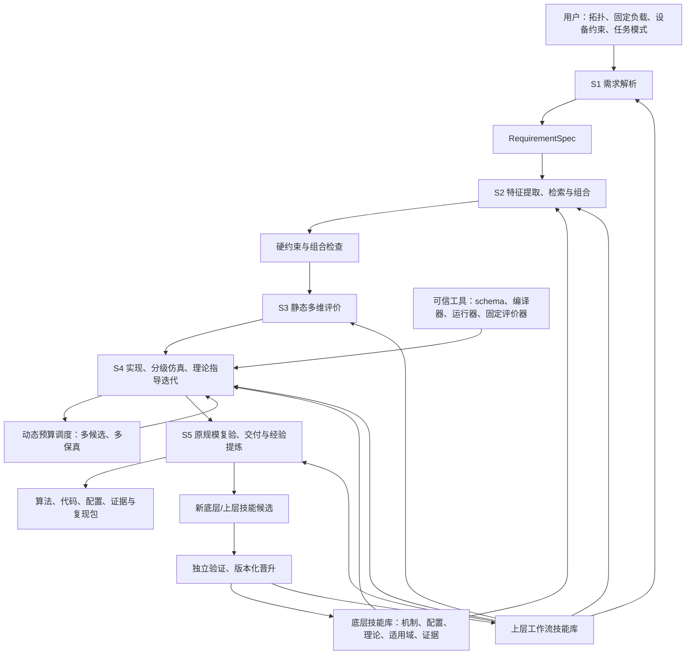

# 智算网络专家 Agent：分层技能复用与仿真驱动设计方案

> 日期：2026-10-16。依据本轮明确的任务边界编制。
>
> 定位：在给定拓扑、固定流量模式和网卡/交换机能力约束下，完成网络算法与配置设计、实验验证和经验复用。
>
> 状态：本文是待实施的详细设计。字段、接口、Prompt 和案例属于设计示例；没有宣称已经生成并测试某个新的控制器，也没有宣称已经完成 1024 端点仿真或真实网卡部署。
>
> 配套：[项目汇报简版](./智算网络专家Agent_项目汇报简版.md)。相关工作背景：[前期可行性报告](./Agent驱动数据中心网络CC与LB自主调优及技能复用可行性报告.md)。涉及集合通信的范围，以本方案为准。

## 1. 目标：把可积累的网络专家能力做成系统

用户提供拓扑、流量模式、设备能力、允许使用的控制信号、性能目标和允许的改动范围；系统像网络专家一样提出一个或多个 RNIC 拥塞控制与交换机配置方案，将方案落实成可执行仿真，利用理论关系和实验反馈改进，最后交付可复现的方案、代码和配置，并沉淀新的技能。

核心复用对象包括两部分：**底层复用“方案为什么适用、怎样实现、如何调参”，上层复用“专家怎样分析问题、组织实验、诊断和交付”。** 系统首先使用现成大模型、结构化检索和确定性工具，知识优先存入技能库；不以预先训练一个专用大模型作为启动条件。

这是面向设计、部署前验证和负载变化后重新配置的专家系统。算法在网卡/交换机内执行时仍受本地事件处理时标约束；LLM 负责作业外的方案设计与实验组织。

### 1.1 三种任务模式

| 模式 | 允许的搜索空间 | 必须保持的内容 | 交付重点 |
|---|---|---|---|
| `parameter_only`：仅调参数 | 设备实际可写的原算法参数、被允许修改的交换机配置 | 原控制公式、状态机、信号和协议不变 | 参数配置、理论依据、效果与适用范围 |
| `minimal_change`：最小改动 | 授权组件中的有限规则变化，及相应参数 | 禁止修改的模块、协议和设备预算不变 | 改动清单、变更成本、对原方案的改进证据 |
| `new_design`：新方案 | 能力约束内的算法规则、状态组合、网络侧配置 | 允许信号、硬件能力、资源预算和工作负载契约不变 | 完整算法说明、受限实现、实验包和设备参考后端 |

模式决定可执行的操作集合，不只是提示词中的倾向。最小改动应量化为新增状态字节、改变的控制组件、反馈协议变化、事件处理开销和交换机功能依赖，不能只用代码行数衡量。

如果仅调参数模式无法达到目标，输出“预算和已测试范围内的最好可行配置、性能缺口、失败证据”。除非有形式化证明，不能声称全参数空间无解；也不能自行升级为改算法或增加信号。

### 1.2 固定集合通信层

本项目的优化变量只属于网络行为：RNIC CC、授权的网侧 ECN/WRED/PFC 参数，以及用户明确放开的网络路径控制。默认冻结 LB 与 PFC；只有需求明确允许且设备支持时才进入搜索空间。

以下内容作为输入条件固定：集合通信算法、通信轮次和依赖、分块方式、rank placement、计算/通信调度、并行策略、通信库版本与参数、库层 QP/通道数。All-to-All、AllReduce 等用于提供负载，不能通过修改这些内容改善候选的分数。

需要区分两种负载输入：

- **开放环 trace**：流大小与起始时刻固定。适合评估网络传输完成时间、拥塞、队列和重传。
- **依赖驱动 workload**：通信依赖图固定，但后续发送由前序操作完成触发。网络优化可以自然改变完成时刻；这不属于修改集合通信方案。

不能把某次基线运行得到的全部绝对发送时刻直接冻结后，声称完整保留了原集合通信的闭环行为。最终需要 collective 完成时间时，应保留原依赖语义；只使用开放环流时，应明确报告通信流集合 makespan/FCT，不把它直接称为训练 JCT。

### 1.3 两个首要业务场景

| 场景 | 用户输入 | 系统必须解决的事 |
|---|---|---|
| 新拓扑设计 | 新拓扑、固定流量、仅允许 ECN/RTT、NIC 状态/算力限制、交换机 ECN 能力 | 生成兼容的 NIC 控制器和 ECN 配置；核实信号链与实现代价；在原规模验证 |
| 存量网络调优 | 已部署 DCQCN、固定的新 All-to-All workload、实际可写参数、最小部署影响 | 保持 DCQCN 机制，联合校准 NIC 参数与 ECN 水线，形成可下发 profile |

1024 点应在需求中明确为主机数、GPU/rank 数还是网络端点数；三者不能互换。1024 端点是最终验证目标之一，不是未经测量即可承诺的运行时长或并行能力。

## 2. 总体结构：五个上层技能、底层技能库与可信工具层

配套原理图：[系统总览](./system-overview.svg)；[一次任务交互时序](./interaction-sequence.svg)。总览图中紫色虚线表示技能加载和知识注入，蓝色实线表示 Runtime 通过工具网关发起结构化执行，绿色实线表示仿真/评价结果和验证后的技能回写。

手绘展示版（16:9横版）：[PNG](./system-overview-handdrawn-wide.png)；[SVG](./system-overview-handdrawn-wide.svg)。

基本元素编辑版：[修复版 Visio VSDX](./network-expert-editable-fixed.vsdx)；[旧版兼容 VDX](./network-expert-editable-legacy.vdx)。



五项上层技能是显式版本化的工作流，可由一个编排器顺序执行；不要求同时运行五个自由对话 Agent。检索、推导和代码生成可以并行，需求版本、约束与证据由一个任务状态机统一管理。

| 技能 | 输入 | 主要输出 | 退出条件 |
|---|---|---|---|
| S1 `AnalyzeRequirements` | 自然语言、拓扑、workload、设备清单 | 结构化需求、明确/推导/未知约束、目标和预算 | 可实验的需求版本，或明确的阻断缺项 |
| S2 `RetrieveComposeCandidates` | 需求、能力清单、技能索引 | 多个候选、技能依赖图、硬约束报告 | 至少一个可行候选，或有证据的不可满足/待确认说明 |
| S3 `AssessAndPrioritize` | 候选、历史证据、理论与资源估计 | 静态多维评分、置信度、预期风险、初始配额 | 候选池与可追溯的试验优先级 |
| S4 `ImplementEvaluateRefine` | 候选池、固定评价器、预算 | 可执行实现、仿真结果、诊断、理论指导更新 | 达到停止条件、预算耗尽或剩余候选不可行 |
| S5 `DeliverAndConsolidate` | 完整实验谱系与最终复验 | 完整交付包、新技能提案、适用域与失败说明 | 交付物可复现，证据等级与未验证项明确 |

下列能力放在工具层：能力校验、量纲检查、修改范围控制、代码编译、进程隔离、指标计算、预算记账和技能晋升检查。上层技能可以调用工具、建议改进，不能在同一任务中自行改写评价标准或放宽硬约束。

## 3. 统一数据契约：把自然语言变成可执行约束

### 3.1 任务、候选与实验对象

统一对象链为：

```text
RequirementSpec + CapabilityProfile + WorkloadContract
  -> CandidateSpec[] + ConstraintReport[]
  -> StaticAssessment[] + ExperimentPlan
  -> ControllerIR / SwitchConfigIR / 参数包
  -> TrialRecord[] + HypothesisRecord[] + FidelityCertificate
  -> SolutionPackage + SkillProposal[]
```

每个对象携带 `task_id/schema_version/content_hash/created_at/source_refs`。一个实验结果必须同时绑定候选代码、配置、拓扑、workload、约束、评价器和仿真后端版本。不能只用“方案 A，第 3 轮”关联日志。

### 3.2 RequirementSpec 示例

以下是新方案任务的字段示例，`null` 表示需要能力核查的值，不表示无限制。路径与 ID 为示意。

```yaml
task_id: example-new-topology-001
mode: new_design
topology:
  endpoint_count: 1024
  endpoint_kind: host
  graph_artifact: inputs/topology.json
  link_rate_unit: bit_per_second
  buffer_model_artifact: inputs/buffers.json
workload:
  contract_artifact: inputs/workload-contract.json
  pattern: all_to_all
  semantics: dependency_driven
  collective_configuration_mutable: false
  rank_mapping_mutable: false
  traffic_bytes_mutable: false
constraints:
  permitted_signal_families: [standard_ecn_feedback, rtt]
  prohibited_features: [int, custom_packet_tags]
  capability_profile: devices/target-profile.yaml
  per_qp_state_bytes_max: null
  event_budget_ns_max: null
  allowed_nic_edits: [controller_policy]
  allowed_switch_edits: [ecn_profile]
  pfc_policy_mutable: false
  load_balancing_mutable: false
objective:
  primary: communication_makespan
  secondary: [p99_fct_slowdown, useful_throughput]
  hard_limits_artifact: inputs/slo-limits.yaml
evaluation:
  baseline_id: deployed-or-approved-baseline
  max_parallel_trials: null
  cpu_hour_budget: null
  wall_time_budget_seconds: null
  final_validation_endpoint_count: 1024
  holdout_suite_id: independently-frozen-suite
```

若缺少状态/算力等决定可实现性的关键值，可继续分析并生成条件化研究候选，但不得标记为设备兼容。用户只给出“允许 RTT”时，还需要确定是否存在真实 RTT 测量与反馈接口。

### 3.3 能力与信号契约

| 契约项 | 需要记录的信息 |
|---|---|
| NIC 控制可编程性 | 固定算法/可调参数/可替换回调；支持的动作、作用域、生效条件 |
| 信号路径 | 产生端、编码载体、回传路径、处理事件、接收端是否需改动 |
| 反馈质量 | 精度、采样率、延迟、合并/抑制规则、丢失、过期和噪声 |
| 状态与算力 | 每 QP/每目的端/每端口状态、最大并发状态数、位宽、运算和定时器能力 |
| 交换机 | ECN/WRED 曲线、队列测量点、buffer/cell、动态共享池、PFC/PG 映射、可配置粒度 |
| 多路径与可靠性 | ECMP/LB、乱序接收、重传/SACK、反馈路径变化、流间共享状态 |
| 设备映射 | 厂商、型号、固件、SDK/驱动版本、参数映射、回读与回退方法 |

能力使用 `supported / unsupported / unknown` 三态。只有有来源支持的能力才能通过部署门控。三种事实必须分开：论文描述支持、当前仿真支持、目标实物支持。

信号集合也有粒度：标准 ECN 经 CNP 回传，不等于直接获得每包 ECN 比例；RTT 不等于单独的正向队列长度；INT、MCE tags、自定义 EECN 标记不能隐含在“允许 ECN”里面。

### 3.4 WorkloadContract

保存固定通信 DAG/trace、总字节、消息分布、活跃端点、真实阶段并发、同步性、通信库配置、rank 映射及 hash。所有候选必须使用相同原始契约。缩小场景另有 `proxy_of` 和映射说明，不能替换原始契约。

最终评价前验证：端点和逻辑操作数正确、业务总字节一致、依赖关系相同、未改变集合通信算法。网络背压导致发送时间变化属于网络执行结果，不属于被禁止的主动调度优化。

## 4. 底层技能：把算法、调参依据和证据共同持久化

### 4.1 技能保存的内容

| 内容 | 目的 |
|---|---|
| 算法机制与可执行表示 | 保存状态、事件、更新公式、动作和初始化/结束行为 |
| 设备与信号要求 | 在检索阶段排除无法实现的方案 |
| 场景适用域 | 拓扑结构、拥塞位置、fan-in、同步性、RTT/BDP、负载与已知失败区间 |
| 配置与后端映射 | 类型、单位、范围、量化、耦合关系、作用域及设备/仿真映射 |
| 理论调参规则 | 现象、假设、推导、方向、前提、反证条件和试验设计 |
| 实验证据 | 基线、场景、种子、置信区间、版本、失败结果与原始文件 hash |
| 生命周期 | 来源、许可、版本、父技能、验证等级、适用域更新与退役条件 |

初始技能可从 DCQCN、TIMELY、HPCC、现有 MCE/EECN、ECN/WRED 配置和现有推导脚本整理。HPCC/MCE 等在设备约束不满足时仍可作为“设计思想”的来源，但其完整实现不能直接进入可部署候选池。新组合必须重新取得证据。

### 4.2 技能目录与机器可执行规则示例

```text
skills/lower/dcqcn-feedback-budget/v1/
  skill.yaml             # 接口、能力、适用域、状态和证据等级
  mechanism.md           # 算法说明、推导和适用假设
  rules.yaml             # 诊断条件、调参动作、反证和停止条件
  controller/            # 参数模板、受限 IR 或策略核心代码
  adapters/              # ns-3 / 指定硬件的映射
  tests/                 # 接口、事件序列、兼容性和行为回归
  evidence/index.json    # 不可变 trial 引用，避免大日志放进 prompt
```

```yaml
skill_id: dcqcn.feedback-budget
version: 0.1.0
status: candidate
requires:
  feedback_semantics: cnp_presence_per_update_window
  nic_actions: [bounded_rate_update]
  switch_features: [ecn_marking]
scope:
  state_granularity: per_qp
  mechanism_family: dcqcn
  allowed_modes: [parameter_only, minimal_change, new_design]
applicability:
  features: [fanin, offered_load, burst_duration_over_rtt, feedback_delay]
  exclusions: []
tuning_rules:
  - id: late_feedback_queue_overshoot
    required_observations: [egress_queue_trace, cnp_times, rate_trace]
    hypothesis: feedback_arrives_after_safe_buffer_budget_is_consumed
    derive: queue_feedback_budget_v1
    propose: bounded_ecn_threshold_and_response_time_candidates
    expected_effects: [earlier_feedback, lower_queue_peak]
    possible_costs: [lower_utilization, more_cnp]
    falsifier: earlier_feedback_without_lower_queue_peak
    next_if_falsified: inspect_feedback_suppression_and_aggregate_rate_recovery
evidence:
  trial_ids: []
  validated_domain: null
```

`derive` 指向受审核的数学工具；`propose` 指向有限动作生成器。LLM 可以解释现象、选择规则和提出新规则，但数学计算和参数边界由工具校验。空证据技能只能作为知识先验。

### 4.3 存储与验证等级

首版使用 Git 存技能定义与代码，SQLite 存索引、依赖和 trial 元数据，本地文件/对象存储存日志；增加向量检索时仍保留结构化能力过滤。大型日志按内容哈希引用，LLM 只读必要摘要。

验证等级沿用同一规则：`knowledge_only → candidate → static_checked → simulation_validated → hardware_compiled → hardware_validated`。另外记录验证场景，不用一个全局“validated”覆盖所有拓扑。算法技能和工作流技能在版本晋升时均需独立测试。

## 5. S1：需求分析与系统 Prompt

### 5.1 固定角色与任务边界

系统 Prompt 建议如下，运行时追加结构化任务、能力清单和检索到的技能摘要：

```text
你是智算网络拥塞控制与交换机配置专家。
任务是在固定拓扑和固定集合通信工作负载下，根据设备能力与允许信号，
设计、适配或调节网络算法，并调用工具取得可复现证据。

遵守 RequirementSpec.mode 及授权修改范围；不得改集合通信算法、分块、
rank映射、通信调度、库层QP/通道数或工作负载总量来提高分数。
先验证硬件与信号兼容，再评价场景匹配；unknown不能当supported。
每个候选注明技能来源、组合方式、状态/事件开销与适用假设。
理论判断输出公式、单位、假设、可观测预测和反证条件。
性能判断引用 TrialRecord；预测、仿真观察和硬件观察必须分别标识。
调用固定评价器；不得修改约束、基线、测试数据或自己的晋升标准。
按当前阶段要求输出结构化对象及简明依据，不编造测量结果。
无法在约束内满足目标时，输出最好可行解、性能缺口和待核实条件。
```

这一 Prompt 用于行为引导，真正的边界来自修改白名单、schema、能力检查与工具权限。

### 5.2 需求解析程序

1. 识别任务模式、拓扑/负载附件、目标、设备清单及允许编辑的字段。
2. 统一端点定义、速率、时延和缓存单位，解析拓扑图与固定通信契约。
3. 通过设备 profile 和技能推导隐含需求，例如 RTT 需要测量/回传链、ECN 需要接收端反馈。
4. 将每项约束标为 `explicit / derived / assumed / unknown`，记录出处。
5. 识别冲突与关键缺项；不影响的研究工作继续，设备可实现性受影响的候选保持条件化状态。
6. 冻结需求版本、目标、基线、预算和留出策略。后续修改需求产生新版本，旧证据重新检查适用性。

验收：同一需求可以确定哪些字段可改、什么结果算成功、哪些候选必然不允许，以及哪些事实尚未得到确认。

## 6. S2：硬约束优先的检索、复用与组合

### 6.1 特征提取

拓扑特征包括层级、节点角色、端口速率分布、过订阅比、路径数、路径不对称、RTT 分布、瓶颈位置与共享缓存结构。流量特征包括通信矩阵、阶段并发度、fan-in/out、流大小/BDP、同步突发、负载占空比、热点与背景干扰。不要只用“Clos、1024点、All-to-All”三个标签匹配。

能力特征与场景特征分开保存：设备/信号属于硬可行性；拓扑/负载相似度属于经验迁移的软依据。

### 6.2 检索顺序

先构建满足以下条件的可行技能集合 \(\mathcal F\)：

\[
\begin{aligned}
\mathrm{requires}(s)&\subseteq\mathrm{supported}\cap\mathrm{permitted},\\
\mathrm{resources}(s)&\leq\mathrm{budget},\\
\mathrm{edits}(s)&\subseteq\mathrm{authorized}.
\end{aligned}
\]

`unknown` 项不能通过硬门控；资源估计缺乏边界时进入“待测量”队列。静态可行性仍需编译/运行测量验证峰值。

再对可行技能按场景结构、拥塞机制、目标、设备版本和证据覆盖排序。文本/向量相似度可用于召回，最终采用结构化重排。高匹配阈值需在历史留出任务上校准，不能把某个 embedding 分数直接解释为成功概率。

- **高匹配**：复用已有方案及参数关系作为起点，仍做兼容检查和少量校准。
- **中等匹配**：迁移无量纲关系与调参流程，重新估计具体参数。
- **无完整匹配**：按允许信号和动作组合机制片段，保留多个算法家族；每个组合注明未知交互。
- **无可行技能**：在新方案模式可从受限模板构造候选；其他模式保持原方案边界，报告缺口。

### 6.3 组合检查

组合需要逐项检查：信号链闭合、接收端支持、包格式、状态总量、事件/定时器预算、位宽、参数单位、控制动作所有权和快慢环相互作用。

两个模块都能更新 `rate` 时，必须指定单一仲裁，例如一个给出基础更新、另一个给出速率上限，由固定函数合成。不得隐式叠加两次降速或两个独立恢复过程。静态无冲突只表示可进入实验，不表示稳定。

例如“ECN 触发降速、RTT 趋势抑制过快恢复”属于一个新组合；它要求合法 RTT 信号、合适的状态预算与事件仲裁，历史 ECN 控制器和 RTT 控制器各自表现良好不能证明组合有效。

输出候选池包括用户基线、最接近的合法迁移方案、若干互补组合，以及模式允许时的新设计。保留技能依赖图、不同机制家族和每项候选的约束报告。

## 7. S3：静态多维评价与初始实验优先级

硬约束结果用 `pass / unknown / fail` 单独表示，禁止用高性能预期抵消功能缺失。仅可行候选获得正式实验配额；待证候选可获得解决缺项的诊断试验，不能默认获得部署资格。

| 评分维度 | 依据 | 分数的含义 |
|---|---|---|
| 拥塞机制匹配 | 瓶颈位置、fan-in、RTT、反馈时延 | 与已有机制适用域的接近程度 |
| 历史证据覆盖 | 相同后端、负载、规模、种子及反例 | 对迁移的实证支持强弱 |
| 理论预期与可验证性 | 模型、假设、可观测预测 | 是否有清楚的作用机制和证伪方法 |
| 资源余量 | 状态、事件处理、定时器、反馈带宽 | 与设备上限的距离 |
| 修改与部署成本 | 组件变化、接口依赖、生效条件 | 对存量部署的影响 |
| 实现与实验成本 | 已有适配器、编译复杂度、仿真开销 | 获得下一份证据的预计成本 |
| 不确定性与风险 | 未覆盖负载、反馈噪声、组合交互 | 需要专门实验确认的内容 |

首版可用有锚点的 0–4 级离散评分，每个分数附来源与解释；不确定性另列，不凭空输出“成功概率 90%”。静态排序可用经版本化的加权/字典序规则，权重由任务模式决定：最小改动模式要显式考虑变更代价。

静态评分只决定起始顺序与温和先验。进入 S4 后，以真实结果更新优先级，同时给不同机制和高不确定候选留探索预算，避免静态 top-1 决定全部结果。

## 8. S4 核心技能：实现、运行、观察与迭代

### 8.1 将方案变成受限的可执行表示

`ControllerIR` 应表达输入信号、状态作用域与位宽、事件、更新规则、输出动作和资源预算；`SwitchConfigIR` 表达设备/端口/队列上的 ECN 曲线、单位、buffer 语义与允许的其他配置。算法方案必须落到这些对象，不能只有自然语言。

三种模式使用不同实现路径：

| 模式 | 生成方式 | 自动检查 |
|---|---|---|
| 仅调参数 | 现有控制器 + 完整配置生成 | 算法/信号/工作负载 hash 不变，只有白名单参数变化 |
| 最小改动 | 固定策略骨架内的有限 patch 或派生控制器 | 变更组件、状态/事件增量、接口与协议差异均在预算内 |
| 新方案 | 受限 IR/策略核心 → ns-3 adapter；必要时增加一次性标准插件入口 | 类型、单位、观测权限、动作边界、算法生命周期与后端集成 |

建议先人工实现一个稳定的 `GeneratedCcAdapter`，其名称在本文中是拟建接口。随后让模型修改小型策略核心，不让每个候选随意改整个 RDMA 栈。可编译接口必须显式传入允许观测，避免直接把整个 `RdmaHw` 指针交给生成策略。

```cpp
// 概念接口；实际类型、定点精度和事件均由目标能力契约确定。
ControlAction OnEvent(const AllowedObservation& obs,
                      ControllerState& state,
                      const ValidatedParameters& params);
```

运行器和评价器可以读取仿真全局队列作为真值；控制器只能读取目标设备真实可获得的字段。必须阻止生成代码读取未来流量、其他流的内部状态、仿真专用 Tag 或全局队列来取得虚假收益。

### 8.2 实现到实验的流水线

1. **生成与校验**：检查 IR、参数、修改范围和所需能力，生成源代码/配置与 manifest。
2. **编译与事件测试**：在隔离目录构建目标；检查初始化、反馈缺失、连续 CNP、RTT 噪声、零流量、QP 结束、速率与状态边界。
3. **机制小场景**：运行低成本测试，校验正确性和本次调参假设。
4. **结构代理与中间规模**：验证多瓶颈交互、规模趋势和代理排序。
5. **诊断与调参**：调用底层理论规则，提出有方向的新参数，或者在模式允许时修改机制。
6. **晋升或停止**：决定追加样本、扩大规模、继续当前路线、保留备用路线或淘汰。
7. **原规模冻结复验**：交给 S5 进行独立最终评价。

编译失败、协议集成失败、运行失败、性能不达标和基础设施故障使用不同状态码。基础设施问题允许有限重试并记账；不能把编译成功当作算法正确，也不能只统计成功完成的流。

### 8.3 仿真运行与指标接口

拟建 `evaluate(candidate, scenario, fidelity, seed)`，输出：

```yaml
trial_id: example-trial-001
candidate_hash: example-content-hash
backend_revision: pinned-commit-and-adapter
scenario_hash: example-scenario-hash
workload_hash: example-workload-hash
fidelity: proxy_structure
seed: 1
status: completed
integrity:
  expected_flow_count: null
  completed_flow_count: null
  expected_payload_bytes: null
  delivered_payload_bytes: null
metrics:
  communication_makespan_seconds: null
  fct_p99_seconds: null
  useful_throughput_bit_per_second: null
  pfc_pause_fraction_by_priority: null
constraints:
  all_checked: false
  violations: []
cost:
  cpu_core_seconds: null
  peak_memory_bytes: null
  wall_seconds: null
artifacts:
  config: run/config.yaml
  raw_metrics: run/metrics.json
  logs: run/log-index.json
```

这是结构示意；真实 `completed` 记录必须填齐必需字段并通过完整性检查。指标值不得由 LLM阅读曲线后估计，必须由固定解析器计算。每项指标同时保存单位、采样窗口、流分组和缺失原因。

完整性门控至少检查：预期流数/字节数、已完成数、超时、程序退出、断言、无效数值、异常重传、未完成流和日志缺失。未完成流属于失败或显式截尾样本，不能从 FCT 分布中无声消失。

### 8.4 多候选、n 并发与动态预算

`n` 表示独立仿真实例的并发上限。开始前用代表性 trial 测资源，约束：

\[
n \leq \min\left(n_{\mathrm{requested}},
\left\lfloor C_{\mathrm{available}}/c_{\mathrm{trial}}\right\rfloor,
\left\lfloor M_{\mathrm{available}}/m_{\mathrm{trial}}\right\rfloor\right).
\]

其中 CPU 与内存均预留编译、日志和系统余量；若单个 ns-3 已启用多线程，不能再按全部核数开启同样数量的 trial。首版用进程池，必要时接 Ray；不以改造分布式 ns-3 作为前置工作。

配额分两层：上层在算法家族间分配，下层在同家族内做参数优化。首先给有区别的可行家族最低验证机会，之后按实际收益、不确定性、机制覆盖与成本分配空闲 worker。静态评分逐步让位于实测。

可用的调度启发式为：

\[
priority_i=\frac{EI_i+\beta U_i+\lambda D_i}{\widehat{cost}_i}.
\]

`EI` 为同保真、同基线下的预计改进，`U` 为经过校准的不确定性，`D` 为归一化机制覆盖奖励，成本以 CPU 时间等资源衡量。各项须归一化；该式是待验证的设计，不是最优性保证。数据不足时使用简单分层轮转与保守晋升，不制造精确后验。

例如 n=8 时，可先让若干家族各获得一个工作槽，其余槽用于补种子、诊断或高保真晋升；比例随任务变化。持续保留探索和代理错杀审计预算，不能把全部资源锁定在一次偶然高分的候选上。

```text
reserve final_evaluation_budget; define separate search_budget
while search_budget remains and runnable work exists:
    collect finished trials; validate integrity; record all costs
    update same-fidelity estimates and candidate-family evidence
    diagnose failures; propose theory-guided local parameter changes
    recheck every new candidate against frozen constraints
    decide repeat / refine / promote / audit / stop
    dispatch independent tasks while CPU, memory and worker slots permit
freeze finalists; use reserved budget for original-scale independent evaluation
```

最低运行要求：每个候选独立源码/构建/输出目录；相同构建键复用二进制，键至少包含候选源码 hash、NS-3/adapter 版本、编译器版本、构建选项和依赖版本；参数候选在构建键相同的前提下共享只读二进制。每次变更有父候选和版本，模型生成也计成本。高事件数的慢 trial 应保留合理完成机会，避免调度器只偏爱运行快的坏方案。

可参考 Hyperband/ASHA/BOHB 的多预算思想 [R9–R11]。它们不会自动证明“小拓扑的排序能代表大拓扑”；网络代理有效性由本项目另行验证。

## 9. 先小后大：构造有适用边界的代理场景

### 9.1 缩小什么，保留什么

1024 端点全连接 All-to-All 理论上有 1,047,552 个有向端点对，但实际同时活跃的 QP 和消息数由固定通信实现决定，不能直接把全部端点对同时启动。

不能只把 1024 个节点改成 32 个节点，再等比例减少总流量。对候选排名有影响的特征至少包括：

| 特征 | 要保留或量化误差的内容 |
|---|---|
| 瓶颈与切面 | 接收端、ToR 上联、跨 pod 等瓶颈位置；需求/服务能力比 |
| 路径结构 | 层数、过订阅、路径数、重叠和不对称，反馈路径 |
| 竞争者 | 每瓶颈同时活跃 QP 数、独立状态、fan-in/out、共享端口 |
| 流量时序 | 同步程度、突发持续时间、峰均比、阶段依赖与背景负载 |
| 相对尺度 | 消息/BDP、buffer/BDP、阈值/BDP、定时器/RTT、突发/反馈时延 |
| 设备语义 | CNP 合并、ACK 聚合、PFC 传播、共享缓存、速率与定时器量化 |

单个大流不能替代许多独立 DCQCN 流，因为它改变控制状态数和反馈回路。小主机数代理可以保留多个虚拟 QP，但要注明这是评测近似，不是对原集合通信的 QP 配置修改。

### 9.2 使用两类互补代理

**瓶颈机制代理**提取一个或多个关键拥塞子图，保留实际速率、基础 RTT、竞争控制状态与反馈语义，验证某个明确假设。可通过边界流量补充被删节点影响，但外生回放不能完整复制这些节点的反馈行为。

**层次结构代理**保留网络层级、过订阅、路径竞争和典型热点，使用原 workload 的投影与明确的边界条件，验证多瓶颈交互。减少参与端点就不可能完整保留原 1024-rank DAG，因此它属于筛选工具。

两者互补，分别回答“局部机制是否成立”和“多点耦合是否破坏收益”。任何一个代理都不单独证明全网稳定性或全规模收益。

### 9.3 分级实验

| 层级 | 建议任务 | 可以形成的证据 |
|---|---|---|
| F0 | schema、资源、编译、事件序列测试 | 接口和基本行为正确 |
| F1 | 8–32 端点或等效瓶颈机制场景 | 局部机制假设与参数方向 |
| F2 | 32–128 端点层次代理 | 多瓶颈/多路径交互，代理域内鲁棒性 |
| F3 | 256/512 中间规模，或原规模代表性阶段 | 规模趋势、原规模阶段表现 |
| F4 | 原拓扑、固定完整 workload、多次复验及独立留出 | 声明适用域内的原规模仿真结论 |
| F5，后续扩展 | 目标 SDK 编译、小型实网校准和资源测量 | 后端可实现性与有限实网证据 |

节点数是起点，不是固定标准。F3 原规模片段要包含合适的预热状态；未实现可靠状态快照时，不得假设可以从任意中间时刻恢复。最终报告明确覆盖了哪些阶段、哪些没有覆盖。

### 9.4 代理有效性与错杀检查

每个代理产生 `FidelityCertificate`：原场景 hash、投影关系、保留特征、误差、遗漏机制、可验证问题、不能验证的问题、校准候选、排序一致性及错杀审计结果。

选取基线、不同水线、不同恢复速度和不同机制的校准方案，在代理与更高一级重复测试，比较收益方向、约束违规一致性及排序。容忍度预先设定并报告置信区间，不能只用一个未经验证的相似度分数通过。

如果关键排名反转、PFC 传播链丢失或 fan-in 严重失真，扩大代理或跳过该层。抽取部分被低保真淘汰的方案进行更高保真审计，估计“错杀率”。低层证据不足时应保留候选，不能把无结论当成无效。

每层性能相对本层同场景基线归一化。不同规模的绝对 FCT 不混合排名；归一化收益仍可能有偏差，需显式校准或分层建模。原规模最终留出集不提供给生成器反复试探。

## 10. 理论指导调参：让每次试验回答一个机制问题

### 10.1 统一的推导与实验记录

每次更新输出 `HypothesisRecord`：现象与 trace 引用、机制假设、技能/论文来源、公式与单位、适用前提、预计改善、副作用、反证条件、有限候选及验证预算。

流程为：

```text
观察异常 -> 调用机制技能 -> 推导范围/方向 -> 生成少量局部候选
         -> 控制变量实验 -> 验证或推翻假设 -> 更新参数先验与技能证据
```

理论用于缩小搜索空间和选择有信息量的实验，不要求所有复杂网络都有闭式最优解。可在理论限定的信赖域内用 Optuna/TPE/BO；只有参数扫描而没有假设、预测与反证，不满足本项目的“理论指导”要求。

### 10.2 ECN 水线：排队预算与反馈滞后

统一使用容量 C、到达速率 A 为 byte/s，时间为秒，队列 Q 和阈值 K 为 byte。

\[
BDP=C\cdot RTT_0,\qquad K_{target}\approx C\cdot d_q.
\]

其中 RTT₀ 为无排队 RTT，d_q 是分配给该瓶颈的排队时延预算。多跳不能给每一跳重复分配完整端到端预算。

例如 400 Gbit/s 等于 50×10⁹ byte/s，8 μs 对应 400,000 byte，即 400 十进制 kB。这只是量纲换算示例，不能据此给所有 400G 端口推荐同一 ECN 水线。

从标记到减速真正抵达瓶颈的时间 L，包含反馈传播、CNP 限频/合并、发送端响应和更新后数据传播。该期间新增积压可用以下保守近似筛选：

\[
\Delta Q\lesssim\int_0^L\max(A(t)-C,0)dt+M.
\]

若有可靠的到达速率上界，可检查 `Q_mark + max(A_max-C,0)×L + M ≤ Q_budget`。M 覆盖包粒度、估计误差与额外延迟；Q_budget 必须先映射到同一测量点。该式只估算反馈等待窗口，后续速率是否降到容量以内、共享缓存和其他队列仍需验证，不能当作普适无损保证。

因此：若首次标记偏晚，优先提出有界提前标记方案；若已经及时标记而 CNP 响应受限，应检查反馈与恢复过程；若零阈值仍容不下同步首轮突发，单调水线不能解决，需在授权动作中寻找其他办法或报告能力缺口。

当前仓库 ECN 读取出口队列，而 PFC 依据入口共享池/headroom 和动态阈值。不能直接使用 `Kmax < 某个PFC数字` 作为安全证明。交换机技能必须保存测量点、共享池关系和厂商量化规则。

### 10.3 DCQCN 平滑与恢复时间尺度

当前 `MellanoxDcqcn` 的 alpha 更新使用“窗口内是否收到 CNP”的二值反馈 z，而不是 DCTCP 的逐包标记比例：

\[
\alpha_{k+1}=(1-g)\alpha_k+gz_k,\qquad z_k\in\{0,1\}.
\]

在无新 CNP、0<g<1 时，无反馈衰减常数为：

\[
\tau_\alpha=-T_\alpha/\ln(1-g)\approx T_\alpha/g.
\]

其中 `Tα/g` 近似只适用于较小的 g，接近1时应使用精确公式。例如 g=1/16、Tα=55 μs 对应约 852 μs。这是离散 EWMA 的数学性质，不是整个 DCQCN 的稳定时间；首次 CNP、速率更新间隔、target rate 与恢复状态仍有独立逻辑。

如果 M 个活跃 QP 在某段近似加性恢复区间内，每次增长 ΔR、间隔 T_inc，则聚合斜率可估为 `a≈M×ΔR/T_inc`。这里 ΔR 为 byte/s，T_inc 为秒，a 为 byte/s²；代码中的 bit/s 需先除以8。从聚合速率刚好跨过容量的时刻开始计，在反馈滞后 L 内，局部队列增长量级为 `ΔQ≈aL²/2`。若起点已有超额速率 `E₀=max(A₀−C,0)`，则改为 `ΔQ≈E₀L+aL²/2`。它解释为什么同样 AI 参数在并发增大后可能导致尖峰；同步程度、target-rate averaging 和 HAI 会改变这一近似。

跨场景先迁移 `K/BDP`、`τ_alpha/L`、`T_inc/RTT₀`、`ΔR/C`、`消息/BDP` 等关系，并显式保留活跃 QP 数、量化与反馈限频。相同比例不能保证相同表现，仍需少量校准。

### 10.4 三类可执行的诊断规则

| 观察 | 待检验假设 | 有方向的候选 | 反证与副作用 |
|---|---|---|---|
| 同步启动后队列高、PFC 多，首个反馈滞后 | 标记过晚或反馈响应来不及 | 调整阈值范围，检查 CNP/降速周期；仅在允许时调初始速率 | 提前标记仍无收益，说明主因可能是不可避免首轮积压；观察吞吐下降 |
| 拥塞解除后链路长期不满 | alpha 记忆或恢复策略过慢 | 校准 g、Tα、恢复周期的组合 | 更快恢复造成振荡；若瓶颈在接收端/PCIe则假设不成立 |
| All-to-All 恢复阶段周期尖峰 | 多 QP 聚合增速过快 | 在原 DCQCN 状态机内调整有效 AI/HAI 和恢复间隔 | 尖峰与恢复无相位关联，或尾延迟/公平性恶化 |

每轮只改变能解释的少量变量，必要时做小型因子实验分离耦合。理论不成立时保存反例并降低对应技能的适用置信度，不用新的语言解释掩盖矛盾。

本仓库 `derive_eecn_window_parameters.py` 已包含二项反馈模型、条件漂移、恢复时间和 EWMA 时间尺度，可作为推导工具技能的起点。其独立标记、固定样本数等假设要保留；条件漂移零点不能写成混合控制器稳定性证明。

## 11. 评价标准：网络收益、完整性、成本与迁移

### 11.1 网络目标与硬限制分开

固定目标可以是通信 makespan、FCT slowdown 或特定网络 SLO。用归一化相对收益比较同场景候选，例如：

\[
I=1-T_{candidate}/T_{baseline}.
\]

只有完整性和硬限制通过后才比较 I。吞吐提高不能抵消流无法完成、超出资源或修改工作负载；LLM 的文本评价也不能替代数值评价。

| 指标组 | 必须考虑的指标 |
|---|---|
| 网络完成效果 | 全部流完成率、通信阶段/makespan、平均与尾部 FCT/slowdown、有效载荷吞吐 |
| 拥塞与反馈 | 队列峰值/分位数/积分、ECN/CNP 时序、PFC 暂停时长与传播、丢弃/重传 |
| 公平性与稳定性 | 同需求流组的吞吐/slowdown 分布、最慢端点、振荡、恢复时间 |
| 实现代价 | 每状态粒度字节数、峰值状态数、事件运算、定时器、反馈开销、量化误差 |
| 搜索与复用成本 | trial 数、CPU-hours、原规模评测次数、LLM token、墙钟时间、人工介入 |
| 泛化与迁移 | 留出场景成功率、负迁移率、代理错杀率、参数校准次数 |

暂停帧数不能等同暂停时长；多优先级暂停时间可能重叠。ECN/CNP 多不自动代表差，减少这些信号也不自动代表好。仿真 CPU 耗时不能当作 NIC 事件执行时延；硬件开销需要目标编译器、静态资源分析或设备测量。

### 11.2 统计与实验纪律

- 基线与候选使用相同 workload、负载阶段、设备模型和种子集合；保持应用总工作量。
- 筛选可少量重复，最终建议至少 5 组独立重复作为起点，并按实际方差增补。配对比较及 bootstrap 置信区间以独立 run 为主要单位，不能把同一 run 内相关流当成独立重复。
- 尾延迟需足够流量样本，同时报告未完成和超时。只报告最优一次、已完成流平均值或单一大流吞吐都不足以验收。
- 调参集、晋升验证集和最终留出集分开。最终结果若被用于下一次训练，之后需要新的留出集。
- 模型与设备的单位、标记时点、ACK/CNP 行为、buffer 模型需要校准。没有实物数据时称“目标场景模型”，不称已验证数字孪生。

### 11.3 必须做的对照与消融

主对照包括现有配置/专家配置、等预算冷启动搜索、最近历史参数缓存、普通 RAG、只复用底层技能、同时复用上下层技能。代码生成阶段再加入同样模板与评价器下的 OpenEvolve cold start。

关键消融：去掉理论规则、去掉反例/适用域、只选静态最高分、等额分配所有家族、按节点数简单缩比、去掉高保真错杀审计、只保存成功技能、允许/禁止上层工作流复用。

主研究命题应是：在原规模同等网络性能和硬限制下，两层技能复用是否减少试验与人工成本；机制约束的代理是否减少排序错误；证据和反例是否降低负迁移。初始技能编写/历史实验成本与后续复用成本分别报告，并统计多次复用后的摊销收益。

## 12. S5：完整交付与两层技能持续积累

### 12.1 每次任务交付一个 SolutionPackage

```text
solution/<task-id>/
  README.md                      # 目标、结论、复现步骤、验证等级
  requirement.yaml               # 最终冻结的需求与模式
  capability-profile.yaml        # 设备能力与未知项
  algorithm.md                   # 状态、事件、公式、伪代码、资源与失败边界
  provenance.json                # 技能谱系、模型/工具/代码版本、内容hash
  simulator/
    source/                      # 锁定后端源码快照及全部新生成源码
    patches/                     # 相对基线的可审阅diff
    build-manifest.json          # 编译器、依赖、选项、源码hash
    configs/                     # 基线、候选、最终完整配置
    topologies/                  # 原拓扑及所有代理
    workloads/                   # 固定trace/DAG及hash
    reproduce.sh                 # 构建与复验入口
  nic-reference/
    controller_core.h
    controller_core.c            # 仅在任务需要生成控制逻辑时提供
    target-adapter/              # 已指定SDK时的事件/参数映射
    compatibility.md            # 编译/设备测试状态、资源与协议要求
  switch/
    config-ir.yaml               # 部署中立的端口/队列profile
    target-profile.yaml          # 厂商、固件、单位、量化与回读方式
    rendered-config/             # 目标已明确时输出具体命令或结构化配置
  results/
    metrics.json
    constraint-report.json
    comparison.md
    fidelity-certificates/
    raw-artifact-index.json
  skill-proposals/               # 本轮提炼的候选技能及证据
```

“完整 NS-3 代码”意味着全部生成源码、所依赖后端的固定源码快照/可精确恢复的依赖及构建运行入口齐全，可从干净环境复现；只有伪代码、代码片段或未锁定主分支的链接不算完成。仅调参数模式不必虚构新算法源码，交付原算法的精确实现和完整配置包即可。

如果源码含未提交修改，Git commit 不足以标识实验版本，还需保存相关完整源码快照或 dirty diff 与必要未跟踪文件清单及 hash。当前工作区已有多项本地修改，后续实现应建立独立实验快照，不以清理或重置用户工作区获得所谓干净基线。

### 12.2 网卡参考代码与交换机配置的可信等级

网卡交付分为通用算法核心、指定 SDK 适配、SDK 编译通过、设备运行验证四级。每级写明状态；定点 C 代码本身不代表可插入任意 RNIC。

老旧固定 DCQCN 网卡只有可写参数时，实际交付是参数 profile，不应附一个无法装入该设备的新控制器来冒充落地。新方案要求可编程 NIC 时，必须先核实资源和接口；能力不具备就保留研究方案并报告缺口。

DOCA PCC 的硬件、SDK、固件和启用条件按官方文档与目标设备核查 [R7]；不能推广成所有 ConnectX 网卡均支持任意代码。CC 回调的信号语义、状态作用域、速率单位、反馈开销和缺失事件处理需要与 NS-3 对齐，使用事件序列比对数值与动作误差。

交换机交付先使用 byte 单位的配置 IR，后按实际 ASIC cell、WRED 标记语义、端口/队列粒度生成配置并记录取整。未知厂商只交付中立配置和缺失映射；已指定厂商则输出具体配置、预检查、回读和回退方法。上游代码及技能的许可与出处随包保存。

### 12.3 新技能的提炼和晋升

底层技能从“成功机制、有效参数关系、诊断流程、失败反例、适用边界”中提炼。一个试验成功只生成候选，不自动晋升为适用于所有 All-to-All 的技能。至少要求独立重复、留出验证、约束通过、基线对照和版本兼容性。

上层技能从多任务轨迹提炼，例如发现“先检查反馈滞后再调整水线”比旧流程更节省试验。将新工作流冻结，在未参与提炼的任务集上与旧版本做等预算对照，比较任务成功率、trial 数、人工介入、成本与负迁移，之后才能晋升。

状态可用：`proposed → offline_checked → heldout_validated → active → deprecated`。保留父版本、升级理由和回退路径；同一任务产生的证据不能既决定规则又独立证明规则有效。

评价器、硬约束、最终留出集和晋升门槛属于受控系统版本。Agent 可以提交改进提案，但不能通过降低自己的标准完成“自我改进”。

## 13. 两个端到端示例

### 13.1 新拓扑，允许 ECN/RTT，需要新 NIC 算法与 ECN 配置

**输入**：原始拓扑和固定 workload；允许标准 ECN 反馈与 RTT；禁止 INT/自定义 tag；NIC 可编程能力、状态/事件预算与交换机 ECN 能力清单；任务模式为新方案。若 NIC 可编程性未知，先产生条件化候选。

**S1**：检查 ECN→接收端→CNP→发送端事件是否闭合；RTT 如何测量、回传与采样；交换机按哪个队列占用打标。锁定 collective、LB、PFC、重传与 rank 映射。

**S2**：保留合法基线；候选 A 为标准 ECN 控制与水线联合校准；候选 B 为 ECN 降速与 RTT 趋势约束恢复的组合；候选 C 为合法 RTT 控制机制与保留的 ECN 保护策略。是否保留 B/C 取决于真实信号、状态和事件预算，不能提前断言哪一个最佳。

HPCC 需要的 INT、MCE 的专用 tag 等不满足信号约束，应排除完整方案；可复用其中兼容的理论思路，但新组合要作为独立新候选。

**S3**：分别评估突发响应、吞吐、公平性、RTT 噪声敏感性、CNP 抑制、状态和实现成本，分配初始试验。

**S4**：生成受限控制器；验证 RTT 时间戳和 CNP 语义；先测试启动、稳态、反向拥塞和多瓶颈；根据队列预算与恢复时间尺度校准。通过代理与中间规模后进入完整原拓扑。

**S5**：交付算法状态/事件/公式、实际测得的 ECN 水线、NS-3 全套代码、指定后端参考代码与结果。若无原规模或硬件证据，明确相应等级未完成，不把模板数值作为推荐。

### 13.2 存量 DCQCN，新的固定 All-to-All，只允许调参数

**输入**：原 DCQCN 实现与配置、可写 knob 清单、交换机 buffer/ECN 语义、固定 All-to-All trace/DAG 和性能目标。

**S1**：冻结原更新公式、状态机、反馈协议、集合通信层及默认冻结的 LB/PFC；实际不可写的 NIC 参数作为常量。

**S2**：检索“同步负载反馈延迟”“多 QP 恢复尖峰”“拥塞消退后利用率不足”等技能；从最接近的证据出发形成几个参数关系不同的起点。

**S3**：比较理论匹配、历史证据、参数变更量和风险。不能因为某个配置在长流单瓶颈上好，就认定适用于 All-to-All。

**S4**：先测基线，区分启动积压、稳态振荡和尾部收敛。调用队列预算、alpha 时间常数、聚合恢复斜率等规则，局部调整可写参数和 ECN 曲线；保留几条不同解释的路线进行验证。

**S5**：交付新的 DCQCN+ECN profile、作用域、变更前后对照、代码/公式 hash 不变证明、复现包和适用范围。若未达标，给出已测试的最好可行配置、剩余缺口和证据，不改变通信启动顺序或悄悄换算法。

首个可运行版本优先完成场景 13.2；在此基础上复用相同约束、评价器和证据接口扩展场景 13.1。

## 14. 与当前 ns3-eecn 仓库的具体连接

以下是 2026-10-16 对当前工作区的只读核查，行号可能随代码变化；实现时使用源码 hash 固定。

| 已有资产 | 已核实位置 | 复用方式与需要补齐的边界 |
|---|---|---|
| CC 生命周期接口 | `simulation/src/point-to-point/model/rdma-congestion-ops.h:15` | 包含初始化、发包、ACK、完成和改速；增加受限观测/动作适配层 |
| CC 选择 | `simulation/src/point-to-point/model/rdma-hw.cc:1107` | CcMode 手写映射到工厂；新类型还需选择器与构建集成 |
| RTT/INT 模式 | `simulation/scratch/common.h:1177` | 现有模式决定时间戳/INT，新增 ECN+RTT 要打通整条链 |
| ECN | `simulation/src/point-to-point/model/switch-mmu.cc:96` | 基于出口队列；ConfigEcn 在第108行把 kB 输入乘1000 |
| 配置解析 | `simulation/scratch/common.h:1127` | 已有属性覆盖；增加单位、类型、能力与模式校验 |
| 水线映射 | `simulation/scratch/common.h:196` | 现有按链路速率 map，异构同速率端口不能直接表达 |
| 固定流输入 | `simulation/scratch/NormalNetwork.cc:38` | 复用流级测试；依赖驱动 workload 需增加对应适配 |
| 配置/分析 | `simulation/examples/mce-test/mce.py:485`、`:698` | 包装现有生成与指标，补完整性和单位检查 |
| 理论推导 | `simulation/examples/eecn-test/derive_eecn_window_parameters.py:14` | 抽取带假设的数学工具，保留条件模型边界 |

### 14.1 四项必须先解决的适配细节

1. **算法 ID**：CcMode 的 1/3/7/…/14 是本仓库的选择值，不是 TypeId 内部 UID，也不是网卡硬件算法编号。禁止模型猜测一个新数字后认为已完成集成。
2. **反馈闭环**：当前全局 `IntHeader::mode` 对 TIMELY/Swift 等选择 TS。新 ECN+RTT 类型要验证时间戳产生、序列化、ACK 回显、CNP 聚合和控制器读入。全局模式也限制异构反馈格式的混用。
3. **交换机粒度**：当前按速率配置且同端口多队列共享水线。需先定义按设备/端口/队列 IR；不能映射的候选报不支持，或作为单独后端扩展实现并验证。
4. **指标完整性**：现有分析函数有历史单位约定，例如 `goodput_bps` 使用 bytes×8/ns，数值实际为 Gbit/s。统一 evaluator 必须做单位转换和未完成流检查，不能直接依赖函数名字。

### 14.2 拟建最小模块

```text
network-expert-agent/
  orchestrator.py                 # 五技能状态机、任务持久化和恢复
  schemas/                        # 需求、能力、候选、IR、结果、技能
  skills/upper/                   # S1-S5 的版本化指令与流程
  skills/lower/                   # 机制、配置、规则、证据
  registry/                       # 硬过滤、特征检索、依赖与版本
  constraints/                    # 能力、单位、修改范围、组合检查
  codegen/                        # 固定模板、IR、patch范围与编译
  scenario/                       # 固定负载、特征、代理映射与校准
  experiments/                    # 调度器、缓存、理论规则、参数搜索
  evaluator/                      # 固定指标、完整性、约束与统计
  adapters/ns3_eecn/               # 项目配置、代码集成、运行、解析
  adapters/hardware/              # 指定设备后端的参考实现与配置映射
  artifacts/                      # manifest、源码快照、结果、技能提案
```

这是拟建目录，不表示本轮已创建可运行系统。首版无需复杂 Agent 框架即可用 Python 状态机实现；所有工具均以结构化输入/输出连接，后续可暴露为内部 RPC 或工具调用接口。

当前构建依照仓库 `AGENTS.md`，只构建具体目标。以下是后续实现时的参考命令，本轮未执行：

迁移资料包后，先把环境变量 `NS3_EECN_ROOT` 指向实际的 `ns3-eecn` 源代码仓库；该仿真后端不在本资料目录内。

```bash
cd "${NS3_EECN_ROOT:?请先设置实际的ns3-eecn仓库路径}/simulation"
CXX=/usr/bin/g++ CXXFLAGS="-include cstdint" ./ns3 configure -d default --enable-mtp --enable-examples
./ns3 build scratch/NormalNetwork
./ns3 run 'scratch/NormalNetwork <candidate-config>'
```

第一阶段每次完整运行仿真、读取输出即可。ns3-ai 用于未来确实需要运行时 C++/Python 交互的功能，不能因为 Agent 使用 Python 就把它当作必须先集成的依赖。

## 15. 开源与论文：直接复用什么，新增什么

| 工作/项目 | 本项目采用的部分 | 仍需自行实现或验证 |
|---|---|---|
| DCQCN、TIMELY、HPCC [R1–R3] | 算法机制、信号/控制思路、公开仿真基线 | 目标设备语义、技能约束、跨场景参数关系 |
| PARALEON [R4] | NIC/交换机联合调参思路、公开 NS-3 参数搜索基线 | 真实 adapter 不等于公开仿真代码；两层技能与受限新算法设计 |
| OpenEvolve [R5] | S4 中的代码变异、多样候选、island、反馈与checkpoint | 网络契约、理论规则、缩比校准、固定评价器、两层技能治理 |
| PolicySmith [R6] | 受限 scaffold、生成/编译/实测反馈思路 | TCP CC 部分仍属实验性，不能直接替代 RDMA 后端 |
| DOCA PCC / Agent Skills [R7–R8] | 指定设备编程接口、产品知识、版本与构建步骤 | 性能经验、真实能力核查、部署验证；开发知识技能不等于性能技能 |
| Optuna / Ray / Hyperband / BOHB [R9–R12] | 候选 ask/tell、任务资源管理、多预算晋升 | 网络代理有效性、理论候选生成、约束前置与公平评价 |
| CCmatic [R13] | 小型语法/简化网络模型内的性质检查、反例引导 | 复杂 RDMA 网络验证；不能把局部证明外推为全网稳定性 |
| SimAI / SimCCL [R14] | 固定集合通信方案到点对点流/依赖的建模与参考接口 | 与本仓库后端兼容性、依赖忠实性；其通信优化旋钮不开放给本 Agent |

OpenEvolve 建议只在 `minimal_change/new_design` 中作为代码搜索引擎，`parameter_only` 优先使用更轻量的理论规则加 Optuna。OpenEvolve 的 archive 是候选档案；不能替代带能力、适用域、反例和晋升规则的技能库。

OpenEvolve 官方配置中的 `enforce_evolve_blocks` 需显式启用；CPU/内存限制不能依赖该框架自行完成。由本项目 runner 隔离编译/执行，限制 CPU、内存、文件与运行时间，评分器和基线只读；错误日志经过字段和长度过滤后回传。性能得分由固定 evaluator 计算。

SimCCL 可把固定的通信选择转换成 FlowModel，但其支持的 collective 与算法子集有限，必须核查用户原方案是否覆盖。导出 CSV 不自动意味着完整 DAG 闭环已接入。只使用其工作负载建模能力，不搜索 NCCL 算法、通道、分块或 rank 排列。

## 16. 实施阶段、资源与验收

以下工期为已有代码能构建、约 2–3 名具备网络/C++/Agent 工程能力人员并行工作的规划估计；1024 端点耗时须先基准测量，不能据此承诺固定完成日期。

| 阶段 | 预计工作量/顺序 | 主要交付与验收 |
|---|---|---|
| P0 契约与基线 | 约1周 | 需求/能力/负载schema、源码快照、单位检查、完整性评价器；基线可重复 |
| P1 参数模式闭环 | 随后约2周 | DCQCN+ECN、初始底层技能、S1-S5串联、少量小场景；每次调参有理论/假设记录 |
| P2 复用与多候选 | 随后约2–3周 | 检索组合、静态评分、异步预算、代理校准；完成缓存/RAG/冷启动对照 |
| P3 受限代码设计 | 随后约3–4周 | IR/固定adapter、ECN+RTT反馈链、代码隔离、OpenEvolve；完成两种代码模式 |
| P4 原规模与交付 | 与P2/P3交叉推进 | 原拓扑/固定负载复验、完整源码包、失败域、双层技能候选与独立晋升 |
| P5 指定硬件适配 | 设备确定后单独排期 | SDK编译、事件语义比对、配置回读与小实网测试；不阻塞首版仿真闭环 |

首个演示可在 P1 结束时形成：用户输入存量 DCQCN 和固定 All-to-All 场景，系统检索若干技能、提出多个参数起点、解释推导、自动运行小场景并输出完整对照。其价值要用成本对照验证，不能以能生成一份文字报告作为验收。

资源准备包括：可并行构建/仿真的 Linux 计算节点、持久化结果存储、固定模型接口和预算；真实设备阶段增加指定 NIC/交换机与测量权限。先测单 trial 峰值内存/事件速率，再决定并发 n。尽早保留原规模验证预算，避免全部预算耗在小场景搜索。

建议验收门槛分开定义：

- **工程门槛**：需求与产物可追溯；不支持能力不会执行；工作负载不变；完整交付包可复现；失败样本完整记录。
- **性能门槛**：达到用户冻结的网络 KPI/SLO，并给出独立复验置信区间和适用范围。
- **复用门槛**：在等预算与留出任务上，相对无技能搜索/配置缓存节省资源；负迁移不因复用而显著增加。
- **规模门槛**：最终推荐在原规模通过；代理证据只用于筛选和解释，未完成时明确报告尚未完成。

具体提高百分比和成本下降目标应在基线测量后预先登记。本设计不把预期收益写成已取得的实验结果。

## 17. 核心创新与主要风险

### 17.1 可以用实验检验的创新点

1. **带能力契约和理论规则的双层技能复用**：同时复用网络方案知识与专家解决问题的方法，验证是否优于参数缓存、普通 RAG 和代码档案。
2. **硬约束下的机制组合**：按真实信号链、状态/动作资源和修改模式构造兼容候选，验证组合价值与负迁移控制。
3. **机制保持与校准的多规模评测**：把缩比适用性、排序误差和错杀率纳入决策，减少昂贵原规模试验。
4. **理论与实测共同驱动的多候选预算分配**：按机制假设、真实收益、不确定性和成本迭代，验证是否优于静态 top-1 或纯扫描。
5. **有独立证据的双层技能晋升**：成功和失败均能更新适用域，上层流程改进也需跨任务验证。

这些是研究主张，不宣称首次自动生成 CC 或首次使用 Agent Skills。已有相关工作覆盖通用代码进化、RDMA 自动调参和产品知识技能化；新颖性强度由上述对照与实际实现决定。

### 17.2 风险与处理

| 风险 | 处理 |
|---|---|
| 硬件能力未知、仿真观测超出实物 | 三态能力与受限观测接口；未知不得当可部署 |
| 用缩小网络代替最终证据 | 双代理、排序校准、错杀审计、原规模留出复验 |
| 生成器修改工作负载或评分器 | 固定hash、文件权限和修改范围；完整性独立检查 |
| 理论近似失效 | 保存假设、反证和残差；必要时换模型，不直接外推 |
| 多控制环组合振荡 | 动作仲裁、资源合计、事件测试、多瓶颈压力测试 |
| 静态评分偏见、过早淘汰新机制 | 最低家族探索配额、不确定性预算、高保真审计 |
| 百万级流对与日志导致资源失控 | 忠实阶段并发、资源pilot、预算限制、摘要/抽样日志 |
| 只统计完成流形成虚假收益 | 流数/字节完整性、超时/失败显式记录 |
| 方案代码可编译但设备不可用 | 明确参考/SDK编译/实机等级，检查回调、量化与能力 |
| 自我改进降低测试标准 | 评价器与晋升门槛独立，工作流使用留出任务评估 |

## 18. 主要资料与证据来源

以下用于说明已有能力及方案依据。平台功能以锁定版本为准，文献结论不等于本项目已取得效果。

- **[R1] DCQCN**：Yibo Zhu et al., *Congestion Control for Large-Scale RDMA Deployments*, SIGCOMM 2015。[Microsoft Research论文页](https://www.microsoft.com/en-us/research/publication/congestion-control-for-large-scale-rdma-deployments/)。
- **[R2] TIMELY**：Radhika Mittal et al., *TIMELY: RTT-based Congestion Control for the Datacenter*, SIGCOMM 2015。[Google Research](https://research.google/pubs/timely-rtt-based-congestion-control-for-the-datacenter/)。
- **[R3] HPCC**：*HPCC: High Precision Congestion Control*, SIGCOMM 2019。[项目](https://hpcc-group.github.io/)；[官方仿真代码](https://github.com/alibaba-edu/High-Precision-Congestion-Control)。
- **[R4] PARALEON**：*Automatic and Adaptive Tuning for DCQCN Parameters in RDMA Networks*, ICNP 2024。[论文](https://zhangmenghao.github.io/papers/ICNP2024-Paraleon.pdf)；[公开NS-3代码](https://github.com/czt8888/Paraleon-ns3)。
- **[R5] OpenEvolve**：[官方仓库](https://github.com/algorithmicsuperintelligence/openevolve)；[配置与实现边界](https://github.com/algorithmicsuperintelligence/openevolve/blob/main/configs/default_config.yaml)。
- **[R6] PolicySmith**：*Man-Made Heuristics Are Dead. Long Live Code Generators!*, HotNets 2025。[论文](https://arxiv.org/abs/2510.08803)；[官方代码与实验性TCP说明](https://github.com/ldos-project/policysmith)。
- **[R7] NVIDIA DOCA PCC**：[官方接口、设备与部署文档](https://docs.nvidia.com/doca/sdk/DOCA-PCC/index.html)。
- **[R8] NVIDIA DOCA Agent Skills**：[官方技能仓库](https://github.com/NVIDIA-DOCA/doca-skills)。复用时保留代码/配置及文档各自许可证和版本。
- **[R9] Hyperband**：Li et al., JMLR 2017。[论文](https://jmlr.org/papers/v18/16-558.html)。
- **[R10] ASHA**：Li et al., *A System for Massively Parallel Hyperparameter Tuning*。[论文](https://arxiv.org/abs/1810.05934)；[Ray Tune调度器](https://docs.ray.io/en/latest/tune/api/schedulers.html)。
- **[R11] BOHB**：Falkner et al., ICML 2018。[论文](https://proceedings.mlr.press/v80/falkner18a.html)。
- **[R12] Optuna**：[ask/tell官方示例](https://optuna.readthedocs.io/en/stable/tutorial/20_recipes/009_ask_and_tell.html)；[代码](https://github.com/optuna/optuna)。约束搜索模型不能替代执行前门控。
- **[R13] CCmatic**：*Towards Provably Performant Congestion Control*, NSDI 2024。[USENIX](https://www.usenix.org/conference/nsdi24/presentation/agarwal-anup)；[代码](https://github.com/108anup/ccmatic)。
- **[R14] SimAI / SimCCL**：SimAI, NSDI 2025。[系统与论文入口](https://github.com/aliyun/SimAI)；[固定通信决策到FlowModel的实现](https://github.com/aliyun/SimCCL)。

当前仓库的接口证据见第14节；本轮核查了相关源码与上述关键开源项目说明。本文没有执行新的算法生成、仿真或硬件操作。
