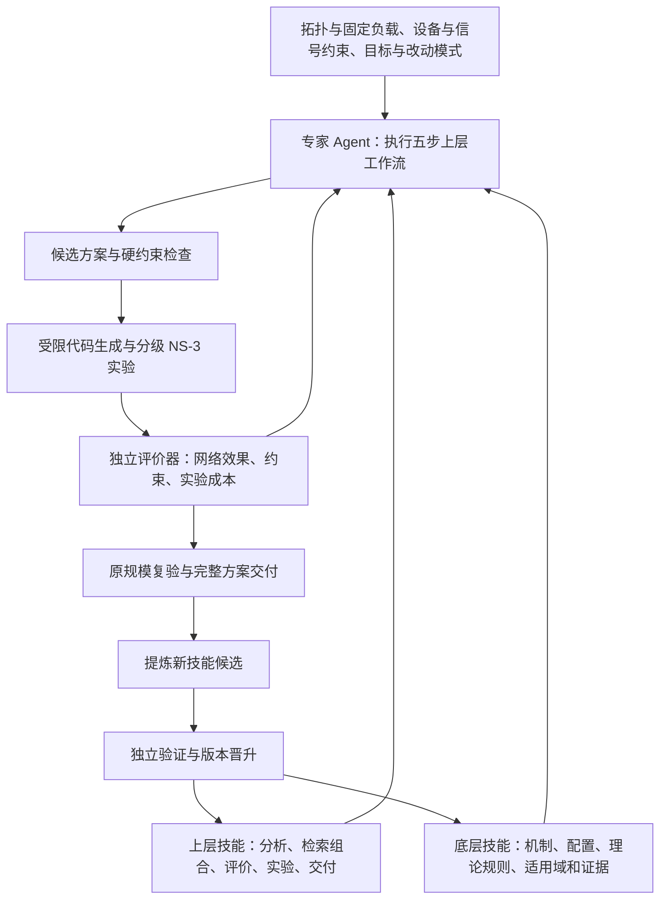

# 智算网络专家 Agent：分层技能复用项目汇报（V2）

> 日期：2026-10-16。按“Intro → Related Work → Motivation → Overview → Design → Evaluation → Discussion”组织为七页核心汇报。
>
> 每页包含可放入 PPT 的正文、配图建议和讲述提示；资料链接用于页脚或备查。本文为拟实施方案，性能与成本收益需通过实验验证。
>
> 配套：[详细实施方案](./智算网络专家Agent_分层技能复用与仿真驱动设计方案.md)。

---

## 第1页｜Intro：智算网络需要随拓扑、负载和设备条件重新设计与调优

**本页主张：我们需要把反复依赖专家的网络设计与调参，转化为可积累、可复用的能力。**

**需求是什么。** 给定网络拓扑、固定流量模式、网卡与交换机能力，输出符合约束的网卡拥塞控制算法及交换机配置；也支持对存量方案做最小改动或仅调参数。

| 典型需求 | 具体要解决的问题 |
|---|---|
| 新建智算网络 | 新拓扑下，仅允许 ECN/RTT、网卡状态和算力有限，怎样设计 CC 与交换机 ECN 水线？ |
| 存量智算网络 | 已部署 DCQCN，面对新的 All-to-All 负载，怎样通过可写参数改善网络完成时间和拥塞表现？ |

**当前的工作方式与困难：**

- **依赖专家反复试验。** 理解瓶颈、选择算法、设置参数、编写测试和分析结果需要网络与设备知识。
- **已有方案难以直接复用。** 拓扑、并发度、突发同步性和反馈时延改变，都会影响原配置；设备也未必支持方案所需信号和状态。
- **经验沉淀不完整。** 往往留下代码与最优参数，却缺少适用前提、调参理由、失败案例及验证过程。
- **验证成本随规模增加。** 新场景重复搜索，大规模仿真和实测占用时间与资源。

**任务边界：只优化网络行为；集合通信算法、分块、rank 映射和调度固定，仅提供工作负载。**

配图建议：左侧“新拓扑 / 新负载 / 设备受限”，中间“专家设计—试验—分析”，右侧“周期长、迁移难、经验难积累”。

讲述提示：算法已经很多，实际困难在于针对具体条件判断哪种方案能用、应该怎样改，以及需要多少试验才能确认。项目要自动化并复用这部分专家劳动。

---

## 第2页｜Related Work：已有研究提供机制、自动化与平台基础

**本页主张：智算及其依赖的数据中心网络已有充分基础，研究重点应放在跨任务的可信经验复用。**

| 路线与代表工作 | 已经解决什么 | 与本项目的关系 |
|---|---|---|
| 数据中心网络机制：DCQCN、TIMELY、HPCC，2015–2019 [1–3] | 分别探索 ECN、RTT、INT 等反馈驱动的拥塞控制 | 作为算法知识与基线；将所需信号、硬件功能及适用条件结构化 |
| 自动参数适配：ACC，2021；PARALEON，2024 [4–5] | 自动调整 ECN，或联合优化 RDMA 网卡 DCQCN 与交换机参数 | **最直接的调优对照**；进一步研究三种任务模式与跨拓扑、负载的技能复用 |
| 学习型数据中心 CC：RLCC，2022；NIC 实现，2023 [6] | 学习发送控制策略，并将策略压缩到网卡可执行形式 | 借鉴离线学习与设备执行；本项目还复用方案选择、诊断和验证流程 |
| 智算仿真：SimAI，NSDI 2025；SimCCL [7] | 对智算通信与网络行为建模，生成通信流描述 | **工作负载与评测支撑**；固定集合通信选择，评估网络侧改进 |
| 算法代码生成：NECC、PolicySmith；通用演化平台 OpenEvolve [8–10] | 候选生成、编译、实验反馈、代码演化及历史候选管理 | 复用搜索基础设施，补充 RDMA 约束、理论规则与跨规模验证 |
| 可编程与技能平台：DOCA PCC、DOCA Agent Skills [11] | 指定设备的编程接口，以及 API、构建和部署知识复用 | 复用工具知识；新增场景适用域、性能证据、反例与技能晋升 |

**研究切入点：把设备能力、算法机制、理论调参方法和成功失败证据组织为可执行技能，研究它们能否降低新场景中获得可靠方案的成本。**

配图建议：将前四行作为数据中心/智算研究主体，后两行用较浅底色标为“生成与开发支撑”。

讲述提示：PARALEON 已经证明 RDMA 联合调参有价值，OpenEvolve 已经能演化代码，DOCA Skills 已经能复用开发知识。我们的核心要通过对照实验建立：两层网络专家技能是否带来额外的迁移效率和可靠性。上述数据中心机制不都专门针对 AI 训练，SimAI 则是直接面向智算的支撑系统。

资料边界：PARALEON 公开仓库为 NS-3 实现；NECC/PolicySmith 的 CC 路线主要面向 Linux TCP，不能当作现成 RDMA 部署平台；SimAI 是可借用的仿真底座。

---

## 第3页｜Motivation：把可迁移的机制与解决问题的方法沉淀为技能

**本页主张：跨场景最值得复用的是“有条件成立的设计依据和实验方法”，它能帮助新任务选择更好的起点与验证路径。**

| 对问题的观察 | 为什么采用技能复用 | 本项目需要验证的预期价值 |
|---|---|---|
| 拓扑和负载不同，但反馈滞后、同步突发、恢复振荡等机制会重复出现 | 保存机制特征、理论关系和适用假设，在新场景中校准具体参数 | 减少重复搜索，缩短达到目标性能的时间 |
| 专家既掌握方案，也掌握诊断与实验顺序 | 底层复用算法与调参规则，上层复用分析、组合和实验流程 | 比单纯参数缓存获得更强的适应能力 |
| 新场景可能没有完全匹配的已有方案 | 先按设备能力筛选，再组合兼容的机制片段，保留多个候选 | 扩大约束内的可行方案覆盖，降低错误套用的风险 |
| 每次全规模测试都很昂贵 | 复用理论模型和机制测试，先小场景筛选，再原规模验证 | 在控制错杀风险的前提下减少昂贵试验 |

**一个例子：** 从少量长流转向同步 All-to-All 后，可以复用“反馈到达前的队列增长”和“多 QP 聚合恢复斜率”两条规则，检查应先调 ECN 水线还是端侧恢复参数；随后用针对性的实验验证判断。

**各组件的职责：** 大模型负责理解任务、检索组合与调用工具；技能提供条件化知识和实验方法；数学工具、约束检查器与仿真负责计算和证据。

**核心假设：在相同设备约束和网络目标下，经过验证的双层技能能够减少新任务的实验与人工成本，同时控制负迁移。**

配图建议：“可重复的网络机制 → 双层技能 → 少量有依据的校准 → 新场景验证”，下方标出“假设待实验验证”。

讲述提示：单组最优参数依赖场景；它背后的关系和诊断方法有机会迁移。技能必须包含成立条件、反例和验证步骤，才能判断何时复用、何时需要重新搜索。

---

## 第4页｜Overview：输入需求，交付有证据的网络方案

**本页主张：用两层技能组织设计流程，由确定性工具完成约束检查和实验验证。**

配套原理图：[系统总览 SVG](./system-overview.svg)；[交互时序 SVG](./interaction-sequence.svg)。

手绘展示版（16:9横版）：[高清 PNG](./system-overview-handdrawn-wide.png)；[矢量 SVG](./system-overview-handdrawn-wide.svg)。

基本元素编辑版：[修复版 Visio VSDX](./network-expert-editable-fixed.vsdx)；[旧版兼容 VDX](./network-expert-editable-legacy.vdx)。

| 输入 | 执行过程 | 输出 |
|---|---|---|
| 拓扑、固定 workload、设备能力、允许信号、目标和预算 | 需求结构化 → 检索组合 → 静态评分 → 实现与实验迭代 → 复验与交付 | 算法说明、完整 NS-3 代码与配置、网卡参考代码、交换机配置、实验与适用域证据 |

**统一支持三种模式：仅调参数 / 在既有算法上最小改动 / 在能力约束内生成新方案。**

配图建议：主流程居中，上下层技能放左侧，仿真工具和评价器放右侧；用反馈箭头突出“每次任务积累经验”。

讲述提示：系统在设计与调优阶段工作。输出的控制器由网卡和交换机执行；Agent 管理需求、方案和实验。仿真通过、SDK 编译通过与实机验证分别标记，交付物明确证据等级。

---

## 第5页｜Design：五步工作流与两层技能如何落地

**本页主张：将专家的分析过程落实为输入、产物和检查条件明确的工作流。**

| 步骤 | 内部设计 | 关键产物与检查 |
|---|---|---|
| **1. 需求解析** | 角色 Prompt + 结构化需求；提取显式约束、隐含依赖和未知能力 | `RequirementSpec`；冻结任务模式、固定负载与评价目标 |
| **2. 检索与组合** | 硬能力先过滤，拓扑/负载/机制特征再匹配；高匹配复用，低匹配组合 | 多个候选及技能依赖；检查信号链、状态总量、动作冲突 |
| **3. 静态评价** | 评价场景匹配、历史证据、资源余量、修改成本与不确定性 | 多维评分和初始配额；分数只作先验，硬约束不能加权抵消 |
| **4. 实现与迭代** | 受限代码/配置生成，编译和行为测试；n 个独立仿真动态分配预算 | 实验结果、理论假设、下一轮候选；保留不同机制的探索机会 |
| **5. 交付与积累** | 原规模复验，输出完整代码/配置/证据；提炼成功经验与失败反例 | 完整方案包、新技能候选；跨任务独立验证后晋升 |

**底层技能结构：** `机制/代码 + 所需能力 + 适用场景 + 参数关系 + 调优规则 + 成功/失败证据 + 版本`。

**上层技能结构：** `输入契约 + 分析与工具调用流程 + 输出契约 + 检查条件 + 失败处理 + 历史效果`。

**第四步的三个关键机制：**

- **理论指导调参：** 观测异常 → 推导假设 → 少量有方向的候选 → 实验验证/反证，结合局部数值优化。
- **多候选并行：** 静态分决定起点，实测收益、不确定性、机制多样性和成本决定后续配额；提前保留最终复验预算。
- **逐级验证：** 瓶颈小场景 → 层次结构代理 → 原拓扑；检查关键特征和候选排序，发现失真就扩大或跳过代理。

配图建议：左侧五步竖向流程，右侧突出两个技能结构和“理论—实验”循环；复杂接口与公式放详细方案。

讲述提示：Prompt 固定角色和边界，执行权限与检查器落实约束。OpenEvolve 可用于受限代码演化，Optuna 可用于局部参数搜索；本项目负责设备契约、技能与网络实验逻辑。新技能也要验证，不能让 Agent 自行修改评分器和晋升标准。

---

## 第6页｜Evaluation：证明网络方案有效，也证明技能复用节省成本

**本页主张：在相同工作负载、约束和预算下，比较获得可靠方案的质量、成本和迁移风险。**

**验证任务与对照：**

| 验证任务 | 场景设置 | 主要比较 |
|---|---|---|
| 存量参数调优 | DCQCN＋ECN，固定 All-to-All，限制实际可写参数 | 原/专家配置、冷启动数值优化、历史参数缓存、双层技能 |
| 受限新方案设计 | 新拓扑，只允许 ECN/RTT，给定状态与事件预算 | 同一代码骨架和评价器下的无技能 Agent、OpenEvolve、技能增强设计 |
| 跨场景迁移 | 留出拓扑、负载、规模或设备约束组合 | 普通 RAG、底层技能、上下层均复用；另测不兼容场景的拒绝能力 |

**四组核心指标：**

- **方案效果：** 完成率、通信完成时间、FCT/尾延迟、有效吞吐，以及队列、PFC、重传和公平性约束。
- **实验效率：** 达到同等性能所需的 trial 数、CPU-hours、原规模评测次数、墙钟时间、LLM 成本和人工介入。
- **迁移可靠性：** 留出任务成功率、相对冷启动的负迁移率、约束违规率、代理误淘汰优质候选的比例。
- **积累价值：** 新任务复用次数、重复诊断减少量、计入技能构建成本后的累计收益。

**实验纪律：** 固定集合通信契约和评价器，按任务/拓扑划分留出集，多次独立重复并报告置信区间；未完成流和失败试验计入结果。搜索成本包含代理和最终复验成本，硬件观测不可用的变量不能供控制器使用。

**关键消融：** 去掉理论规则、只选静态最高分、只保存参数、去掉反例/适用域、简单按节点数缩比、冻结上层工作流。

**计划展示三张主图：** “性能—累计实验成本”曲线、“新场景迁移收益与失败率”对比、“代理排序与原规模排序一致性”图。均待实际实验产生。

配图建议：左侧三类任务，右侧三张待验证图的示意框，底部突出“同等性能下成本降低，且可靠性不恶化”。

讲述提示：目标包含两个层次：网络配置本身要有效，技能复用还要比无技能搜索更省成本。最终推荐要回到原始拓扑和固定负载验证；1024 端点是规划中的验证规模，运行资源与耗时先做基准测量。

---

## 第7页｜Discussion & Future Work：从一次调优走向可持续积累的专家能力

**本页主张：先完成一个可复现的业务闭环，再围绕迁移、组合和证据开展更深入研究。**

**近期落地顺序：**

1. **首版闭环：** 现有 DCQCN＋ECN、固定 All-to-All、少量技能和统一评价器，完整跑通五步工作流。
2. **复用验证：** 扩展拓扑与负载，完成缓存/RAG/冷启动对照，加入多候选和代理有效性检查。
3. **设计扩展：** 受限新算法、完整原规模验证，随后接指定设备 SDK 与小型实网校准。

**未来深化的研究问题：**

| 方向 | 进一步研究什么 | 如何判断有进展 |
|---|---|---|
| **机制驱动的技能迁移** | 用 BDP、反馈时延、fan-in、同步性等机制特征，学习哪些经验可迁移 | 留出任务所需试验更少，负迁移更低 |
| **可验证的技能组合** | 分解控制规则，识别信号、状态和控制环冲突，结合简化模型性质检查 | 未见组合的可行率与全规模效果提高，组合失败减少 |
| **可信的规模映射** | 确定应保留的拥塞特征，估计代理误差，主动选择升级规模的时机 | 排序错误与错杀率降低，总实验成本下降 |
| **上层工作流持续学习** | 从多任务轨迹学习诊断顺序、实验选择和停止规则 | 在独立任务集上优于旧工作流，排除增加预算带来的假收益 |
| **仿真到设备与长期治理** | 校准反馈/缓存/量化语义；管理固件变化、技能合并与退役 | 降低仿真到实网排序偏差及过期技能引发的失败 |

**需要持续回答的边界问题：**

- 没有足够匹配的技能时，如何合理扩大探索，而不是勉强复用？
- 小场景没有覆盖的全网耦合，如何及时发现并提升验证级别？
- 如何确保技能库越积越有用，而不是积累过期参数和重复经验？
- 如何区分“已验证收益”“条件性推断”和“仍待验证的方案”？

**预期形成的资产：** 可运行专家 Agent、双层技能库、固定工作负载与评测基准、可复现方案代码，以及由实验证据支持的论文/专利方向。

配图建议：“首版闭环 → 跨场景复用 → 受限新设计 → 指定硬件验证”的阶段线，下方放三条核心研究线：迁移、组合、可信验证。

讲述提示：主线始终是可验证的双层技能复用。能力约束、理论调参和分级仿真共同支撑这个主张；未来从可测量的迁移收益与实验成本入手深化，集合通信层仍保持既定边界。

---

### 资料索引（页脚与备查，不计入七页）

1. **DCQCN**, SIGCOMM 2015：[论文页](https://www.microsoft.com/en-us/research/publication/congestion-control-for-large-scale-rdma-deployments/)。
2. **TIMELY**, SIGCOMM 2015：[论文页](https://research.google/pubs/timely-rtt-based-congestion-control-for-the-datacenter/)。
3. **HPCC**, SIGCOMM 2019：[项目](https://hpcc-group.github.io/)；[代码](https://github.com/alibaba-edu/High-Precision-Congestion-Control)。
4. **ACC: Automatic ECN Tuning for High-Speed Datacenter Networks**, SIGCOMM 2021：[论文](https://conferences.sigcomm.org/sigcomm/2021/files/papers/3452296.3472927.pdf)。
5. **PARALEON**, ICNP 2024：[论文](https://zhangmenghao.github.io/papers/ICNP2024-Paraleon.pdf)；[公开 NS-3 实现](https://github.com/czt8888/Paraleon-ns3)。
6. **RLCC / NIC 实现**, 2022–2023：[RLCC 代码](https://github.com/NVlabs/RLCC)；[CCGrid 2023 论文页](https://research.nvidia.com/publication/2023-01_implementing-reinforcement-learning-datacenter-congestion-control-nvidia-nics)。
7. **SimAI**, NSDI 2025：[系统与论文入口](https://github.com/aliyun/SimAI)；[SimCCL](https://github.com/aliyun/SimCCL)。
8. **NECC**, ICC 2025：[代码与论文信息](https://github.com/zmrui/NECC)。
9. **PolicySmith**, HotNets 2025：[论文](https://arxiv.org/abs/2510.08803)；[代码](https://github.com/ldos-project/policysmith)。
10. **OpenEvolve**：[代码与机制说明](https://github.com/algorithmicsuperintelligence/openevolve)。
11. **NVIDIA DOCA**：[PCC 文档](https://docs.nvidia.com/doca/sdk/DOCA-PCC/index.html)；[Agent Skills](https://github.com/NVIDIA-DOCA/doca-skills)。

补充研究基础：[CCmatic，NSDI 2024](https://www.usenix.org/conference/nsdi24/presentation/agarwal-anup)可用于简化模型内的性质检查；[Optuna](https://github.com/optuna/optuna)可支撑局部参数搜索。更完整的算法、接口、验证条件与工程排期见配套详细方案。
