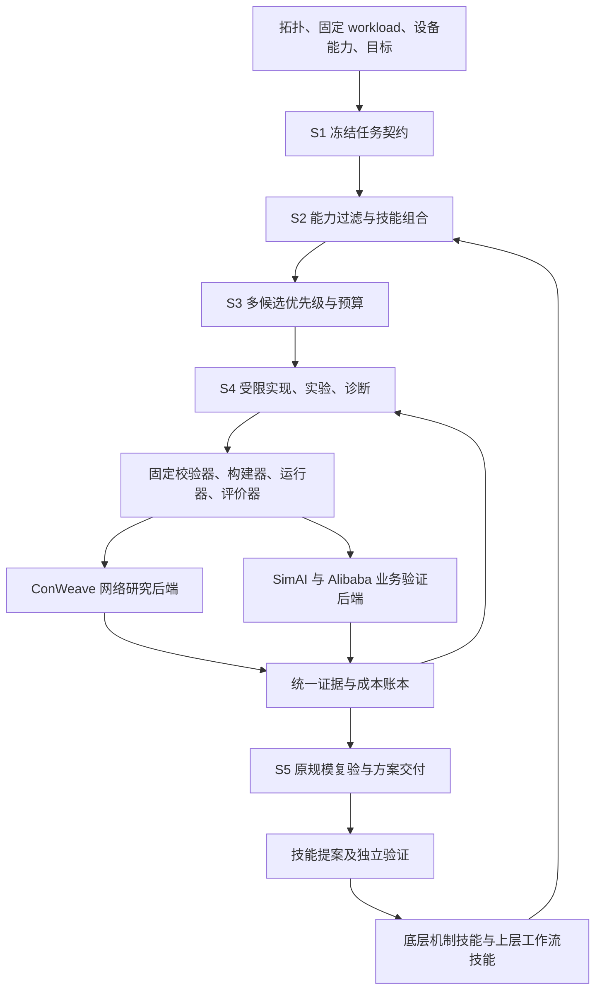

# 智算网络专家：交换机、RNIC 拥塞控制与多路径开发计划

编制日期：2026-10-23。版本：v1.0，实施规划。

本计划以资料包中的分层技能设计、可行性研究和 RDMA 多路径调研为基础，并结合本机两个 ns-3 分支的只读源码核查。交付目标是一个能提出、验证、解释和复用 RDMA 网络优化方案的专家系统。本文中的接口、目录、测试、工期与性能目标均为待实施设计；本次编制没有构建仿真器、运行性能实验或修改后端源码。

**建议采用 ConWeave 分支作为网络机制研究主后端，采用 ccl-rdma-lab 锁定的 SimAI／Alibaba 分支验证固定集合通信负载。先交付 DCQCN＋ECN 参数优化闭环，再开放受限 CC 与多路径策略开发。** 两个后端共享契约、实验记录和评价口径，分别维护 C++ 适配层。

配套文件：[42 项开发任务拆分表](./开发任务拆分.csv)、[排期核算](./排期核算.json)、[编制依据与源码核查记录](./编制依据与源码核查记录.json)。净工作量合计 159 人日；按网络开发 A、工具开发 B 各最多 1 人，评测 C 最多 0.5 人的资源上限，当前依赖下可构造约 23 个工作周的开发排程，建议交付窗口留到 25–26 周，并单列 16 人日工作量风险储备。W 表示启动后的相对工作周，不代表已承诺的日历截止日期。人日总量不能直接除以总人数当作工期。

## 1. 目标、范围及相对原方案的变化

### 1.1 两个必须同时回答的问题

1. **网络问题：** 在固定拓扑／业务负载和设备能力下，能否找到满足完整性、资源预算与性能约束的交换机、RNIC CC、多路径方案？能够说明收益来自哪里、在什么条件下失效，以及需要哪些设备能力。
2. **专家系统问题：** 将底层机制知识与上层专家工作流共同复用，能否在新任务上减少试验次数、CPU 时、模型调用成本和人工处理时间，同时控制负迁移？需要与等预算冷启动、历史参数缓存、普通 RAG 等对照。

网络收益和技能复用收益分别验收。没有显著网络提升的任务也可以产生可信的适用域与反例记录；不能把一次失败配置泛化为“该算法不可行”。

### 1.2 本轮授权范围

原设计第 1.2 节默认冻结 LB 与 PFC。本轮用户明确允许研究“交换机、RNIC 拥塞控制和多路径”，因此将这些能力纳入项目范围，但每个任务仍需生成明确的修改白名单。

| 层次 | 可研究、可优化内容 | 每次任务必须固定或声明的边界 |
|---|---|---|
| 交换机 | ECN 水线与标记、PFC/headroom、缓冲分配、已有 LB 参数、授权的转发与反馈策略 | 端口能力、缓冲总量、队列与优先级映射、可编程功能、元数据和控制报文成本 |
| RNIC | DCQCN 等已有机制调参、受限控制公式／状态机、反馈处理、可支持的路径控制 | 可观测信号、状态大小、数值精度、计时器、乱序及可靠性能力 |
| 多路径 | ECMP 基线、flowlet／拥塞感知路径策略、交换机重排、具备能力时的 RNIC 路径选择 | 决策位置、切换粒度、路径反馈、重排与重传语义，实际硬件支持范围 |
| 集合通信与训练 | 提供固定工作负载，用于验证网络优化效果 | 算法、依赖关系、分块、rank 映射、并行策略、库版本／配置、库层 QP 与通道数、计算通信调度、业务数据量 |

RNIC 内部传输状态或网络路径映射的研究，不能隐式改变通信库层 QP／通道数。需要改变库层配置才能工作的方案必须作为另一个范围明确的任务，不能计入当前网络方案的收益。

首版保留两个业务入口：存量网络的参数调优；新拓扑下、设备能力受限的网络策略设计。没有具体 ASIC／RNIC 型号时，输出设备中立配置和能力需求；厂商 CLI、SDK 代码与实机部署在设备映射后交付。

### 1.3 三种执行模式

| 模式 | 可执行修改 | 门控与失败退出 |
|---|---|---|
| `parameter_only` | 白名单内已有参数；控制公式、协议与信号固定 | 对配置字段和二进制 hash 检查；无可行结果时给出已测试范围、最好可行配置及差距 |
| `minimal_change` | 指定策略接口内的有限规则和状态变更 | 同时限制组件、状态字节、信号、反馈开销、操作复杂度；按 patch 白名单验收 |
| `new_design` | 能力契约允许的机制组合和新策略 | 仍受固定 workload、硬件预算、可靠性与评价器约束；不自动开放整个仿真内核 |

模式由工具执行，不靠 Prompt 自觉遵守。`parameter_only` 失败不能自动升级模式；`new_design` 也不意味着可以读全局仿真状态或改评价器。

## 2. 仓库选择与版本基线

### 2.1 主线和辅助库的职责

| 仓库／分支 | 本项目用途 | 采用方式与边界 |
|---|---|---|
| [zbdhz/conweave-ns3-rdma-newly](https://github.com/zbdhz/conweave-ns3-rdma-newly) | 首选网络机制后端；交换机、CC、LB、重排和可靠性对照 | 基于本地核查快照派生；先修实验接口与观测，再改策略 |
| [zbdhz/ccl-rdma-lab](https://github.com/zbdhz/ccl-rdma-lab) | 业务验证的版本锁定、运行入口与复现组织 | 使用其明确锁定的 SimAI、SimCCL、ns-3 组合，先复核最小案例 |
| [zbdhz/SimAI](https://github.com/zbdhz/SimAI)、[zbdhz/SimCCL](https://github.com/zbdhz/SimCCL) | 固定集合通信工作负载、依赖驱动业务验证 | 审核依赖与完成回调；FlowModel CSV 本身不能证明完整保留 DAG |
| [zbdhz/ns-3-alibabacloud](https://github.com/zbdhz/ns-3-alibabacloud) | SimAI 的网络后端；第二套网络语义校准 | 从锁定的 `simai-lab-baseline` 派生；本地 master 只作源码参考 |
| [conweave-project/conweave-ns3](https://github.com/conweave-project/conweave-ns3)、[HPCC 原始实现](https://github.com/alibaba-edu/High-Precision-Congestion-Control) | 对照上游机制、协议假设与实现来源 | 需要时逐项比较、移植，不整体混合旧内核 |
| [zbdhz/NS3-MP-RDMA](https://github.com/zbdhz/NS3-MP-RDMA) | RNIC 端多路径的后续机制参考 | 首版不接入；先审查版本、可靠性及接口差异，再单列移植任务 |
| [zbdhz/REPS_EuroSys_Artifact](https://github.com/zbdhz/REPS_EuroSys_Artifact) | REPS 路径机制参考及独立结果对照 | 使用 htsim 路线，不能作为可直接链接的 ns-3 模块 |
| [Alibaba dev/qp](https://github.com/aliyun/ns-3-alibabacloud/tree/dev/qp) | 后续研究模块化 CC／QP 接口的候选来源 | 分支接口需要独立核查；不作为现有本地 master 已具备的能力 |

P0 记录各依赖许可证、第三方头文件和修改来源，交付时保留原许可与归属。上表是用途选择，不代表所有仓库已经编译或论文结果已经复现。

### 2.2 已核查的本地版本

| 对象 | 路径／版本 | 事实与处理 |
|---|---|---|
| ConWeave 本地树 | `/home/gtx/rdma_project/ns-allinone-3.19/ns-3.19`；HEAD `236a801a00e35de9078635e04acae2f701c21ded` | 存在用户修改与未跟踪实验脚本／流量；不能只记录 commit，也不能清理或覆盖 |
| Alibaba 本地 master | `/home/gtx/rdma_project/ns-3-alibabacloud`；HEAD `7e3cb5b88c99abcb582c5abc3919484a4805111b` | 本次核查时工作区干净；`simulation/VERSION` 为 3.36.1 |
| SimAI 联合基线 ns-3 | `simai-lab-baseline@3e0c7c1bfbbe9f77890ddcf5e5b9c79fc6dd7437` | 与 master 区分；后续从联合基线验证 |
| 联合基线 SimAI／SimCCL | SimAI `0154b87f3a855726a83bcbf0847cb9549cc62724`；SimCCL `fd7cd57d16f9bd42e3ccb70911c977e18ec294b9` | 来自此前核查的 ccl-rdma-lab 版本清单；P0 再校验引用、提交和依赖完整性 |

保留用户工作区后，创建独立开发副本或工作树；保存 tracked diff、相关未跟踪文件快照、子模块版本和文件 hash。Git worktree 不会自动带入未提交／未跟踪文件，应明确哪些用户修改纳入实验基线。每次实验绑定快照 hash，不能仅绑定上述 HEAD。

ConWeave 是旧 ns-3/Waf 工具链，部分构建脚本含 Python 2 语法；运行脚本又使用 Python 3。应分别验证构建与运行解释器，优先锁定可复现容器或独立环境。已有 `gpu-dev` 环境用于 PyTorch／CUDA 学习，不承担旧 ns-3 构建兼容性。现代 Alibaba CMake 工具链独立锁定。原资料第 14 节的 `ns3-eecn`、`rdma-congestion-ops.h` 等接口属于原方案背景，需要在当前后端重新适配。

## 3. 首先处理的能力约束与源码缺口

### 3.1 能力矩阵先于搜索空间

| 组合／功能 | 当前源码证据 | 首版处理 |
|---|---|---|
| DCQCN＋ECMP | 模式开关与实现存在 | 首个拟验证基线；P0 冒烟通过后才标为可运行 |
| HPCC／TIMELY／DCTCP 与其他 LB | 有各自模式开关 | 每个组合独立验证；不做未经验证的 CC×LB 全组合 |
| DCQCN＋ConWeave | C++ 允许 | 校验 VOQ、反馈延迟与可靠性后加入对照 |
| 非 DCQCN＋ConWeave | `scratch/network-load-balance.cc:1120` 明确拒绝 | 标为不支持；直接删除限制不构成支持，需要重新处理目的 ToR 重排引入的反馈语义 |
| PFC／IRN | `run.py` 要求二选一 | 两条可靠性路线分开记录；同时开启或同时关闭不进入初始搜索 |
| 独立 RoCE CNP | ConWeave `ReceiveCnp()` 直接退出，实际在 ACK/NACK 携带通知位 | 能力字段记录真实反馈语义，不能用真实 CNP 定时模型解释尚未实现的行为 |
| 自定义路径反馈／重排 | 部分机制依赖 Tag、控制包、VOQ | 列出信息来源、传输延迟、字节与状态成本；不得增加无成本全局真值 |

模式标识也要映射：CC `dcqcn=1/hpcc=3/timely=7/dctcp=8`；LB `fecmp=0/drill=2/conga=3/letflow=6/conweave=9`。这些是所审计 ConWeave 分支的值，不是跨后端统一枚举。

### 3.2 必须排入 P0／P1 的修正

| 工作 | 实际入口或现象 | 实施与验收 |
|---|---|---|
| 统一组合预检 | Python 入口拒绝范围小于 C++ | adapter 的能力白名单以更严格的实际约束为准，启动前输出原因 |
| ECN 阈值单位 | 两套 `ConfigEcn()` 都将输入乘 1000 | 标准字段使用 bytes；适配层显式转换、检查可表示性，禁止隐式取整 |
| 队列观测 | 旧监控被 `#if(false)` 屏蔽，读取 legacy `egress_bytes` | 绑定真实 MMU 计数；物理队列、共享池、ingress/headroom 账本分开 |
| 完整速率轨迹 | `ChangeRate()` 不能覆盖 DCQCN／TIMELY／DCTCP 多处直接赋值 | 先加入统一记录 helper 覆盖所有写点，不先改变 pacing；以后再抽象控制器 |
| PFC 暂停时长 | 原事件不等于每优先级实际暂停区间 | 增加 priority、暂停到期／恢复事件；按端口和 PG 求区间并集 |
| 完成与停止语义 | 只解析已完成流会偏向未完成方案 | 流／字节对账、剩余 QP、停止原因、drain 策略纳入评价前门控 |
| 种子与实验标识 | 脚本的随机实验名与配置 seed 不一致 | task/trial ID 与 ns-3 seed/run 分开，记录独立随机流分配 |
| 端口／数组边界 | 本分支交换机、设备存在固定端口容量 | 在拓扑预检时检查度数、端口 ID 和优先级范围，不到运行时碰界 |

具体记录来源见[核查索引](./编制依据与源码核查记录.json)。源码行号只对应本次快照，后续以符号与版本定位。

## 4. 系统分层与拟建工程结构



首版使用一个 Python 状态机编排 S1–S5，SQLite 管结构化记录，Git 管代码／技能版本，文件目录保存输入与原始结果。采用 JSON Schema 做输入输出契约，可在 Python 内使用类型校验库；具体依赖在 P0 锁定。不以向量数据库、Web 平台、多 Agent 自由对话或 ns3-ai 接入作为启动条件。LLM 在作业外提出方案和诊断，不在每包事件路径调用。

建议新建 `/home/gtx/rdma_project/rdma-network-expert/`，以下是待创建结构，不是本次已生成的代码：

```text
rdma-network-expert/
  contracts/                 # schema、IR、单位、能力和状态码
  runtime/                   # S1–S5 状态机、预算、恢复、工具网关
  adapters/conweave/         # validate/render/build/run/collect
  adapters/simai_alibaba/    # 联合版本和依赖 workload 适配
  policy_core/               # 可复用、无 ns-3 对象依赖的受限策略
  skills/mechanisms/         # 底层：原理、实现、参数关系、证据、反例
  skills/workflows/          # 上层：输入、步骤、工具、退出与失败处理
  evaluator/                # 固定解析、完整性、指标、统计、Pareto
  workloads/                # 微基准、开放环、依赖 DAG、生成器版本
  experiments/              # 场景矩阵、基线、任务划分、预登记目标
  tests/                    # 有协议含义的事件、守恒与集成测试
  tools/                    # CLI、复现、导出、版本审计
  docs/                     # 能力矩阵、模型差异、实验与交付规范
  runs/<task>/<trial>/       # 只追加证据；不进入普通代码提交
  artifacts/                # 内容寻址输入、二进制、patch、报告
```

仿真后端保留独立仓库／精确快照，通过 manifest 指向。共享的是约束和算法核心，移植工作以小型独立变更完成，避免整体合并两套 `point-to-point` 目录。

## 5. 数据契约、接口与实验谱系

### 5.1 必须实现的对象

所有对象包含 `schema_version/id/content_hash/source_refs`，时间戳不参与语义 hash。hash 输入采用稳定字段排序与单位规范化。未知值用 `null`＋来源／待办，不表示无限资源。

| 契约 | 必需内容 | 验证者 |
|---|---|---|
| `RequirementSpec` | 任务模式、目标、硬限制、修改白名单、预算、任务阶段 | schema＋范围检查器 |
| `CapabilityProfile` | 信号、控制动作、缓冲／状态／计时器预算、可编程能力、反馈语义、后端支持矩阵 | 能力检查器 |
| `WorkloadContract` | 开放环／依赖驱动、rank/host/endpoint 映射、字节量、DAG、固定库配置、完成语义 | workload 校验器 |
| `CandidateSpec` | 机制家族、参数、策略 patch、技能版本、假设、依赖及所需设备能力 | 组合检查器 |
| `ConstraintReport` | 每条约束的结果、证据位置、未知项；`pass/fail/unknown` | 固定门控 |
| `ExperimentPlan` | 任务集合、保真级别、seed/run、基线、预算、停止规则、最终留出 | 计划检查器 |
| `TrialRecord` | 输入版本、命令、资源、状态、原始产物、指标、失败原因、成本 | runner＋evaluator |
| `HypothesisRecord` | 观察、机制解释、带单位公式、参数方向、预期副作用、反证条件 | 诊断与试验前登记 |
| `FidelityCertificate` | 代理构造、保留／丢失特征、排序误差、错杀审计、适用范围 | 代理校验器 |
| `SolutionPackage` | 方案、配置／代码、适用条件、对照、全部复现依赖、能力与证据等级 | 交付检查器 |
| `SkillProposal` | 新技能、来源试验、适用域、反例、晋升所需留出任务 | 独立验证器 |

沿用 `ControllerIR` 和 `SwitchConfigIR`；本轮拟增加 `PathPolicyIR`、`ReliabilityProfile`。前者明确交换机／RNIC 决策、流／flowlet／包粒度、path ID／EV、反馈、切路条件和重排成本；后者明确 ACK/NACK、PFC、IRN、重传、顺序与完成语义。统一 IR 不意味着后端支持所有字段，无法实现的字段返回 `unsupported`。

### 5.2 单位与示例

对外标准化：容量用 bytes、速率用 bit/s、时刻／延迟用整数 ns，概率用 `[0,1]`，计数用无符号整数；报告可转换为秒／微秒／Gbps，但字段名标明单位。禁止用“KB”同时代表 1000 和 1024 字节。

下面是可理解字段关系的设计示例，省略 hash，尚不是完整可运行输入：

```json
{
  "schema_version": "0.1",
  "task_id": "incast-dcqcn-ecn-001",
  "mode": "parameter_only",
  "backend": "conweave-audited-snapshot",
  "workload_contract": "inputs/incast-fixed.json",
  "capability_profile": "devices/simulation-reviewed.json",
  "control": {
    "cc": "dcqcn",
    "lb": "ecmp",
    "reliability": "pfc",
    "mutable_fields": ["switch.ecn.kmin_bytes", "switch.ecn.kmax_bytes", "cc.dcqcn.alpha_gain"],
    "frozen_fields": ["workload", "topology", "collective_config", "pfc_profile"]
  },
  "objective": {"primary": "p99_fct_ns", "constraints_ref": "inputs/slo.json"},
  "budget": {"search_cpu_hours": null, "final_cpu_hours": null},
  "status": "draft_requires_pilot_budget"
}
```

参数实际名称、范围与可调性由适配层核查后映射；示例没有给出现成设备的有效水线或 DCQCN 推荐值。草稿中的空预算必须在试验启动前填定。

### 5.3 后端接口与结果状态

拟定接口：`capabilities()`、`validate(task,candidate)`、`render()`、`build(snapshot)`、`run(experiment)`、`collect(raw)`。编译与运行输入均来自校验后的结构化文件；避免由模型拼任意 shell 命令。

状态机：`draft → validated → queued → building → running → collecting → evaluated → archived`。退出类别至少包含：`unsupported / compile_error / protocol_error / runtime_error / timeout / infrastructure_error / integrity_error / completed`；`completed` 后再标 `feasible/infeasible` 和性能比较结果。超时、未完成流或解析错误不能变成“低分但有效”的性能数据。基础设施错误可以有限重试，候选自身的错误记入候选成本并保留首个失败记录。

每个 trial 绑定：源码快照与 patch、adapter、编译器／flags／依赖、二进制、拓扑、workload、候选配置、约束、随机种子、评价器版本和原始结果 hash。构建缓存键含所有编译输入；只改运行参数可以复用同一只读二进制。任务恢复只恢复编排状态，不假定 ns-3 支持任意仿真时刻检查点。

## 6. 网络侧开发工作包

### 6.1 交换机：从配置搜索到受限策略

1. 在 ConWeave 的 `switch-mmu.*` 与 `switch-node.*` 核对 `ShouldSendCN`、入／出队准入、PFC 暂停／恢复、共享池和 headroom 的完整调用链；对 Alibaba 逐项建立语义映射。
2. 参数阶段只开放后端真实支持且任务允许的 ECN、缓冲、headroom、动态阈值参数。以每端口／每优先级是否可独立配置为能力项，不假设字段粒度。
3. 增加实际队列峰值、积分、ECN 分母、PFC 区间、drop 原因等观测。共享池账本和端口队列统计可能重叠，不能直接求和当物理总缓存。
4. 最小规则阶段选择一个局部 ECN 或路径规则，不同时改整套 MMU。状态、计数精度和报文开销由 IR 限定。

验收：容量与缓冲守恒；无下溢／越界；拥塞解除后恢复；低负载不异常暂停；新配置对未授权端口／优先级无影响；观测开关不改变确定性结果。

### 6.2 RNIC CC：保留行为后抽象接口

第一步补齐 `rdma-hw.cc` 的反馈和速率记录，覆盖 `ReceiveAck`、`cnp_received_mlx`、HPCC／TIMELY／DCTCP 处理和直接速率赋值点。区分 ECN 引发与乱序引发的通知；记录每次决策的旧速率、新速率、触发原因和 QP 生命周期。

第二步由开发者手工建立固定适配层，再提供拟定的 `OnAck`、`OnFeedback`、`OnTimer`、`OnQpClose` 策略接口。控制器只得到本地可观测字段和明确的计时器 API；不能拿到完整 `RdmaHw*` 后绕过限制。以已有机制回归等价性作为重构门槛，最后接入一个受限策略原型。

首个研究方向建议选择“ECN/RTT 条件下的恢复规则或参数关系”，先固定 ECMP 与可靠性，以便解释原因。新增协议、独立 CNP 生成／抑制定时模型、任意 CC 与 ConWeave 兼容不纳入首轮 159 人日承诺。

验收：速率上下界、量化、定时器取消、迟到 ACK、QP 销毁、空闲后恢复、无反馈／持续反馈等边界正确；状态字节和操作数可核算。仿真宿主 CPU 时间不能替代 RNIC 每事件执行延迟。

### 6.3 多路径：明确决策与可靠性依赖

顺序采用 ECMP → 一个已验证 flowlet／拥塞感知方案 → ConWeave 对照 → 一个受限策略原型。主线的新增原型优先放在交换机侧；RNIC 端逐包 EV 控制作为能力允许后的扩展。

ConWeave／CONGA 在 `SendToDev()` 等位置经 `RouteInput()` 和回调处理，不能只改 `GetOutDev()`。需要联查 `conga-routing.*`、`letflow-routing.*`、`conweave-routing.*`、`conweave-voq.*` 以及 QBB 入／出队路径。

| 粒度／位置 | 必须观测 | 必须验证 |
|---|---|---|
| 流级 ECMP | 哈希结果、路径与活跃流负载 | 同流一致、碰撞热点、端口映射稳定 |
| flowlet | 边界间隔、切换时刻、路径时延差 | 边界假设、乱序、短流与长流、路径不对称 |
| 逐包／拥塞感知 | 信息时延、控制字节、选路原因 | 陈旧反馈、振荡、乱序深度、重传和故障恢复 |
| 目的交换机重排 | VOQ 数量、占用、等待／释放、超时 | 内存预算、无永久阻塞、接收完成正确、对 CC 反馈的影响 |
| RNIC 路径控制 | path/EV 状态、反馈关联、路径探测 | 设备 API 实际粒度、QP 生命周期、可靠性与库配置固定 |

首次联合调优分四步：固定 CC 调交换机；固定交换机调 CC；固定前两者比较 LB；最后才搜索少量已验证的交互参数。每步保留单因素对照，判断收益来自速率控制还是路径分散／重排。

## 7. S1–S5 专家工作流实现

| 技能 | 具体程序与工具 | 输出及退出条件 |
|---|---|---|
| S1 `AnalyzeRequirements` | 读拓扑、流量与设备 profile；提取明确／推导／未知项；单位、端点映射、修改范围校验 | 冻结 RequirementSpec 与 WorkloadContract；必要能力缺失时标出依赖，仍可完成已知部分的静态分析 |
| S2 `RetrieveComposeCandidates` | 先硬过滤信号、可靠性、硬件资源与后端组合，再按拓扑／负载特征检索机制和反例 | 有来源的候选池、组合依赖图、ConstraintReport；没有可行候选则解释缺项 |
| S3 `AssessAndPrioritize` | 使用历史证据、机制差异、适用域距离、实现成本和不确定性安排初始机会 | 多候选及初始预算；静态第一名不等于最终胜者 |
| S4 `ImplementEvaluateRefine` | 受限生成／配置、固定校验、编译、运行、观测、假设登记、分级试验 | 每轮可追踪的 Trial/Hypothesis；达到停止条件或预算后交出证据完整的候选集合 |
| S5 `DeliverAndConsolidate` | 锁定候选，原规模与独立留出复验，生成部署条件、反例、复现包和技能提案 | SolutionPackage 可复现；技能需另行验证后晋升 |

模型输出使用 schema 约束，字段要引用具体证据 ID。工具返回确定的错误类别；模型可以修改候选与诊断，不能修改固定评价器、输入 workload、硬约束或晋升阈值。保留模型名称／版本、Prompt 版本、工具调用和费用统计；回放依赖已存输出，不要求外部模型每次生成完全相同的文本。

第一个演示任务：固定 32 端点代理拓扑与 incast／All-to-All 开放环负载，使用已验证 DCQCN＋ECMP＋PFC；先优化 3–6 个可写参数。演示过程必须包括需求冻结、候选理由、至少一次有反证条件的诊断试验、完整性门控、基线对照和方案包。结果可以是“当前预算内没有显著提升”，仍需如实完成闭环。

## 8. 双层技能库与理论驱动迭代

### 8.1 初始资产

| 层次 | 首批拟建技能 | 必需证据 |
|---|---|---|
| 底层机制 | DCQCN＋ECN 配合、BDP／反馈时延与队列、PFC/headroom、ECMP 热点、flowlet 乱序边界、ConWeave 重排预算 | 来源、实现版本、适用域、能力依赖、参数关系、至少一个正例和一个失效／边界案例 |
| 上层工作流 | 瓶颈定位、参数模式闭环、可靠性诊断、代理选择、跨后端校准、独立交付 | 输入输出、工具顺序、退出条件、失败分支、成本记录及跨任务验证 |

首版使用结构化特征过滤＋文本检索，SQLite 保存关系索引，Git 保存技能定义。可加入向量检索改善召回，但不能绕过能力过滤。没有实验的条目标为 `prior_only`，可以用于提出假设，不计入“已验证技能”。

特征至少包括：拓扑层次、过订阅、端口速率、路径数量／不对称、共享瓶颈、fan-in/out、同步性、流大小/BDP、活跃 QP 数、背景流与可靠性。不能仅凭“Clos＋All-to-All”匹配。

### 8.2 假设记录必须在试验前形成

例如，观察到队列峰值与 PFC 暂停增多时，先检查反馈到生效的时延和超额注入，而不是直接搜索全部参数：

- `BDP_bytes = link_bps × RTT_ns / (8 × 10^9)`，注明使用基础 RTT 还是含队列 RTT。
- 持续超额注入的粗略积压为 `excess_bytes ≈ max(0, aggregate_arrival_bps − service_bps) × feedback_delay_ns / (8 × 10^9)`。这是诊断近似，需要考虑突发、暂停、共享池及排空。
- 排队预算可由 `queue_budget_bytes ≈ service_bps × queue_delay_budget_ns / (8 × 10^9)` 推出初始量级，再检查硬件水线粒度与 headroom。

HypothesisRecord 写明：使用哪段 trace、认为哪个机制导致问题、拟调哪个参数、预期哪项指标朝哪个方向变化、可能牺牲什么、什么结果会推翻假设、最多使用多少预算。公式给初始范围与方向，不给未经验证的万能阈值。PFC headroom 还涉及链路与设备流水、传播、反应时间和包长，不能只套 BDP。

对采用周期性 EWMA 更新的 DCQCN alpha，可使用 `alpha[k+1]=(1-g)×alpha[k]+g×z[k]` 分析。在无新反馈、`0<g<1` 时，衰减时间常数为 `tau_alpha=-T_alpha/ln(1-g)`；只有 g 较小时才近似 `T_alpha/g`。先核查当前分支的 z 是窗口内是否有通知、包比例还是其他统计，不能把不同实现混为一谈。这个时间常数不是完整 DCQCN 系统的收敛保证。

若 M 个活跃 QP 在局部加性恢复区间内，每隔 `T_inc` 增加 `delta_R`，可以估计聚合斜率 `a≈M×delta_R/T_inc`。此处统一转为 byte/s 和秒，a 为 byte/s²；反馈滞后 L 内的队列增长近似 `delta_Q≈E0×L+a×L²/2`，其中 E0 为起始超额到达速率。该近似要通过同步程度、target-rate averaging、恢复阶段和实际 trace 校验。当前 ConWeave 的 ACK 携带通知语义不能直接当作独立 RoCE CNP 定时闭环。跨任务优先迁移 `K/BDP`、`tau_alpha/L`、`T_inc/RTT0` 等关系，并重新核对活跃 QP 数与单位。

### 8.3 技能晋升与负迁移

状态为 `proposed → offline_checked → heldout_validated → active → deprecated`；验证失败保留提案与反例。训练／技能构建任务、晋升任务、最终报告留出任务分别隔离。最终留出结果若用于修正技能，该任务就不能继续作为该版本的独立留出。

负迁移指标包含：迁移后相对等预算冷启动的性能退化比例、额外成本、不可行建议比例、适用域外误检。首批技能重人工编制，其成本要单列并在累计任务上摊销，不能只报告之后的边际节省。

## 9. 微基准、场景矩阵与正确性

### 9.1 六类必做微基准

| 编号 | 场景 | 必须回答的问题与通过条件 |
|---|---|---|
| M01 | 单流、无背景负载 | offered/acked/completed payload 对账；完成时间不小于按实际路径、包长、协议开销算出的传播＋串行化下界；容量不越界 |
| M02 | 两流共享瓶颈，加入晚到／短流 | 队列和吞吐守恒；分组公平性与恢复可解释；无长期饥饿 |
| M03 | 多对一 incast 与周期性突发 | ECN、PFC、暂停恢复链正确；峰值与积分可核算；队列不下溢／越界；流全部完成 |
| M04 | 确定位置的单次丢包、重复、乱序 | ACK/NACK、IRN／重传分支分别可解释；payload 最终完整；重传数据与重复接收不重复计 goodput |
| M05 | 双路径，时延不对称／单路径热点 | ECMP、flowlet、重排语义符合模式；VOQ 最终释放；路径控制开销纳入统计 |
| M06 | 短仿真停止、端口故障、恢复与 QP 结束 | 不完整结果被拒绝；支持的故障模型可恢复，无悬挂 timer；不支持的故障明确标记，不能假装通过 |

M01 不一概规定“零 ECN/PFC”：需先选择保证低于有效阈值的负载／配置，才能以此验收。M04 的注入工具由固定测试端控制，不能被候选改写。M06 的故障可作为扩展能力，首版必须先通过停止与结束语义。

测试应覆盖真实协议后果，不为每个配置 setter 写镜像测试。已有通用 ns-3 单元测试不能替代 RDMA 可靠性与完成语义测试。

### 9.2 逐步扩展的实验矩阵

按“基线语义 → 单瓶颈 → 多路径交互 → 固定业务”扩展，不一次穷举全部维度。

| 维度 | 首版取值原则 | 后续增加 |
|---|---|---|
| 拓扑 | 单瓶颈、双路径、两层 Clos | 多层／多 plane、过订阅、非对称与故障 |
| 负载 | 单流、incast、短长流混合、同步／错峰 All-to-All 开放环 | 固定 AllReduce／All-to-All DAG，多作业背景干扰 |
| 负载强度 | 以瓶颈实际 offered load 和持续／突发方式定义 | 多个同步度、fan-in、流大小/BDP 与链路速率 |
| CC | DCQCN 优先；其余逐个冒烟后加入 | 通过能力门控的受限原型 |
| LB | ECMP，之后一个 flowlet／拥塞感知基线、ConWeave | 单独研究的交换机或 RNIC 策略 |
| 可靠性 | PFC 与 IRN 分开实验 | 新组合必须补独立正确性证据 |

第一轮建议 6 个机制微基准＋少量代表性场景，不做盲目的完整笛卡尔积。跨场景验证至少覆盖一个同步突发变化、一个路径／过订阅变化和一个流大小分布变化；实际数量与 CPU 预算在 pilot 后预登记。

## 10. 指标字典、统计与完整性门槛

### 10.1 固定指标口径

| 指标 | 定义和单位 | 常见误用及实现要求 |
|---|---|---|
| 完成率 | 完成流数／预期流数；完成 payload／预期 payload | 所有预定发送与依赖未触发部分均需对账；不能删除慢流 |
| FCT | 指定流起点到指定完成事件，ns | 区分应用提交、首包发出、发送完成、接收／确认完成；同实验固定一种定义 |
| p50/p95/p99 FCT | 每次独立 run 内按规定流集合计算 | 样本数、分位算法与未完成数同时报告；样本太少时报告最大值／分布，不夸大 p99 精度 |
| FCT slowdown | FCT／相同流和路径假设下的无竞争参照时间 | 分母定义并版本化，不能用不含协议开销的随意常数 |
| 流集合 makespan | 固定流集合最早定义起点至最后完成 | 开放环结果不能改称训练 JCT |
| collective／job 时间 | 固定依赖图起点至所有指定结束节点完成 | 只在 DAG 依赖、计算和完成回调校验后报告 |
| goodput | 唯一完成 payload bytes×8／观测时段，bit/s | 与含报头、控制包、重传的端口吞吐分别统计 |
| 队列 | 各队列／池峰值 bytes、时间积分 byte·ns、阈值以上时长 | 事件峰值和周期采样共存；不可低频采样后声称捕获微突发峰值 |
| ECN 与反馈 | 标记包数／可标记包数；反馈事件、报文和字节 | ConWeave 区分 ACK 携带通知、ECN 来源与乱序来源；不虚构独立 CNP 包 |
| PFC | 每端口／PG 暂停区间并集 ns、占空比、传播范围 | 暂停帧数不等于暂停时间；合并重复暂停／刷新与自动到期 |
| 可靠性 | drop、重传 payload、重复接收、乱序深度／持续时间 | 按原因计数，分清恢复成功和业务完整性 |
| 多路径 | 各路径负载、切换次数／理由、VOQ 峰值与等待、控制字节 | 吞吐收益与重排／反馈成本一起报告 |
| 公平性／稳定性 | 同类竞争流的 Jain 指数、速率／队列振荡、收敛时间 | 不把大小不同／起止不同的所有流简单混算 Jain |
| 实现代价 | 每 QP／路径状态、总缓存、计时器数、操作数和定点需求 | 仿真 CPU 开销单列，不能直接等价为硬件时延 |
| 搜索代价 | CPU 时、wall time、峰值 RSS、编译、失败运行、模型调用与人工工时 | 同时报告单任务与历史技能编制成本 |

### 10.2 统计协议

以独立 run 为重复单元，不能将同一拥塞过程中的每条流当作独立重复来缩小置信区间。候选与基线使用相同 workload、seed/run 配对；固定实验顺序或随机化并记录，避免系统负载引入偏差。

最终候选和基线至少 5 次独立运行作为起点。依据预登记的置信区间宽度与方差追加，5 次不保证结论充分；完全确定且没有随机因素的案例，报告确定性复现而不是制造“统计显著性”。对每次 run 的指标做配对差／比值、置信区间和完整原始值展示；bootstrap 的重采样单位也是 run。

在基线完成后、优化前，冻结主要目标和允许退化范围。例如“在完成率 100%、缓冲／状态预算内降低尾时延，同时 goodput 不低于约定下限”。提升百分比、最低可检测差异和各项 SLO 必须从业务要求与基线测量确定，本文不预设“必提升 20%”。多指标用约束＋Pareto 对照，若使用加权分数需先冻结归一化和权重。

搜索效率采用另一层重复：在独立任务上冻结历史知识、预算和质量目标，重复整个搜索过程，记录搜索随机种子、候选生成／模型版本及所有试验成本。按“任务×完整搜索重复”统计，不能把单次搜索得到的配置重复仿真 5 次，就当作技能节省试验次数的证据。完整搜索重复数先经 pilot 估计；预算不足时缩小复用收益结论。

`time_to_target`／`trials_to_target` 的目标质量与硬限制在搜索前冻结。耗尽预算仍未达标的搜索保留为失败，做达到目标时间分析时按右截尾处理；同时报告成功率和到达成本，不删除失败搜索后只对成功者求平均。

### 10.3 评价前的硬门槛

只有版本与输入一致、支持矩阵通过、退出正常、原始输出完整、业务字节与流数对账、资源无越界的试验才进入性能排名。有限仿真窗口导致未完成时，增加统一 drain 规则或给所有方案同一超时；不能只延长有利候选。若研究任务本身允许丢失，也必须在独立契约中定义，不能沿用无损 RDMA 的通过标签。

## 11. 受限代码生成与运行隔离

首版优先让模型生成参数与结构化策略 IR，由固定模板生成可编译代码。必须由开发者先完成受限 adapter，随后才允许模型改策略核心。

拟定接口如下，表示设计边界，不对应当前后端已有 C++ 类：

```text
CcAction OnEvent(LocalObservation obs, BoundedState state)
PathDecision SelectPath(LocalPathObservation obs, BoundedPathState state)
```

输入只含明确允许的本地 ACK/ECN/RTT、已建模路径反馈、计时器及本地状态；输出仅含限幅速率／窗口、允许的计时器操作、可用路径 ID 等。数值类型、定点范围、循环上界、状态字节和计时器数由契约限定。

构建器校验允许修改文件、IR 约束、禁用 API 和实际 diff。策略不能读取未来 workload、任意交换机队列或全局最优路径；现有协议 Tag 必须逐项说明来源、传输和成本。把模拟器 Tag 换成真实 Header 会影响线速字节量，采用显式开销模型或序列化实现后重新基线化。

候选源码／构建／输出目录各自独立；基线、输入与评价器对候选运行只读。设置超时、内存、进程和文件配额。没有经过验证的进程隔离时，不运行任意自由 C++，继续使用固定模板和参数模式。失败要可归因，不能自动修改 evaluator 让候选通过。

最小策略验收包括：空输入、极值参数、分母为零防护、定点溢出／饱和、速率上下界、计时器取消与 QP 销毁、晚到反馈、长期空闲、持续拥塞、故障恢复。策略核心跨后端复用前，先在相同事件序列下比较动作，再分别做系统仿真。

## 12. 多候选调度、代理和算力预算

### 12.1 先测资源，再决定并发

本机此前检查约为 20 个逻辑 CPU、46 GiB 内存、57 GB 可用磁盘；实施开始时重新检测，不把历史空闲量当保证。ns-3 网络仿真主要使用 CPU／内存，已有 GPU 不直接增加普通离散事件仿真的并发能力。

P0 先测一个 trial 的 CPU 时间、峰值 RSS、日志量及编译成本。开始使用单 trial，测量后尝试 2–4 个独立仿真进程；最终并发由以下预算取最小值，而不是直接取 CPU 线程数：

```text
n <= min(可分配CPU / 单trial实际CPU需求,
         可分配内存 / 高分位单trial峰值RSS,
         I/O和日志配额允许并发数)
```

为操作系统、编译和分析预留内存，磁盘建议保留至少 10 GB 作为起始运维阈值，后续按产物量调整。详细逐包 trace 只用于定位的有限时间窗；常规实验保存指标、摘要和必要事件，按策略压缩／归档。设置配额前估算“场景×候选×seed×保真级别”的总运行数。

### 12.2 搜索预算与公平机会

预算账本分别登记搜索、代理校验、最终原规模复验、独立留出和故障重试。最终验证预算预留，不能被搜索全部消耗。初始可用 60% 搜索、15% 代理／错杀、25% 最终验证作为讨论起点；P0 根据实测修订并在搜索前冻结，不视为固定最优比例。

第一版采用机制家族轮转＋家族内小范围搜索，保证合法互补家族获得最少试验机会。之后再引入带成本和不确定性的晋升策略；不在数据不足时先实现复杂采集函数。编译失败、超时、模型调用和诊断都计费。缓存命中需要相同输入 hash，不能把“看起来接近”的任务当相同结果。

### 12.3 保留原设计的 F0–F5 分级

| 级别 | 工作负载与规模 | 可以支持的结论 |
|---|---|---|
| F0 | schema、能力、编译、事件序列与守恒 | 接口和基本行为正确 |
| F1 | 8–32 端点或等效瓶颈机制代理 | 局部机制假设和参数方向 |
| F2 | 32–128 端点层次结构代理 | 多瓶颈、多路径及代理域内鲁棒性 |
| F3 | 256／512 端点，或原规模代表性完整阶段 | 规模趋势及已覆盖阶段的表现 |
| F4 | 原拓扑、固定完整 workload、多次复验及独立留出 | 声明范围内的原规模仿真结论 |
| F5，后续阶段 | 目标 SDK 编译、受控实网校准、资源测量 | 设备实现与有限实网证据 |

F5 沿用资料包定义，不改成另一层仿真留出；独立留出包含在 F4。端点数仅作起始建议，需按机制选择。1024 必须明确是主机、rank 还是网络端点；1024 个端点的有向端点对数量不等于同时活跃 QP 数。并发度由固定通信实现和 DAG 决定。

使用两类互补代理：瓶颈机制代理保留 fan-in、流大小/BDP、反馈时延和同步；层次结构代理保留路径共享、层级、过订阅、热点和非对称。缩小端点后的 workload 无法完整保留原 DAG，属于筛选证据。未实现状态快照时，代表性阶段从可定义的预热／初态运行，不能假设任意中间状态可恢复。

FidelityCertificate 记录保留与损失的特征、关键指标误差、Spearman 排序相关、成对排名反转、top-k 召回和被淘汰候选抽查。样本很少或性能近似持平时不凭单个相关系数判定；用重复实验及不确定性识别真正反转。初始验收门槛在校准集上制定并冻结，在独立任务验证。发生稳定的关键排名反转时，扩大代理、增加边界场景或跳过代理，保留错杀成本。

错杀审计对被淘汰候选按机制家族和淘汰原因分层随机抽取，并上推高保真；记录抽中概率、样本量、优质候选判据、错杀率分母及置信区间。人为挑选的几个反例只能解释失效，不能外推总体错杀率。排名比较使用同一保真层和场景的固定基线归一化，近似持平不强判为反转。

## 13. 跨后端与集合通信验证

### 13.1 工作顺序

P0 提前审核联合后端能否构建、版本与 DAG 接口，P5 才进行完整业务验证，避免直到最后才发现基础接口不可用。路线为：

1. 固定 ccl-rdma-lab 联合版本与已有修复；确认时间单位、运行入口和示例来源。此前 README 中的 CPU smoke 结果是仓库声明，需本项目自行复验。
2. 对齐拓扑、流量大小、链路延迟、MTU、ACK、反馈、ECN/PFC、重传和完成事件的定义。
3. 先移植参数映射和必要遥测；再选择最多一个边界清楚的小机制，保留其后端差异。CC、IRN、复杂 ConWeave 不做整体移植。
4. 运行相同单流、瓶颈、incast、双路径小案例，生成模型差异报告；在每个后端分别相对自己的基线归一化。
5. 接入固定依赖 workload，最后运行原规模与独立留出。

Alibaba 有 `SendComplete` 和 `QpComplete` 等不同完成回调，ConWeave 主要以 QP 完成为应用回调。哪个完成事件触发后继节点必须在 WorkloadContract 固定，不能只对齐函数名字。已锁定 SimAI 中已有的 send latency 单位修复需确认，不重复叠加乘 1000 或补丁。

### 13.2 DAG 正确性小案例

至少构造串行 A→B、两分支并行后汇合、带计算间隔的两阶段、固定轮次 collective 四个小案例。人工可推导依赖顺序，日志必须显示后继只在合法完成事件后启动。比较慢链路与快链路时，后续发送应自然随前序完成变化；如果所有发送时间固定，标记为开放环验证。

FlowModel CSV 要检查是否携带 message ID、源／目的、字节、前驱和完成语义。缺失依赖时，回到 SimAI 的依赖执行路径或增加明确的 DAG 适配；在此完成前，只报告流集合 makespan／FCT。不能把开放环优化直接换算训练 JCT 收益。

跨后端不要求数值严格相同；先解释模型差异，再判断机制方向是否一致。仅两套仿真相互一致属于交叉验证，真实设备校准仍需 RDMA NIC、交换机及可比较测量。已有 GPU／NCCL 环境测试不构成 RDMA 硬件校准。

每个交付包增加“候选→后端→工作负载→保真等级→证据 ID”覆盖表。未移植到 Alibaba 的新 LB／重排机制，只能声明 ConWeave 上已验证的结果；仅把它配套的 ECN／DCQCN 参数移入 SimAI，并不构成该新 LB 的集合通信业务验证。示意覆盖如下，所有状态需由实际运行填定：

| 候选 | ConWeave 网络场景 | SimAI／Alibaba 固定 DAG | 允许的结论 |
|---|---|---|---|
| 共同支持的 DCQCN＋ECN 配置 | 通过对应基线与完整实验后记录 | 参数语义校准、DAG 与完整实验通过后记录 | 分别报告网络和 collective 指标 |
| 仅在 ConWeave 实现的新路径策略 | 按其实际 F1–F4 覆盖报告 | 未移植则标 `unsupported` | 不声称该路径策略已改善 SimAI collective 时间 |
| 移植了核心但反馈语义不同的策略 | 保留原模型结果 | 先记录差异和校准范围 | 条件化对照，不宣称两个实现数值等价 |

## 14. 对照、消融与研究验收

| 对照组 | 保持一致的条件 | 检验的问题 |
|---|---|---|
| 当前部署／仓库基线 | 同拓扑、workload、可靠性、资源 | 网络收益相对于什么 |
| 专家调参基线 | 允许参数、试验预算和硬限制相同 | 自动化是否达到可接受方案质量 |
| 等预算冷启动 | 同机制集合、评价器、试验／CPU／模型成本口径 | 历史知识是否节省总成本 |
| 历史参数缓存 | 同历史数据可见范围 | 是否只需复用参数就足够 |
| 普通 RAG | 同原始文档、代码和历史证据 | 结构化技能是否有额外价值 |
| 仅底层技能 | 同工具链和任务 | 上层工作流复用是否有效 |
| 双层技能 | 同资源上限与独立任务 | 完整系统收益及负迁移 |
| 代码模式的 OpenEvolve 类对照 | 同固定 scaffold、评价器、操作边界和预算 | 受限专家工作流相对一般代码搜索的效果；工具版本和许可先核查 |

先完成参数模式下前七类的最小公平对照；代码搜索对照随受限策略阶段加入。冷启动不读取历史实验，但可使用同样的公开算法先验；各组得到的信息需要明确，防止无意偏置。

必须安排的最小消融：去掉理论规则、去掉反例、只取静态 top-1、只做简单节点缩比、去掉错杀审计、去掉上层工作流复用。若算力不足，优先保留与主张直接相关的对照，缩小主张范围并列出未完成项，不能省去对照后继续声称全系统优越。

验收分四类：

- **工程验收：** 干净环境复现、接口与能力门控、完整性、状态与失败归因、成本／版本谱系齐全。
- **网络性能验收：** 独立原规模任务满足预登记硬限制；效果与置信范围如实报告，不预承诺正收益。
- **复用验收：** 同等目标质量下的总成本、达到可行解的时间、负迁移与冷启动／RAG 等有可比证据。
- **规模验收：** 原规模完整 workload 完成；若只到 F2/F3，就将证据等级停在该层，不视为 F4 通过。

## 15. 人员、排期、阶段门控与工作量

### 15.1 估算前提

参考角色：A 熟悉 C++／ns-3／RDMA，B 负责 Python／Agent／工具链，C 负责实验设计、指标与复现。资源上限为 A 1 人、B 1 人、C 0.5 人；它表示任务可用资源，不要求三种角色整个项目连续满负荷投入。

CSV 内逐任务净投入为 A 63、B 64、C 32 人日，共 159 人日。建议另留 A 7、B 6、C 3 人日风险储备，共 16 人日，形成 175 人日工作量预算。若实际采取持续全职雇用，工资成本应按日历人员占用计算，不能直接把 175 人日当全周期人员成本。

排期按每周 5 个工作日、所有前置完成后开工、任务最短时长 `max(A人日, B人日, C人日/0.5)` 核算。在忽略跨任务资源竞争时，依赖路径下界已经为 97 工作日；加入角色容量后，一条可行排程为 112 工作日，约 22.4 周，按 23 周管理。此排程不是最优解，还没有额外计入任务内部串行步骤、排队等待和超长仿真，因此建议保留至 25–26 周的交付窗口。

P0 完成后按真实构建难度、仿真耗时和人员熟练度重估。可以拆分“契约冻结／实现完成／验证完成”里程碑来缩短等待，但必须证明下游已获得可用输入，不能为缩短表面工期随意删除依赖。

如果由你单人边学边做，159 人日即使不计学习、等待和返工，也约为 32 个全职工作周；建议按 40–48 周规划完整范围。先以参数模式 MVP 为学习主线，CC／多路径受限生成和业务后端作为后续阶段，不用一开始同时维护所有机制。

### 15.2 阶段与出口

| 阶段 | 参考工作日／周次 | 任务及净人日 | 完成后必须交付 | 阶段门控 |
|---|---|---|---|---|
| P0 基线与可行性 | D1–15，W1–3 | T001–006；20 | 源码／环境快照、最小可运行基线、能力矩阵、资源 pilot、业务后端 DAG 审计 | G0：至少一个合法组合复现；阶段风险、预算和支持范围冻结 |
| P1 可信工具链 | D16–34，W4–7 | T007–013；25 | schema/IR、adapter、可靠遥测、固定评价器、隔离 runner、统计与留出协议 | G1：同输入重跑一致；完整性拒绝用例生效；原始数据可追溯 |
| P2 参数 MVP | D35–51，W7–11 | T014–020；25 | S1–S5 闭环、DCQCN＋ECN 参数推导、小型搜索、方案包 | G2：完成一次固定任务端到端演示，结果可复现，模式边界无越权 |
| P3 双层技能与预算 | D52–68，W11–14 | T021–027；25 | 机制／工作流技能、预算调度、双代理、晋升／错杀审计、复用对照 | G3：至少一组跨任务迁移和失败域案例；有完整成本对比，无留出泄漏 |
| P4 受限策略 | D69–91，W14–19 | T028–035；35 | 固定策略接口、生命周期回归、CC／路径原型、生成门控、联合微基准 | G4：至少一条 CC 或多路径策略在合法组合通过正确性与预算验证；冻结迁移范围 |
| P5 业务验证与交付 | D92–112，W19–23 | T036–042；29 | 锁定业务后端、参数及小机制适配、语义对照、固定 DAG、原规模与留出、总成本和交付包 | G5：完整 workload 与独立留出有证据；干净环境复演；所有未验证项明示 |
| 风险窗口 | W24–26，按问题启用 | 16 人日储备，按角色分配 | 解决已登记的工具链／模型／算力问题 | 不通过降低完整性与统计标准“赶工” |

周次在阶段边界有重叠，是同一周不同工作日的衔接；具体开始／结束工作日见 CSV。人日是开发投入，不含无限实验计算资源。主要串行链为：可复现后端 → 可信观测 → 固定评价 → 参数闭环 → 技能与预算 → 受限原型 → 业务语义与最终复验。

P4 同时安排 CC 与多路径方向，但承诺最低是一条完整可运行原型。另一条若涉及新反馈协议或复杂重排，则收缩为接口与事件验证，并在 G4 记录延期，避免两条都停在半成品。P5 最多移植一个小机制；完整 ConWeave、任意 CC＋ConWeave、独立 CNP 协议、MP-RDMA 大规模移植、SDK／实机部署均需新增估算。

### 15.3 里程碑的可审查证据

| 门控 | 必需证据包 | 不通过时的处理 |
|---|---|---|
| G0 | `source-manifest`、工具链锁定、最小运行日志、能力白名单、pilot 资源表 | 固定一个能运行的版本继续；替代后端先做小型能力评估，更新范围与工期 |
| G1 | 流／字节守恒报告、错误／超时／未完成拒绝示例、指标核算样本、确定性复现 | 暂停性能优化，先修评价和遥测；基线变动后旧结果重新标记 |
| G2 | 固定需求、候选理由、Hypothesis、基线／候选 Trial、可复现 SolutionPackage | 保留参数模式；识别是预算不足、能力缺失还是方法无收益 |
| G3 | 技能版本、训练／晋升／留出划分、等预算对照、代理证书、错杀案例 | 缩小技能适用域、补代理或退回全规模比较；不能靠删失败案例晋升 |
| G4 | 策略范围 diff、状态／信号预算、生命周期测试、可靠性／乱序／控制开销记录 | 仅交通过的方向；协议级扩展另立工作包 |
| G5 | F4 完整运行、独立任务统计、模型差异、复现演示、全部证据索引 | 交付已验证部分，但明确 F4／DAG／硬件等未通过项，不标项目全验收 |

## 16. 前十个工作日的实际启动安排

以下是启动清单；与 CSV 同样属于未来实施，不表示本次已经执行。

| 时间 | 工作安排 | 可检查产物 |
|---|---|---|
| D1–2 | 阅读核心设计与本计划；确认两类业务任务；保存用户工作区修改与相关未跟踪文件；登记来源与许可 | 范围表、快照 manifest、版本／依赖清单、问题列表 |
| D3–4 | 建独立副本，分别锁定旧 ns-3 与 Alibaba 工具链；分开构建 Python 和运行 Python；排查代理／路径写死 | 环境锁定文件、精确构建命令、首个编译日志 |
| D5–6 | 运行最小 DCQCN＋ECMP 案例；固定 seed/run、拓扑、流量、停止时间 | 首个完整 TrialRecord；字节完成和容量下界初查 |
| D7–8 | 重复并完成单流／双流／小 incast 基线；核对 payload 与 wire bytes；明确 FCT 起止事件 | T003 基线包、可重复性与理论下界核对 |
| D9–10 | 检查乱序／短停止／恢复用例，整理 CC×LB×可靠性支持矩阵与观测缺口 | T004 正确性样例、非法组合清单、G0 待关闭问题 |

随后 D11–12 做资源 pilot，D13–15 完成联合后端 DAG 审计和 G0 门控。若 D4 还不能完成工具链复现，优先解决一个主后端的构建，不同时大改 CC/LB；用工作量储备处理明确阻塞，并更新后续节点。

建议学习顺序嵌入这些工作：先追踪一条 RDMA 流的 QP 创建、发送、入队、ECN、ACK、速率变化和完成；再追踪一次 PFC／IRN 恢复；然后追踪一条流在不同路径上的转发和重排。每次读源码对应一个可观察微基准，避免只按算法名称学习而无法解释日志。

## 17. 每次网络优化任务的交付形式

系统最终应交付能用于评审和复现的网络方案包，建议结构如下：

```text
solution/<task_id>/<version>/
  summary.md                 # 问题、建议、收益/代价、适用范围、证据等级
  requirement.json           # 冻结需求与修改白名单
  capability-profile.json    # 设备/仿真能力及未知项
  workload-contract.json     # 固定拓扑、数据量、库配置、DAG与完成定义
  candidate.json             # 机制组合、参数、所需能力
  configs/                   # 中立IR和经验证的后端配置
  patches/                   # 受限策略变更与适配层版本
  source-manifest.json       # commit、dirty快照、依赖、工具链、许可
  experiment-plan.json       # 预登记目标、预算、seed、任务划分
  evidence-index.json        # Trial、原始日志、指标、hash、保留位置
  results/                   # 基线对照、统计区间、Pareto、失败域、模型差异
  cost-report.json           # 编译/运行/模型/人工/历史技能成本
  fidelity-certificate.json  # 代理与原规模证据
  reproduce.md               # 精确步骤、资源需求、预期输出及容差
  skill-proposals/           # 待独立晋升的机制与工作流技能
```

方案正文必须回答：瓶颈在哪里；为何选择这个 CC／交换机／路径组合；改动什么参数或代码；收益和代价是多少；对硬件有什么要求；不适用于什么负载；如何恢复基线；如何验证实际设备没有偏离模型。回退配置随建议包提供，实际下发需要在具体设备验证阶段组织。

证据等级分开：源码存在、最小案例运行、完整仿真、跨后端交叉验证、SDK 编译、实机验证。通用 C++ 参考实现只能标为参考实现；未知目标设备时只给 IR 和映射要求，不生成看似可直接执行的厂商命令。

## 18. 主要风险、处理动作和范围调整

| 风险／触发条件 | 处理动作 | 对交付的影响 |
|---|---|---|
| 旧 Waf／Python 依赖无法复现 | 固定已验证工具链；记录最小兼容补丁；必要时在 P0 比较后端替代成本 | 不先迁移整个内核到最新版；工具链问题消耗储备 |
| 用户未提交修改影响基线 | 保存 diff 与相关未跟踪输入，明确采纳／排除清单 | 实验必须绑定实际快照；不能把原 HEAD 当完整基线 |
| 独立 CNP、PFC、IRN 与设备语义不同 | capability 明示、补微基准；对实网解释设模型边界 | 不以 ACK 携带反馈声称复现完整 RoCE 设备 |
| 多路径收益由无限重排／无成本 Tag 获得 | 计入字节、时延、缓冲、状态及生命周期；超预算拒绝 | 必要时仅保留模型研究结论 |
| CC 与 LB 强耦合 | 组合白名单、单因素对照、少量联合搜索 | 非 DCQCN＋ConWeave 另列研究，不绕过限制 |
| 队列／速率轨迹不完整 | 修正观测与对账，再基线化 | 暂停以该指标为目标的搜索 |
| 代理排名不稳定 | 双代理、重复、错杀审计；扩大或跳过代理 | 增加计算预算或缩小结论范围 |
| 原规模内存／时间超预算 | P0 尽早测量；减少搜索候选，保留完整最终验证预算；按需迁移计算资源 | 无完整运行则停在 F2/F3，不将缩比视为原规模 |
| DAG 无法完整保留 | 审核 SimAI 事件和完成回调，补适配；暂用开放环网络指标 | collective／训练 JCT 主张延期 |
| 模型生成不可编译或越界 | 固定 IR／模板、受限接口、范围检查和隔离 | 保持参数模式仍可交付，代码模式按真实成熟度推进 |
| 技能迁移退化或留出泄漏 | OOD 标记、反例、独立晋升；调整适用域，重建留出 | 不晋升或降级，不删失败记录 |
| 人员投入不足或仿真等待超过估计 | G0 后按真实吞吐重排；优先参数闭环，再一条受限策略 | 使用25–26周窗口仍不足时列出延期项与原因 |

F5 实机阶段另行规划：先采集 RNIC、交换机、固件／SDK、链路速率、可写参数、INT／重排／多路径能力及测量工具；再做小型基线、模型校准和有回退的配置实验。现有资料不足以确定硬件适配工作量，本计划不把这一阶段算入 159 人日或 23 周开发基线。

## 19. 依据、追溯与后续重估

| 依据 | 本计划采用的内容 | 本轮处理 |
|---|---|---|
| [分层技能复用与仿真驱动设计方案](../network-expert-diagrams/智算网络专家Agent_分层技能复用与仿真驱动设计方案.md) | 三模式、固定集合通信、S1–S5、双层技能、受限实现、双代理、F0–F5、交付与晋升 | 保留主命题；扩大网侧范围；重做当前后端适配和排期 |
| [项目汇报简版](../network-expert-diagrams/智算网络专家Agent_项目汇报简版.md) | 产品定位、交互与项目解释 | 转换成可执行工作包及阶段评审材料 |
| [CC/LB 自主调优及技能复用可行性报告](../network-expert-diagrams/Agent驱动数据中心网络CC与LB自主调优及技能复用可行性报告.md) | 成本、知识迁移、对照、消融与研究问题 | 拆成参数／代码两类对照与成本账本；原 ns3-eecn 事实不机械照搬 |
| [RDMA 多路径调研报告](../network-expert-diagrams/RDMA多路径负载均衡方案调研报告.md) | 交换机／RNIC 决策、粒度、反馈、状态、可靠性和重排 | 落入 PathPolicyIR、ReliabilityProfile、观测及兼容门控 |
| [源码核查记录](./编制依据与源码核查记录.json) | 文档 hash、本地仓库与关键文件快照 | 只读证据；不代表仿真通过 |
| [开发任务表](./开发任务拆分.csv)、[排期核算](./排期核算.json) | 42 项任务、责任、依赖、工作量与资源可行排程 | 可用于任务管理；P0 和每阶段门控后根据事实重估 |

下一项实际实施任务是 T001：冻结范围和源码／资料快照；随后 T002–T006 建立能解释、能复现的主后端基线。第一个可演示成果是 G2 参数优化闭环，完整研究交付以 G5 为准。
